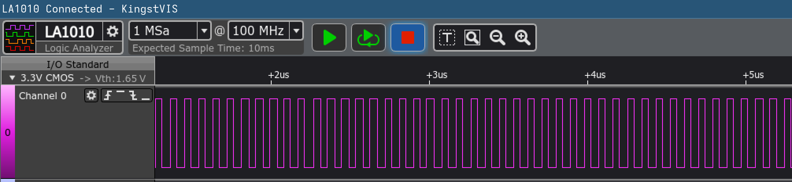
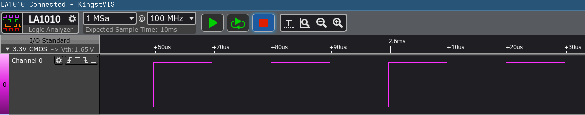
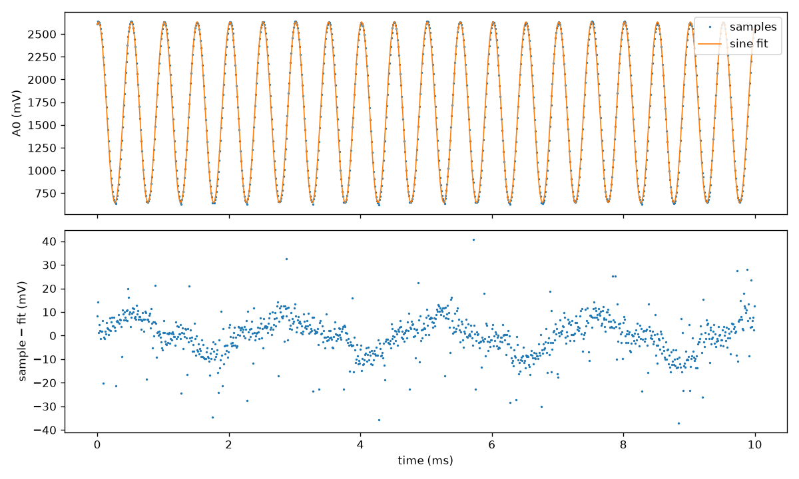
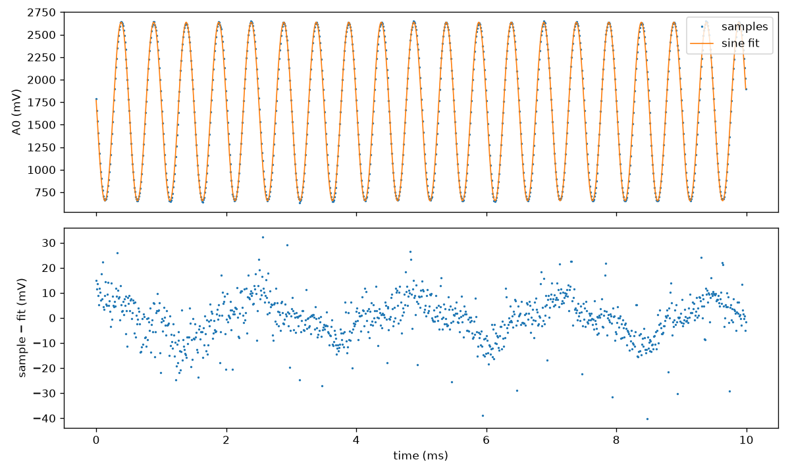
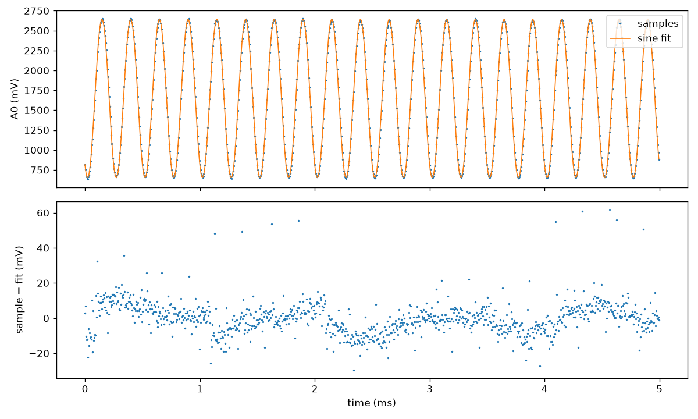
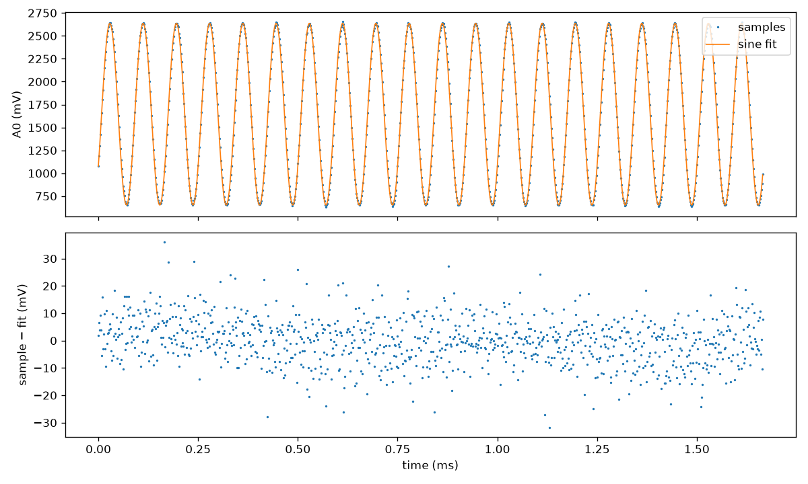
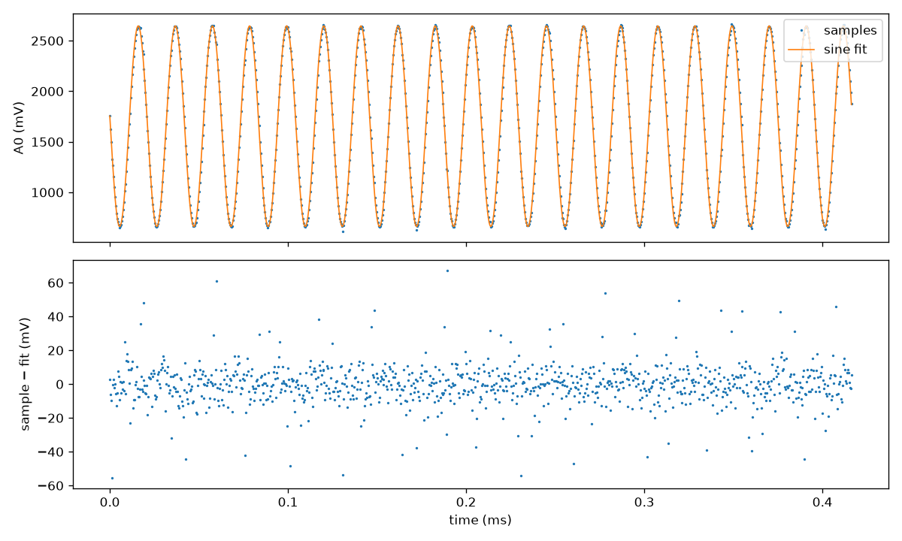
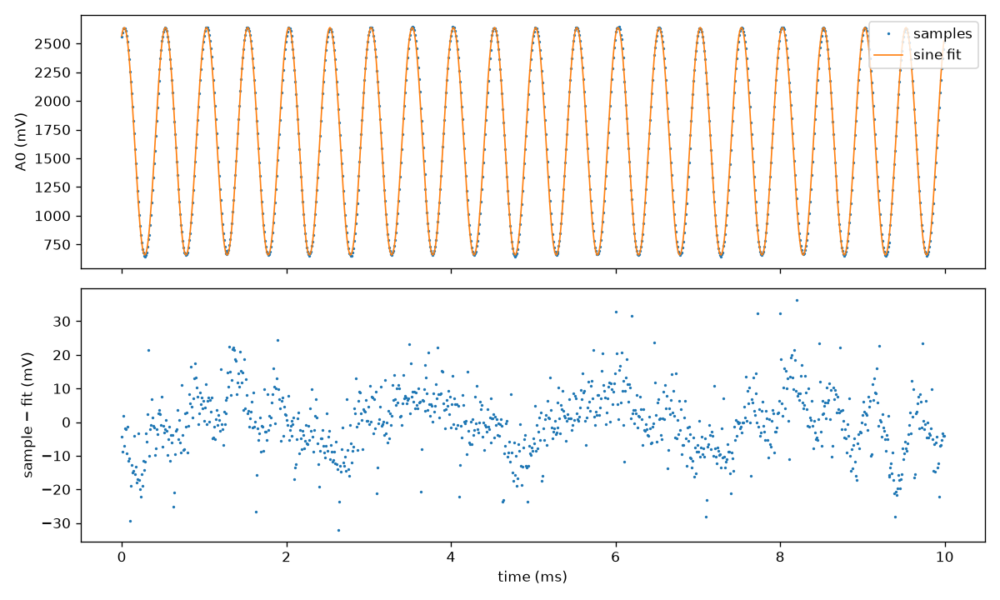
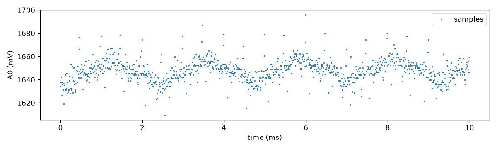

# ScopeLogic

> Benchmarked polling, interrupt, and DMA-based ADC acquisition in bare-metal C on an STM32F429 (register-level, no HAL); using logic-analyzer GPIO instrumentation and oscilloscope timing measurements, showed DMA cut CPU load from **100%** to **0%**, reduced sampling jitter from **2.5 µs** to **<5 ns**, and raised max sustained sample rate **4×** to **2.4 MSPS**.

Measured with a 1 kHz, 2 µs background interrupt running. CPU load (at 100 kHz) and jitter compare polling with DMA. The rate compares DMA with interrupts: 600 kHz to 2.4 MHz, the ADC's own limit (12× over polling). Jitter for DMA is the sample clock's own, measured on the scope. Details in the Step 11–15 summaries.

## Step 1 — Confirm the toolchain can talk to the board

**Goal:** before writing any code, confirm the PC can reach the STM32 through the Nucleo's ST-LINK.

1. Plug the Nucleo into USB through the ST-LINK connector (the end of the board with the ST-LINK chip on it).
2. Connect and read the chip: `STM32_Programmer_CLI -c port=SWD`

**Done when:** substep 2 reports device ID `0x419` (the STM32F42x/F43x family) and a flash size of 2 MBytes.

### Step 1 summary

**Step 1 confirmed that the PC can reach the STM32 through the Nucleo's on-board ST-LINK, before any code was written.**

- `STM32_Programmer_CLI -c port=SWD` connected over SWD and reported device ID `0x419` (STM32F42x/F43x) with 2 MBytes of flash, which matches the STM32F429ZI.
- That shows the USB cable, the ST-LINK and the programmer software all work. From here on, if something fails, the cause is in the code or the wiring, not the connection to the board.

## Step 2 — Turn on an LED from your own code

**Goal:** build the smallest possible bare-metal program, flash it, and see it run. It turns on the green user LED (LD1, wired to pin PB0).

1. Start from a known state: erase the flash with `STM32_Programmer_CLI -c port=SWD mode=UR -e all`, then check that LD1 (the green LED labelled LD1 on the board) is **off**. With the flash erased the chip runs nothing, so nothing drives PB0.
2. `firmware/stm32f429zi.ld`: tell the linker where flash and RAM are, and put the vector table at the start of flash:
   ```ld
   MEMORY {
     FLASH (rx)  : ORIGIN = 0x08000000, LENGTH = 2048K
     RAM   (rwx) : ORIGIN = 0x20000000, LENGTH = 192K
   }
   SECTIONS {
     .isr_vector : { KEEP(*(.isr_vector)) } > FLASH
     .text       : { *(.text*) *(.rodata*) } > FLASH
   }
   ```
3. `firmware/main.c`: write the registers directly by address (from the reference manual, RM0090):
   ```c
   #include <stdint.h>

   #define RCC_AHB1ENR (*(volatile uint32_t *)0x40023830)
   #define GPIOB_MODER (*(volatile uint32_t *)0x40020400)
   #define GPIOB_BSRR  (*(volatile uint32_t *)0x40020418)

   void Reset_Handler(void)
   {
       RCC_AHB1ENR |= 1u << 1;                  /* turn on GPIOB's clock */
       (void)RCC_AHB1ENR;                       /* wait for it to take effect */
       GPIOB_MODER = (GPIOB_MODER & ~3u) | 1u;  /* PB0 = output */
       GPIOB_BSRR  = 1u << 0;                   /* PB0 high: LD1 on */
       for (;;) {}
   }

   /* The two words the CPU reads at reset: initial stack pointer, reset address. */
   __attribute__((section(".isr_vector"), used))
   void *const vectors[2] = { (void *)0x20030000, Reset_Handler };
   ```
4. Build, from `firmware/`: `mkdir -p build && arm-none-eabi-gcc -mcpu=cortex-m4 -mthumb -Wall -nostdlib -T stm32f429zi.ld main.c -o build/fw.elf`
5. Flash: `STM32_Programmer_CLI -c port=SWD -w build/fw.elf -v -rst`

**Done when:** LD1 goes from off (substep 1) to on after flashing, and lights again after unplugging and replugging USB, which shows the program is stored in flash.

### Step 2 summary

**Step 2 built the smallest possible bare-metal program, with no HAL, no startup file and no C library, and ran it: it turns on LD1.**

**What the program needs:**
1. A linker script: flash at `0x08000000`, RAM at `0x20000000`, and the vector table first in flash.
2. A two-word vector table: the initial stack pointer (`0x20030000`, the end of the 192K RAM) and the address of `Reset_Handler`.
3. Three register writes in `Reset_Handler`: turn on GPIOB's clock (`RCC_AHB1ENR`), set PB0 as an output (`GPIOB_MODER`), and drive PB0 high (`GPIOB_BSRR`).

**Results:**

| Check | Expected | Seen |
|---|---|---|
| LD1 after erasing flash | off | off |
| LD1 after flashing | on | on |
| LD1 after unplugging and replugging USB | on | on |

**What you learned along the way:**
- **The CPU starts by reading two words** from the start of flash: where the stack begins and where the code begins. That's all a program needs to run.
- **With `-nostdlib` nothing runs before `Reset_Handler`**, so global variables aren't set up. That's fine here because the program doesn't use any.
- **A peripheral's clock must be on before you touch it.** The extra read of `RCC_AHB1ENR` gives the clock time to start.
- **LD1 lighting again after a power cycle** shows the program is stored in flash, not just running from the debugger.

## Step 3 — See a pin toggle on the logic analyzer

**Goal:** drive a pin up and down as fast as a simple loop can, and capture it on the LA1010. This is the timing-marker technique the benchmarks will use. The pin is PF15, which comes out on the header socket labelled D2 and has nothing else connected to it.

1. Wire the LA1010: CH0 to the **D2** socket (PF15), and the LA's GND to a **GND** pin on the Nucleo.
2. Get a "before" capture: with the Step 2 program still on the board, capture about 1 ms in KingstVIS at 50 MS/s or faster. CH0 should show **no repeating pulses**.
3. Change `firmware/main.c` to keep LD1 on as a "program is running" light, and toggle PF15 forever:
   ```c
   #include <stdint.h>

   #define RCC_AHB1ENR (*(volatile uint32_t *)0x40023830)
   #define GPIOB_MODER (*(volatile uint32_t *)0x40020400)
   #define GPIOB_BSRR  (*(volatile uint32_t *)0x40020418)
   #define GPIOF_MODER (*(volatile uint32_t *)0x40021400)
   #define GPIOF_BSRR  (*(volatile uint32_t *)0x40021418)

   void Reset_Handler(void)
   {
       RCC_AHB1ENR |= (1u << 1) | (1u << 5);         /* turn on GPIOB and GPIOF clocks */
       (void)RCC_AHB1ENR;                            /* wait for them to take effect */
       GPIOB_MODER = (GPIOB_MODER & ~3u) | 1u;       /* PB0 = output */
       GPIOB_BSRR  = 1u << 0;                        /* LD1 on: program is running */
       GPIOF_MODER = (GPIOF_MODER & ~(3u << 30)) | (1u << 30);  /* PF15 = output */

       for (;;) {
           GPIOF_BSRR = 1u << 15;                    /* PF15 high */
           GPIOF_BSRR = 1u << (15 + 16);             /* PF15 low */
       }
   }

   /* The two words the CPU reads at reset: initial stack pointer, reset address. */
   __attribute__((section(".isr_vector"), used))
   void *const vectors[2] = { (void *)0x20030000, Reset_Handler };
   ```
4. Build and flash, with the same commands as Step 2 (substeps 4 and 5).
5. Capture again, with the same settings as substep 2.

**Done when:** LD1 is on, and CH0 shows a steady repeating pulse train that wasn't there in substep 2. Write down its frequency, and how long it stays high and low: that's your first timing measurement.

**Measured (16 MHz HSI, KingstVIS at 50 MS/s):** 1.25 MHz, about 380 ns high and 420 ns low (800 ns period, about 13 CPU cycles). Single widths vary by ±20 ns because that's one 20 ns sample step; the low part is longer because the jump back to the top of the loop happens while the pin is low.


### Step 3 summary

**Step 3 toggled PF15 as fast as a simple loop can and captured it on the LA1010. This is the timing-marker technique the benchmarks will use.**

**What changed in the firmware:** it also turns on GPIOF's clock, sets PF15 as an output, and then loops forever writing PF15 high and low through `GPIOF_BSRR`. LD1 stays on as a "program is running" light.

**Results:**

| Check | Expected | Measured |
|---|---|---|
| LA1010 on PF15, before | no pulses | no pulses |
| LA1010 on PF15, after | steady pulse train | **1.25 MHz**, about 380 ns high and 420 ns low |

**What you learned along the way:**
- **One loop pass takes about 13 CPU cycles** (800 ns at 16 MHz). That's the cost of a GPIO timing marker, and the baseline Step 4 compared against.
- **`BSRR` sets or clears a pin in a single write**, with no read-modify-write, so a marker can't disturb the other pins on the port.
- **The low part is longer than the high part** because the jump back to the top of the loop happens while the pin is low.
- **The LA1010 measures in sample steps.** At 50 MS/s each step is 20 ns, so single widths vary by ±20 ns.

## Step 4 — Run the CPU at 144 MHz

**Goal:** switch from the 16 MHz internal clock (HSI) to 144 MHz from the PLL, fed by the 8 MHz clock the ST-LINK supplies (HSE bypass, the board's default wiring per UM1974 §7.8.1). 144 MHz is chosen for the ADC, not the CPU: it makes APB2 72 MHz, so the ADC clock can later run at its 36 MHz maximum (2.4 MSPS). 180 MHz would cap the ADC at 22.5 MHz. To prove the new speed, the chip also outputs its clock ÷ 5 on pin PC9 (MCO2) for the scope.

1. Wire the scope: probe tip to **CN8 pin 4** (D44, PC9), ground clip to **CN8 pin 11 or 13** (GND). CN8 is the upper header on the left side. Use the probe's ×10 setting and keep the ground lead short. Leave the LA1010 on D2 (PF15) from Step 3.
2. Change `firmware/main.c` to set up the clock output, then switch the clock, then turn LD1 on and toggle PF15 as before. LD1 now only comes on once the switch has finished, so if it stays off, the program is stuck waiting in one of the `while` loops.
   ```c
   #include <stdint.h>
   
   #define RCC_CR      (*(volatile uint32_t *)0x40023800)
   #define RCC_PLLCFGR (*(volatile uint32_t *)0x40023804)
   #define RCC_CFGR    (*(volatile uint32_t *)0x40023808)
   #define RCC_AHB1ENR (*(volatile uint32_t *)0x40023830)
   #define FLASH_ACR   (*(volatile uint32_t *)0x40023C00)
   #define GPIOB_MODER (*(volatile uint32_t *)0x40020400)
   #define GPIOB_BSRR  (*(volatile uint32_t *)0x40020418)
   #define GPIOC_MODER   (*(volatile uint32_t *)0x40020800)
   #define GPIOC_OSPEEDR (*(volatile uint32_t *)0x40020808)
   #define GPIOC_AFRH    (*(volatile uint32_t *)0x40020824)
   #define GPIOF_MODER (*(volatile uint32_t *)0x40021400)
   #define GPIOF_BSRR  (*(volatile uint32_t *)0x40021418)
   
   void Reset_Handler(void)
   {
       RCC_AHB1ENR |= (1u << 1) | (1u << 2) | (1u << 5);  /* GPIOB, GPIOC, GPIOF clocks */
       (void)RCC_AHB1ENR;
   
       /* MCO2 = SYSCLK / 5 on PC9 (set the divider before the pin starts outputting) */
       RCC_CFGR = (RCC_CFGR & ~(0x1Fu << 27)) | (7u << 27);   /* MCO2 = SYSCLK (00), MCO2PRE = /5 (111) */
       GPIOC_AFRH    &= ~(0xFu << 4);                          /* PC9 alternate function 0 = MCO2 */
       GPIOC_OSPEEDR |= 3u << 18;                              /* PC9 very high speed */
       GPIOC_MODER    = (GPIOC_MODER & ~(3u << 18)) | (2u << 18);  /* PC9 = alternate function */
   
       /* 1. HSE: the 8 MHz clock from the ST-LINK, fed in directly (bypass) */
       RCC_CR |= 1u << 18;                                     /* HSEBYP */
       RCC_CR |= 1u << 16;                                     /* HSEON */
       while (!(RCC_CR & (1u << 17))) {}                       /* wait for HSERDY */
   
       /* 2. PLL: 8 MHz / M=4 = 2 MHz, x N=144 = 288 MHz, / P=2 = 144 MHz (Q=6 gives 48 MHz) */
       RCC_PLLCFGR = (RCC_PLLCFGR & ~0x0F43FFFFu)
                   | (4u << 0) | (144u << 6) | (0u << 16) | (1u << 22) | (6u << 24);
       RCC_CR |= 1u << 24;                                     /* PLLON */
       while (!(RCC_CR & (1u << 25))) {}                       /* wait for PLLRDY */
   
       /* 3. Flash: 4 wait states for 144 MHz at 3.3 V, plus prefetch, instruction and data caches */
       FLASH_ACR = 4u | (1u << 8) | (1u << 9) | (1u << 10);
       while ((FLASH_ACR & 0xFu) != 4u) {}
   
       /* 4. Bus dividers: AHB /1 (144), APB1 /4 (36), APB2 /2 (72) */
       RCC_CFGR = (RCC_CFGR & ~0xFCF0u) | (5u << 10) | (4u << 13);
   
       /* 5. Switch the system clock to the PLL */
       RCC_CFGR = (RCC_CFGR & ~3u) | 2u;
       while (((RCC_CFGR >> 2) & 3u) != 2u) {}                 /* wait until SWS reports PLL */
   
       GPIOB_MODER = (GPIOB_MODER & ~3u) | 1u;
       GPIOB_BSRR  = 1u << 0;                                  /* LD1 on: clock switch finished */
       GPIOF_MODER = (GPIOF_MODER & ~(3u << 30)) | (1u << 30);
   
       for (;;) {
           GPIOF_BSRR = 1u << 15;
           GPIOF_BSRR = 1u << (15 + 16);
       }
   }
   
   __attribute__((section(".isr_vector"), used))
   void *const vectors[2] = { (void *)0x20030000, Reset_Handler };
   ```
   Register notes (RM0090): the power controller's voltage scale is already Scale 1 at reset, which allows up to 168 MHz, so over-drive isn't needed. Flash needs 4 wait states between 120 and 150 MHz at 3.3 V, and must be set before the clock goes up. The bus dividers are also set before the switch so APB1 and APB2 never exceed their limits (45 and 90 MHz).
3. Build and flash, with the same commands as Step 2 (substeps 4 and 5). If the programmer can't connect afterwards, add `mode=UR` to the flash command.
4. Measure: the scope on PC9, and the LA1010 on PF15 at its highest sample rate (100 MS/s with 3 or fewer channels enabled).

**Done when:** LD1 is on, the scope shows about **28.8 MHz** on PC9 (144 MHz ÷ 5), and the PF15 toggle is about **9× faster** than the 1.25 MHz measured in Step 3. Write down both frequencies. The scope number checks the clock directly; the toggle number shows what the loop actually costs at the new speed, which won't be exactly 9× because flash wait states and the cache change the cycle count.

**Measured (144 MHz PLL):** LD1 on. Scope on PC9: **28.90 MHz** (expected 28.8; the 0.35% difference is the scope's measurement limit). The wave looks rounded because the 5th harmonic (144 MHz) is at the scope's 150 MHz bandwidth limit. It overshoots to about +4.2 V and −1.3 V (about 5.5 Vpp) because of ringing from the probe's clip-on ground lead. A spring ground tip reduces both. PF15 toggle on the LA1010 (100 MS/s): **11.11 MHz**, a 90 ns period, which is 8.9× Step 3. That's about 13 CPU cycles per loop at 144 MHz, the same as at 16 MHz: the flash's 4 wait states cost nothing here because the ART accelerator's instruction cache and prefetch serve the tiny loop. The true value is probably 144 MHz ÷ 13 = 11.08 MHz; 11.11 MHz is the nearest the 10 ns sample step can show.




### Step 4 summary

**Step 4 switched the CPU from its 16 MHz internal clock to 144 MHz from the PLL. The scope and the logic analyzer both confirmed the new speed.**

**Why 144 MHz:** it's chosen for the ADC, not the CPU. It puts APB2 at 72 MHz, which lets the ADC clock run at its 36 MHz maximum later (2.4 MSPS). 180 MHz would have limited the ADC clock to 22.5 MHz.

**What the firmware does, in order:**
1. Sets PC9 to output SYSCLK ÷ 5 (MCO2), so the scope can measure the clock.
2. Turns on HSE, the 8 MHz clock from the ST-LINK, fed in directly (bypass mode).
3. Sets up the PLL: 8 MHz ÷ 4 × 144 ÷ 2 = 144 MHz.
4. Sets flash to 4 wait states and turns on the prefetch and caches. This has to happen before the speed goes up.
5. Sets the bus dividers: AHB 144 MHz, APB1 36 MHz, APB2 72 MHz, all within their limits.
6. Switches the system clock to the PLL, then turns LD1 on and toggles PF15 as in Step 3.

**Results:**

| Check | Expected | Measured |
|---|---|---|
| LD1 | on | on |
| Scope on PC9 | about 28.8 MHz | **28.90 MHz** |
| LA1010 on PF15 | about 9× 1.25 MHz | **11.11 MHz** (8.9×) |

**What you learned along the way:**
- **The toggle loop still takes about 13 cycles.** The flash wait states cost nothing in a loop this small, because the ART cache serves it.
- **The scope wave looks rounded** because 28.8 MHz is close to what the scope's 150 MHz bandwidth can show cleanly.
- **The 5.5 Vpp swing** from a 3.3 V pin is ringing caused by the probe's clip-on ground lead. A spring ground tip would reduce it.
- **The LA1010 can only resolve 10 ns at 100 MS/s.** The true toggle rate is probably 11.08 MHz, and 11.11 MHz is the closest value it can show.

## Step 5 — Time PF15 with the cycle counter

**Goal:** turn on the Cortex-M4's built-in cycle counter (`DWT_CYCCNT`), which counts every CPU clock at 144 MHz, and use it to toggle PF15 exactly every **1440 cycles (10 µs)** instead of as fast as the loop goes. Every later measurement (CPU load, timing, the benchmarks) relies on this counter.

1. Wiring: same as Step 4. The LA1010 stays on **D2** (PF15, CN10 pin 12) with its GND on **CN10 pin 17**. The scope isn't needed.
2. Change `firmware/main.c`: add four register addresses, start the counter after the clock switch, and replace the toggle loop with one that waits for a deadline. Everything else is the same as Step 4.
   ```c
   #include <stdint.h>
   
   #define RCC_CR      (*(volatile uint32_t *)0x40023800)
   #define RCC_PLLCFGR (*(volatile uint32_t *)0x40023804)
   #define RCC_CFGR    (*(volatile uint32_t *)0x40023808)
   #define RCC_AHB1ENR (*(volatile uint32_t *)0x40023830)
   #define FLASH_ACR   (*(volatile uint32_t *)0x40023C00)
   #define GPIOB_MODER (*(volatile uint32_t *)0x40020400)
   #define GPIOB_BSRR  (*(volatile uint32_t *)0x40020418)
   #define GPIOC_MODER   (*(volatile uint32_t *)0x40020800)
   #define GPIOC_OSPEEDR (*(volatile uint32_t *)0x40020808)
   #define GPIOC_AFRH    (*(volatile uint32_t *)0x40020824)
   #define GPIOF_MODER (*(volatile uint32_t *)0x40021400)
   #define GPIOF_ODR   (*(volatile uint32_t *)0x40021414)
   #define GPIOF_BSRR  (*(volatile uint32_t *)0x40021418)
   #define DEMCR       (*(volatile uint32_t *)0xE000EDFC)
   #define DWT_CTRL    (*(volatile uint32_t *)0xE0001000)
   #define DWT_CYCCNT  (*(volatile uint32_t *)0xE0001004)
   
   #define PERIOD 1440u                                    /* 1440 cycles at 144 MHz = 10 us */
   
   void Reset_Handler(void)
   {
       RCC_AHB1ENR |= (1u << 1) | (1u << 2) | (1u << 5);  /* GPIOB, GPIOC, GPIOF clocks */
       (void)RCC_AHB1ENR;
   
       /* MCO2 = SYSCLK / 5 on PC9 (set the divider before the pin starts outputting) */
       RCC_CFGR = (RCC_CFGR & ~(0x1Fu << 27)) | (7u << 27);   /* MCO2 = SYSCLK (00), MCO2PRE = /5 (111) */
       GPIOC_AFRH    &= ~(0xFu << 4);                          /* PC9 alternate function 0 = MCO2 */
       GPIOC_OSPEEDR |= 3u << 18;                              /* PC9 very high speed */
       GPIOC_MODER    = (GPIOC_MODER & ~(3u << 18)) | (2u << 18);  /* PC9 = alternate function */
   
       /* 1. HSE: the 8 MHz clock from the ST-LINK, fed in directly (bypass) */
       RCC_CR |= 1u << 18;                                     /* HSEBYP */
       RCC_CR |= 1u << 16;                                     /* HSEON */
       while (!(RCC_CR & (1u << 17))) {}                       /* wait for HSERDY */
   
       /* 2. PLL: 8 MHz / M=4 = 2 MHz, x N=144 = 288 MHz, / P=2 = 144 MHz (Q=6 gives 48 MHz) */
       RCC_PLLCFGR = (RCC_PLLCFGR & ~0x0F43FFFFu)
                   | (4u << 0) | (144u << 6) | (0u << 16) | (1u << 22) | (6u << 24);
       RCC_CR |= 1u << 24;                                     /* PLLON */
       while (!(RCC_CR & (1u << 25))) {}                       /* wait for PLLRDY */
   
       /* 3. Flash: 4 wait states for 144 MHz at 3.3 V, plus prefetch, instruction and data caches */
       FLASH_ACR = 4u | (1u << 8) | (1u << 9) | (1u << 10);
       while ((FLASH_ACR & 0xFu) != 4u) {}
   
       /* 4. Bus dividers: AHB /1 (144), APB1 /4 (36), APB2 /2 (72) */
       RCC_CFGR = (RCC_CFGR & ~0xFCF0u) | (5u << 10) | (4u << 13);
   
       /* 5. Switch the system clock to the PLL */
       RCC_CFGR = (RCC_CFGR & ~3u) | 2u;
       while (((RCC_CFGR >> 2) & 3u) != 2u) {}                 /* wait until SWS reports PLL */
   
       GPIOB_MODER = (GPIOB_MODER & ~3u) | 1u;
       GPIOB_BSRR  = 1u << 0;                                  /* LD1 on: clock switch finished */
       GPIOF_MODER = (GPIOF_MODER & ~(3u << 30)) | (1u << 30);
   
       /* Cycle counter: counts every CPU clock (144 MHz) */
       DEMCR     |= 1u << 24;                              /* TRCENA: turn on the debug/trace block */
       DWT_CYCCNT = 0;
       DWT_CTRL  |= 1u << 0;                               /* CYCCNTENA: start counting */
   
       uint32_t next = DWT_CYCCNT;
       for (;;) {
           next += PERIOD;                                 /* next deadline, from the last one, not from now */
           while ((int32_t)(DWT_CYCCNT - next) < 0) {}     /* wait for it (works across wraparound) */
           GPIOF_BSRR = (GPIOF_ODR & (1u << 15)) ? 1u << (15 + 16) : 1u << 15;  /* flip PF15 */
       }
   }
   
   __attribute__((section(".isr_vector"), used))
   void *const vectors[2] = { (void *)0x20030000, Reset_Handler };
   ```
   Register notes (Cortex-M4 / ARMv7-M architecture manual): `DEMCR` bit 24 (`TRCENA`) powers the debug and trace block the counter lives in; `DWT_CTRL` bit 0 (`CYCCNTENA`) starts it. It's a 32-bit counter, so at 144 MHz it wraps every 29.8 s. Comparing `(int32_t)(DWT_CYCCNT - next) < 0` instead of `DWT_CYCCNT < next` keeps the wait correct across the wrap. `GPIOF_ODR` is read to find PF15's current level so the loop can flip it.

   Each deadline is set from the previous deadline, not from "now", so the time spent in the loop never adds up: the edges stay on a fixed 10 µs grid. A hardware timer works the same way, and the ADC sample clock will later.
3. Build and flash, with the same commands as Step 2 (substeps 4 and 5).
4. Check the counter is running, without any probe: read it over SWD twice while the board runs. The two values should differ.
   ```
   STM32_Programmer_CLI -c port=SWD mode=HOTPLUG -r32 0xE0001004 1
   ```
5. Measure: capture PF15 on the LA1010 at 100 MS/s, 1 MSa (10 ms), as in Step 4. Read the frequency and the high and low widths.

**Done when:** the two counter readings in substep 4 differ, and PF15 is a **50.00 kHz** square wave with high and low widths both about **10.00 µs** that don't drift across the 10 ms capture. Single widths can be off by up to about ±0.1 µs: the wait loop only checks the counter every few cycles (about 6 instructions), so each edge lands up to a few cycles after its deadline, and the LA adds its own ±10 ns sample step. Because the deadlines don't move, those small errors never add up, so the average stays at exactly 50.00 kHz. Write down the frequency and the widths.

**Measured (144 MHz, cycle counter, KingstVIS at 100 MS/s):** the counter read over SWD went up by about 6.6–6.7 million in the ~45 ms between reads, which is about 144 MHz. PF15: **10.01 µs high, 10.00 µs low**, KingstVIS frequency **49.975 kHz**. That's 1 ÷ 20.01 µs: KingstVIS works out the frequency from a single period, and 20.01 µs is one 10 ns sample longer than 20.00 µs. The deadlines are exactly 1440 cycles apart, so the average is 50.000 kHz. No drift: edges 2.6 ms into the capture still sit on the 10 µs grid.



### Step 5 summary

**Step 5 turned on the Cortex-M4's cycle counter and used it to toggle PF15 on a fixed 10 µs grid, instead of as fast as the loop goes.**

**What changed in the firmware:**
1. Turns on the cycle counter: `DEMCR.TRCENA` powers the debug and trace block, then `DWT_CYCCNT` is cleared and `DWT_CTRL.CYCCNTENA` starts it.
2. Replaces the toggle loop with a deadline loop: add 1440 cycles to the last deadline, wait until the counter passes it, flip PF15.

**Results:**

| Check | Expected | Measured |
|---|---|---|
| Counter over SWD | changes between reads | about 144 MHz (6.6–6.7 M counts per ~45 ms) |
| PF15 frequency | 50.00 kHz | 49.975 kHz on one period (20.01 µs); 50.000 kHz on average |
| PF15 high / low | about 10.00 µs each, ±0.1 µs | 10.01 µs / 10.00 µs |

**What you learned along the way:**
- **The cycle counter is a free 144 MHz stopwatch** (6.9 ns resolution) that wraps every 29.8 s. Comparing with `(int32_t)(now - deadline) < 0` keeps working across the wrap.
- **Setting each deadline from the last deadline, not from "now", stops errors from adding up.** Each edge can land a few cycles late, but the next deadline doesn't move, so the average rate is exact. A hardware timer works the same way.
- **The edge lateness depends on how often the wait loop checks the counter**: about every 6 instructions here. That's the same kind of jitter software-started ADC sampling will have in the benchmarks.
- **`mode=HOTPLUG` reads memory over SWD while the program keeps running**: a way to look at variables without UART or a debugger session.
- **A frequency read from one period inherits the analyzer's step:** 10 ns in 20 µs is 0.05%, so 49.975 kHz instead of 50.000.

## Step 6 — Startup code, global variables and a Makefile

**Goal:** make global variables work, give the CPU a proper vector table, and build with `make`. So far the firmware has had no startup code (`-nostdlib`), so nothing set globals to their starting values: C promises that `uint32_t count;` starts at 0 and `uint32_t period = 1440;` starts at 1440, but on this board both would start with whatever was in RAM. Every later step needs globals (sample buffers, counters, flags shared with interrupts) and interrupt handlers. On the board nothing visible changes: PF15 stays at 50 kHz. What's new is that it now comes from a global variable, which you also read back over SWD.

1. Wiring: same as Step 5 (LA1010 CH0 on D2 / PF15, CN10 pin 12; GND on CN10 pin 17).
2. `firmware/stm32f429zi.ld`: add a `.data` section (in RAM, with its starting values stored in flash) and a `.bss` section (in RAM, zeroed), and export the addresses the startup code needs:
   ```ld
   ENTRY(Reset_Handler)
   
   MEMORY {
     FLASH (rx)  : ORIGIN = 0x08000000, LENGTH = 2048K
     RAM   (rwx) : ORIGIN = 0x20000000, LENGTH = 192K
   }
   
   _estack = ORIGIN(RAM) + LENGTH(RAM);        /* 0x20030000: the stack starts at the top of RAM */
   
   SECTIONS {
     .isr_vector : { KEEP(*(.isr_vector)) } > FLASH
     .text       : { *(.text*) *(.rodata*) . = ALIGN(4); } > FLASH
   
     /* Initialized globals: live in RAM, but their starting values are stored in flash */
     .data : {
       _sdata = .;
       *(.data*)
       . = ALIGN(4);
       _edata = .;
     } > RAM AT > FLASH
     _sidata = LOADADDR(.data);                /* where in flash the starting values are */
   
     /* Zero-initialized globals: live in RAM, nothing stored in flash */
     .bss (NOLOAD) : {
       _sbss = .;
       *(.bss*) *(COMMON)
       . = ALIGN(4);
       _ebss = .;
     } > RAM
   }
   ```
   `AT > FLASH` is what puts `.data`'s starting values in flash while its addresses point at RAM. `ENTRY(Reset_Handler)` tells the tools where the program starts.
3. `firmware/startup.c` (new): `Reset_Handler` moves here, does the RAM setup, then calls `main()`. The vector table grows to the 16 Cortex-M4 entries:
   ```c
   #include <stdint.h>
   
   /* Defined by the linker script */
   extern uint32_t _estack, _sidata, _sdata, _edata, _sbss, _ebss;
   
   int main(void);
   
   /* Runs first after every reset: set up RAM the way C expects, then call main() */
   void Reset_Handler(void)
   {
       uint32_t *src = &_sidata;
       uint32_t *dst = &_sdata;
       while (dst < &_edata) *dst++ = *src++;      /* .data: copy starting values from flash */
   
       for (dst = &_sbss; dst < &_ebss; ) *dst++ = 0;  /* .bss: zero */
   
       main();
       for (;;) {}                                 /* main() should never return */
   }
   
   /* Any fault or interrupt without its own handler ends up here. In a debugger,
      a program stuck in Default_Handler means something went wrong. */
   void Default_Handler(void) { for (;;) {} }
   
   /* "weak": a later step can define e.g. SysTick_Handler() in another file and it replaces this */
   void NMI_Handler(void)        __attribute__((weak, alias("Default_Handler")));
   void HardFault_Handler(void)  __attribute__((weak, alias("Default_Handler")));
   void MemManage_Handler(void)  __attribute__((weak, alias("Default_Handler")));
   void BusFault_Handler(void)   __attribute__((weak, alias("Default_Handler")));
   void UsageFault_Handler(void) __attribute__((weak, alias("Default_Handler")));
   void SVC_Handler(void)        __attribute__((weak, alias("Default_Handler")));
   void DebugMon_Handler(void)   __attribute__((weak, alias("Default_Handler")));
   void PendSV_Handler(void)     __attribute__((weak, alias("Default_Handler")));
   void SysTick_Handler(void)    __attribute__((weak, alias("Default_Handler")));
   
   /* The 16 Cortex-M4 entries. Peripheral interrupts (timer, ADC, DMA) get added in the steps that use them. */
   __attribute__((section(".isr_vector"), used))
   void (*const vectors[16])(void) = {
       (void (*)(void))&_estack,   /*  0: initial stack pointer */
       Reset_Handler,              /*  1 */
       NMI_Handler,                /*  2 */
       HardFault_Handler,          /*  3 */
       MemManage_Handler,          /*  4 */
       BusFault_Handler,           /*  5 */
       UsageFault_Handler,         /*  6 */
       0, 0, 0, 0,                 /*  7-10: reserved */
       SVC_Handler,                /* 11 */
       DebugMon_Handler,           /* 12 */
       0,                          /* 13: reserved */
       PendSV_Handler,             /* 14 */
       SysTick_Handler,            /* 15 */
   };
   ```
   Any fault (for example a bad memory access) now ends in `Default_Handler` instead of jumping to a random address. The handlers are `weak`, so a later step can write its own `SysTick_Handler()` in another file and it replaces the default one.
4. `firmware/main.c`: three changes from Step 5. `Reset_Handler` becomes `main`, the `PERIOD` constant becomes a global `period` (in `.data`) and a new global `toggles` (in `.bss`) counts flips, and the vector table moves out to `startup.c`:
   ```c
   #include <stdint.h>
   
   #define RCC_CR      (*(volatile uint32_t *)0x40023800)
   #define RCC_PLLCFGR (*(volatile uint32_t *)0x40023804)
   #define RCC_CFGR    (*(volatile uint32_t *)0x40023808)
   #define RCC_AHB1ENR (*(volatile uint32_t *)0x40023830)
   #define FLASH_ACR   (*(volatile uint32_t *)0x40023C00)
   #define GPIOB_MODER (*(volatile uint32_t *)0x40020400)
   #define GPIOB_BSRR  (*(volatile uint32_t *)0x40020418)
   #define GPIOC_MODER   (*(volatile uint32_t *)0x40020800)
   #define GPIOC_OSPEEDR (*(volatile uint32_t *)0x40020808)
   #define GPIOC_AFRH    (*(volatile uint32_t *)0x40020824)
   #define GPIOF_MODER (*(volatile uint32_t *)0x40021400)
   #define GPIOF_ODR   (*(volatile uint32_t *)0x40021414)
   #define GPIOF_BSRR  (*(volatile uint32_t *)0x40021418)
   #define DEMCR       (*(volatile uint32_t *)0xE000EDFC)
   #define DWT_CTRL    (*(volatile uint32_t *)0xE0001000)
   #define DWT_CYCCNT  (*(volatile uint32_t *)0xE0001004)
   
   /* Globals: the startup code sets these up before main() runs */
   uint32_t period = 1440;                                 /* .data: 1440 cycles at 144 MHz = 10 us */
   uint32_t toggles;                                       /* .bss: starts at 0 */
   
   int main(void)
   {
       RCC_AHB1ENR |= (1u << 1) | (1u << 2) | (1u << 5);  /* GPIOB, GPIOC, GPIOF clocks */
       (void)RCC_AHB1ENR;
   
       /* MCO2 = SYSCLK / 5 on PC9 (set the divider before the pin starts outputting) */
       RCC_CFGR = (RCC_CFGR & ~(0x1Fu << 27)) | (7u << 27);   /* MCO2 = SYSCLK (00), MCO2PRE = /5 (111) */
       GPIOC_AFRH    &= ~(0xFu << 4);                          /* PC9 alternate function 0 = MCO2 */
       GPIOC_OSPEEDR |= 3u << 18;                              /* PC9 very high speed */
       GPIOC_MODER    = (GPIOC_MODER & ~(3u << 18)) | (2u << 18);  /* PC9 = alternate function */
   
       /* 1. HSE: the 8 MHz clock from the ST-LINK, fed in directly (bypass) */
       RCC_CR |= 1u << 18;                                     /* HSEBYP */
       RCC_CR |= 1u << 16;                                     /* HSEON */
       while (!(RCC_CR & (1u << 17))) {}                       /* wait for HSERDY */
   
       /* 2. PLL: 8 MHz / M=4 = 2 MHz, x N=144 = 288 MHz, / P=2 = 144 MHz (Q=6 gives 48 MHz) */
       RCC_PLLCFGR = (RCC_PLLCFGR & ~0x0F43FFFFu)
                   | (4u << 0) | (144u << 6) | (0u << 16) | (1u << 22) | (6u << 24);
       RCC_CR |= 1u << 24;                                     /* PLLON */
       while (!(RCC_CR & (1u << 25))) {}                       /* wait for PLLRDY */
   
       /* 3. Flash: 4 wait states for 144 MHz at 3.3 V, plus prefetch, instruction and data caches */
       FLASH_ACR = 4u | (1u << 8) | (1u << 9) | (1u << 10);
       while ((FLASH_ACR & 0xFu) != 4u) {}
   
       /* 4. Bus dividers: AHB /1 (144), APB1 /4 (36), APB2 /2 (72) */
       RCC_CFGR = (RCC_CFGR & ~0xFCF0u) | (5u << 10) | (4u << 13);
   
       /* 5. Switch the system clock to the PLL */
       RCC_CFGR = (RCC_CFGR & ~3u) | 2u;
       while (((RCC_CFGR >> 2) & 3u) != 2u) {}                 /* wait until SWS reports PLL */
   
       GPIOB_MODER = (GPIOB_MODER & ~3u) | 1u;
       GPIOB_BSRR  = 1u << 0;                                  /* LD1 on: clock switch finished */
       GPIOF_MODER = (GPIOF_MODER & ~(3u << 30)) | (1u << 30);
   
       /* Cycle counter: counts every CPU clock (144 MHz) */
       DEMCR     |= 1u << 24;                              /* TRCENA: turn on the debug/trace block */
       DWT_CYCCNT = 0;
       DWT_CTRL  |= 1u << 0;                               /* CYCCNTENA: start counting */
   
       uint32_t next = DWT_CYCCNT;
       for (;;) {
           next += period;                                 /* next deadline, from the last one, not from now */
           while ((int32_t)(DWT_CYCCNT - next) < 0) {}     /* wait for it (works across wraparound) */
           GPIOF_BSRR = (GPIOF_ODR & (1u << 15)) ? 1u << (15 + 16) : 1u << 15;  /* flip PF15 */
           toggles++;
       }
   }
   ```
5. `firmware/Makefile` (new). It uses the same compiler flags as before, plus `-g` (debug info: it doesn't change the code). Recipe lines must start with a **tab**, not spaces:
   ```make
   CC      = arm-none-eabi-gcc
   CFLAGS  = -mcpu=cortex-m4 -mthumb -Wall -g
   LDFLAGS = -nostdlib -T stm32f429zi.ld
   SRCS    = startup.c main.c
   
   build/fw.elf: $(SRCS) stm32f429zi.ld Makefile
   	mkdir -p build
   	$(CC) $(CFLAGS) $(LDFLAGS) $(SRCS) -o $@
   	arm-none-eabi-size $@
   
   flash: build/fw.elf
   	STM32_Programmer_CLI -c port=SWD -w $< -v -rst
   
   clean:
   	rm -rf build
   
   .PHONY: flash clean
   ```
   Optimization stays off for now. Turning it on (`-O2`) changes the loop timing and is worth trying as its own change later.
6. From `firmware/`: `make`, then `make flash`. `make` should report `data 4` and `bss 4`: those are `period` and `toggles`.
7. Find where the linker put the two globals: `arm-none-eabi-nm build/fw.elf | grep -E "period|toggles"`. Expect `20000000 D period` and `20000004 B toggles` (`D` = `.data`, `B` = `.bss`).
8. Unplug and replug the Nucleo's USB. RAM keeps its contents through a reset, but not through a power cycle, so this makes sure `period` really came from the startup code and not from the previous program.
9. Read both globals over SWD while the board runs, twice:
   ```
   STM32_Programmer_CLI -c port=SWD mode=HOTPLUG -r32 0x20000000 8
   ```
   The `8` is the number of **bytes** to read (two 32-bit words). The first word is `period`, the second is `toggles`.
10. Measure PF15 on the LA1010 as in Step 5 (100 MS/s, 1 MSa).

**Done when:** `make` and `make flash` work; after the power cycle, `period` reads `0x000005A0` (1440); `toggles` goes up between the two reads at about **100,000 per second** (two flips per 20 µs period: about 4,500 for reads 45 ms apart); and PF15 is still a 50 kHz square wave with 10 µs high and low widths, as in Step 5. If `period` hadn't been copied, PF15 would run at some other rate: as fast as the loop can go if it were 0, or something odd if it were random.

**Measured (after a power cycle):** `make` reported `data 4`, `bss 4`; `nm` put `period` at `0x20000000` and `toggles` at `0x20000004`. Over SWD: `period` = **`0x000005A0`** (1440) in both reads; `toggles` = 735,743 then 739,477, up 3,734 in about 40 ms, which is about 100,000 per second, and 735,743 is about 7.4 s of counting since power-up. PF15 on the LA1010 at 100 MS/s: the same 50 kHz square wave as Step 5, every high and low part **10.0 µs** (read off the screenshot, ±0.05 µs), with edges 2.6 ms into the capture still on the 10 µs grid.


### Step 6 summary

**Step 6 added startup code, so global variables start with the values C promises, gave the CPU a proper vector table, and replaced the hand-typed build and flash commands with a Makefile. The board behaves exactly as in Step 5. The difference is that the 10 µs period now comes from a global variable.**

**What changed:**
1. **Linker script:** new `.data` section (in RAM, starting values stored in flash) and `.bss` section (in RAM, zeroed), plus the addresses the startup code needs.
2. **`startup.c` (new):** `Reset_Handler` copies `.data` from flash to RAM, zeroes `.bss`, then calls `main()`. The vector table now has all 16 Cortex-M4 entries, with faults and unused interrupts going to `Default_Handler`.
3. **`main.c`:** `Reset_Handler` became `main()`; the period is the global `period` (`.data`), and the global `toggles` (`.bss`) counts flips.
4. **`Makefile` (new):** `make`, `make flash`, `make clean`.

**Results:**

| Check | Expected | Measured |
|---|---|---|
| `make` sizes | data 4, bss 4 | data 4, bss 4 |
| `period` after power cycle | `0x5A0` (1440) | `0x5A0` |
| `toggles` rate | about 100,000 per second | 3,734 in about 40 ms (about 100,000 per second) |
| PF15 | 50 kHz, 10 µs high and low | 50 kHz, 10.0 µs high and low |

**What you learned along the way:**
- **Globals don't set themselves up.** On a PC the operating system and C library do it before `main()`; with `-nostdlib` your own `Reset_Handler` has to.
- **An initialized global lives in two places:** its starting value in flash (`_sidata`), and the variable itself in RAM (`_sdata`). `AT > FLASH` in the linker script is what sets that up.
- **RAM keeps its contents through a reset but not a power cycle,** so only a power cycle shows the startup code really did the copy.
- **`STM32_Programmer_CLI -r32` takes its size in bytes**, not words: `8` reads two 32-bit values.
- **`weak` handlers** let later steps add an interrupt handler just by writing a function with the right name, such as `SysTick_Handler`.

## Step 7 — Send text to the PC over UART

**Goal:** send a line of text from the board to the PC once a second, over the ST-LINK's USB serial port. Measurement data will leave the board this way, starting with the first ADC readings. Each line also reports how many cycles the previous line took to send, so the step measures the cost of sending too.

No extra wiring: on the NUCLEO-F429ZI, USART3 (PD8 TX, PD9 RX) is connected to the ST-LINK's virtual serial port by default (UM1974), which shows up on the PC as `/dev/ttyACM0`. The LA1010 stays on D2 (PF15) as in Step 6.

1. Change `firmware/main.c`: add the USART3 and GPIOD registers, three small send functions (there's no C library, so no `printf`), set up USART3 after the clock switch, and send a line every 100,000 flips. `startup.c`, the linker script and the Makefile are unchanged.
   ```c
   #include <stdint.h>
   
   #define RCC_CR      (*(volatile uint32_t *)0x40023800)
   #define RCC_PLLCFGR (*(volatile uint32_t *)0x40023804)
   #define RCC_CFGR    (*(volatile uint32_t *)0x40023808)
   #define RCC_AHB1ENR (*(volatile uint32_t *)0x40023830)
   #define RCC_APB1ENR (*(volatile uint32_t *)0x40023840)
   #define FLASH_ACR   (*(volatile uint32_t *)0x40023C00)
   #define GPIOB_MODER (*(volatile uint32_t *)0x40020400)
   #define GPIOB_BSRR  (*(volatile uint32_t *)0x40020418)
   #define GPIOC_MODER   (*(volatile uint32_t *)0x40020800)
   #define GPIOC_OSPEEDR (*(volatile uint32_t *)0x40020808)
   #define GPIOC_AFRH    (*(volatile uint32_t *)0x40020824)
   #define GPIOD_MODER (*(volatile uint32_t *)0x40020C00)
   #define GPIOD_AFRH  (*(volatile uint32_t *)0x40020C24)
   #define GPIOF_MODER (*(volatile uint32_t *)0x40021400)
   #define GPIOF_ODR   (*(volatile uint32_t *)0x40021414)
   #define GPIOF_BSRR  (*(volatile uint32_t *)0x40021418)
   #define DEMCR       (*(volatile uint32_t *)0xE000EDFC)
   #define DWT_CTRL    (*(volatile uint32_t *)0xE0001000)
   #define DWT_CYCCNT  (*(volatile uint32_t *)0xE0001004)
   #define USART3_SR   (*(volatile uint32_t *)0x40004800)
   #define USART3_DR   (*(volatile uint32_t *)0x40004804)
   #define USART3_BRR  (*(volatile uint32_t *)0x40004808)
   #define USART3_CR1  (*(volatile uint32_t *)0x4000480C)
   
   /* Globals: the startup code sets these up before main() runs */
   uint32_t period = 1440;                                 /* .data: 1440 cycles at 144 MHz = 10 us */
   uint32_t toggles;                                       /* .bss: starts at 0 */
   
   /* Send one byte: wait until the transmitter can take it (TXE), then hand it over */
   static void uart_putc(char c)
   {
       while (!(USART3_SR & (1u << 7))) {}                 /* TXE: transmit data register empty */
       USART3_DR = (uint8_t)c;
   }
   
   static void uart_puts(const char *s)
   {
       while (*s) uart_putc(*s++);
   }
   
   /* Send a number in decimal (no printf without a C library) */
   static void uart_putu(uint32_t v)
   {
       char digits[10];
       int n = 0;
       do { digits[n++] = (char)('0' + v % 10); v /= 10; } while (v);
       while (n) uart_putc(digits[--n]);                   /* most significant digit first */
   }
   
   int main(void)
   {
       RCC_AHB1ENR |= (1u << 1) | (1u << 2) | (1u << 3) | (1u << 5);  /* GPIOB, GPIOC, GPIOD, GPIOF clocks */
       (void)RCC_AHB1ENR;
   
       /* MCO2 = SYSCLK / 5 on PC9 (set the divider before the pin starts outputting) */
       RCC_CFGR = (RCC_CFGR & ~(0x1Fu << 27)) | (7u << 27);   /* MCO2 = SYSCLK (00), MCO2PRE = /5 (111) */
       GPIOC_AFRH    &= ~(0xFu << 4);                          /* PC9 alternate function 0 = MCO2 */
       GPIOC_OSPEEDR |= 3u << 18;                              /* PC9 very high speed */
       GPIOC_MODER    = (GPIOC_MODER & ~(3u << 18)) | (2u << 18);  /* PC9 = alternate function */
   
       /* 1. HSE: the 8 MHz clock from the ST-LINK, fed in directly (bypass) */
       RCC_CR |= 1u << 18;                                     /* HSEBYP */
       RCC_CR |= 1u << 16;                                     /* HSEON */
       while (!(RCC_CR & (1u << 17))) {}                       /* wait for HSERDY */
   
       /* 2. PLL: 8 MHz / M=4 = 2 MHz, x N=144 = 288 MHz, / P=2 = 144 MHz (Q=6 gives 48 MHz) */
       RCC_PLLCFGR = (RCC_PLLCFGR & ~0x0F43FFFFu)
                   | (4u << 0) | (144u << 6) | (0u << 16) | (1u << 22) | (6u << 24);
       RCC_CR |= 1u << 24;                                     /* PLLON */
       while (!(RCC_CR & (1u << 25))) {}                       /* wait for PLLRDY */
   
       /* 3. Flash: 4 wait states for 144 MHz at 3.3 V, plus prefetch, instruction and data caches */
       FLASH_ACR = 4u | (1u << 8) | (1u << 9) | (1u << 10);
       while ((FLASH_ACR & 0xFu) != 4u) {}
   
       /* 4. Bus dividers: AHB /1 (144), APB1 /4 (36), APB2 /2 (72) */
       RCC_CFGR = (RCC_CFGR & ~0xFCF0u) | (5u << 10) | (4u << 13);
   
       /* 5. Switch the system clock to the PLL */
       RCC_CFGR = (RCC_CFGR & ~3u) | 2u;
       while (((RCC_CFGR >> 2) & 3u) != 2u) {}                 /* wait until SWS reports PLL */
   
       GPIOB_MODER = (GPIOB_MODER & ~3u) | 1u;
       GPIOB_BSRR  = 1u << 0;                                  /* LD1 on: clock switch finished */
       GPIOF_MODER = (GPIOF_MODER & ~(3u << 30)) | (1u << 30);
   
       /* USART3 on PD8 (TX), wired to the ST-LINK's virtual serial port: 115200 baud, 8N1 */
       RCC_APB1ENR |= 1u << 18;                            /* USART3 clock */
       (void)RCC_APB1ENR;
       GPIOD_AFRH  = (GPIOD_AFRH & ~0xFu) | 7u;            /* PD8 alternate function 7 = USART3_TX */
       GPIOD_MODER = (GPIOD_MODER & ~(3u << 16)) | (2u << 16);  /* PD8 = alternate function */
       USART3_BRR  = 313;                                  /* 36 MHz / 115200 = 312.5 -> 313 */
       USART3_CR1  = (1u << 13) | (1u << 3);               /* UE: USART on, TE: transmitter on */
   
       /* Cycle counter: counts every CPU clock (144 MHz) */
       DEMCR     |= 1u << 24;                              /* TRCENA: turn on the debug/trace block */
       DWT_CYCCNT = 0;
       DWT_CTRL  |= 1u << 0;                               /* CYCCNTENA: start counting */
   
       uint32_t tx = 0;                                    /* cycles the last line took to send */
       uint32_t next = DWT_CYCCNT;
       for (;;) {
           next += period;                                 /* next deadline, from the last one, not from now */
           while ((int32_t)(DWT_CYCCNT - next) < 0) {}     /* wait for it (works across wraparound) */
           GPIOF_BSRR = (GPIOF_ODR & (1u << 15)) ? 1u << (15 + 16) : 1u << 15;  /* flip PF15 */
           toggles++;
   
           if (toggles % 100000u == 0) {                   /* 100,000 flips = once a second */
               uint32_t start = DWT_CYCCNT;
               uart_puts("t=");        uart_putu(toggles / 100000u);
               uart_puts(" toggles="); uart_putu(toggles);
               uart_puts(" tx=");      uart_putu(tx);
               uart_puts("\r\n");
               tx = DWT_CYCCNT - start;                    /* cycles this line took, sent with the next one */
           }
       }
   }
   ```
   Register notes (RM0090): USART3 is on APB1, which runs at 36 MHz. With 16× oversampling `BRR` = 36,000,000 ÷ 115,200 = 312.5, rounded to 313, giving 115,016 baud: 0.16% slow, far inside what a UART tolerates (a few %). `TXE` (bit 7 of `USART3_SR`) means the transmitter has room for the next byte. PD8's alternate function 7 connects it to USART3.
2. From `firmware/`: `make`, then `make flash`.
3. Watch the output: `picocom -b 115200 /dev/ttyACM0` (quit with Ctrl-A then Ctrl-X). Lines look like:
   ```
   t=12 toggles=1200000 tx=375807
   ```
   Prediction for `tx`: each byte is 10 bits on the wire (start bit, 8 data bits, stop bit), so 86.9 µs at 115,016 baud. The transmitter holds two bytes at once: one in the shift register that's sending bits, and one waiting in the data register. So the first two bytes of a line go in without waiting, and `uart_puts()` returns as soon as the last byte is handed over, not when it has finished going out. A line of *n* characters therefore measures *n* − 2 byte-times: for a 32-character line, 30 × 86.9 µs = 2.61 ms, or **about 375,600 cycles** (plus a couple of hundred cycles for the code itself). Each character more or less moves it by about 12,500 cycles. The first line shows `tx=0` because nothing had been sent yet.
4. Capture PF15 on the LA1010 for **at least 1 s**, so the capture is sure to include a line being sent. A 10 ms capture would catch it only about 1 time in 100. Use **10 MHz and 20 MSa** (2 s): 100 ns per sample is still plenty for 10 µs pulses and a gap of a few ms. Then zoom in on the gap. While a line is being sent the CPU is stuck in `uart_putc()` and misses about 260 of PF15's 10 µs deadlines. Afterwards the deadline loop catches up by flipping PF15 as fast as it can until it's back on schedule.

**Done when:** picocom shows one new line per second, with `t` going up by 1 and `toggles` by 100,000 each line; `tx` is about (*n* − 2) × 12,520 cycles for an *n*-character line: about 375,600 (2.6 ms) for 32 characters, about 350,600 (2.4 ms) for the 30-character lines while `t` is below 10; and the LA1010 shows, once a second, **a gap on PF15 of about (*n* − 2) byte-times (2.4–3.0 ms, depending on line length), followed by a short burst of fast pulses**, with normal 10 µs pulses either side. That gap is what the project is about: while the CPU waits on I/O, its timing suffers. Interrupts and DMA will fix it later.

**Measured:** one line per second, `t` +1 and `toggles` +100,000 every line. `tx` against the *n* − 2 rule:

| Line length | When | Predicted | Measured `tx` |
|---|---|---|---|
| 30 characters | `t` = 1–9 | 350,560 | 350,704–351,935 |
| 32 characters | `t` = 10–99 | 375,600 | 375,752–376,967 |
| 36 characters | `t` ≥ 1000 | 425,680 | 426,295–426,357 |

The extra few hundred to ~1,250 cycles is the code itself plus waiting for the UART's bit clock: a byte can only start on the next bit tick, which adds 0 to 1 bit-time (about 1,250 cycles). It creeps up by about 32 cycles per line and then drops back, as the 1 s schedule slides against that clock.

LA1010 on PF15 at 10 MHz, 2 s: the whole capture shows two thin breaks about 1.00 s apart (at 0.153 s and 1.151 s). Zoomed in on one: normal 10 µs pulses, then PF15 stays low for **2.79 ms**, then a dense burst of about **0.13 ms** (about 280 catch-up flips, about 0.46 µs or 67 cycles each), then normal pulses back on schedule. The capture was taken while `t` was in the hundreds, when lines were 34 characters long: predicted 32 byte-times = 2.78 ms.


### Step 7 summary

**Step 7 got text from the board to the PC over the ST-LINK's USB serial port, and measured what sending it costs: while the CPU waits on the UART, PF15's 10 µs timing stops for 2.4–3 ms once a second.**

**What changed in the firmware:**
1. **USART3 setup:** GPIOD and USART3 clocks on, PD8 to alternate function 7, `BRR` = 313 for 115,016 baud from the 36 MHz APB1 clock, transmitter on.
2. **Send functions:** `uart_putc()` waits for `TXE` and writes a byte; `uart_puts()` sends a string; `uart_putu()` sends a number in decimal (there's no `printf` without a C library).
3. **Once a second** (every 100,000 flips): send `t`, `toggles` and `tx`, the cycles the previous line took, timed with the cycle counter.

**Results:**

| Check | Expected | Measured |
|---|---|---|
| Lines on `/dev/ttyACM0` | one per second | one per second |
| `t`, `toggles` | +1, +100,000 per line | +1, +100,000 per line |
| `tx`, 32-character line | about 375,600 cycles | 375,752–376,967 |
| PF15 gap, 34-character line | about 2.78 ms | 2.79 ms, then a 0.13 ms catch-up burst |

**What you learned along the way:**
- **The UART holds two bytes at once** (shift register + data register), so sending *n* characters blocks for *n* − 2 byte-times, not *n*. My first prediction (*n* − 1) was wrong; the measurement caught it.
- **A byte on the wire is 10 bits** (start, 8 data, stop): 86.9 µs at 115,016 baud.
- **Blocking I/O wrecks timing.** For 2.4–3 ms per line the CPU can do nothing else, so PF15 misses about 280 deadlines. The deadline loop then catches up as fast as it can, so the average rate stays right but the spacing doesn't. That's the problem interrupts and DMA solve in later steps.
- **A once-a-second event in a 2 s capture is easy to miss when zoomed in.** Zoom all the way out and look for breaks first, then zoom in on one.
- **Old serial data can be waiting when you open the port.** Somewhere between the ST-LINK and the PC, lines sent while nothing had the port open were held, and arrived in a burst when it was opened (even after clearing the PC's input buffer). Ignore the first lines after opening.

## Step 8 — First ADC readings

**Goal:** get ADC1 working with single conversions started by software, and check it against voltages you already know, before connecting a signal generator. Each second the board reads two inputs and sends the results over the UART from Step 7:

- **VREFINT** (ADC channel 17): the chip's internal reference of about 1.2 V. No wiring needed. At the factory, ST measured what this chip's ADC reads for it at a 3.3 V supply and 30 °C, and stored the result in read-only memory at `0x1FFF7A2A` (`VREFINT_CAL`). This board's value is **1491** (`0x05D3`, read over SWD).
- **PA3** (header **A0**, ADC channel 3): connected with a jumper wire to GND, then 3V3, then nothing.

From those it works out the real supply voltage, `vdda_mV = 3300 × cal ÷ vref` (if the supply is higher than 3.3 V, the 1.2 V reference is a smaller share of it and reads lower), and A0 in millivolts, `a0_mV = a0 × vdda_mV ÷ 4095`. It also times one conversion with the cycle counter.

1. Wiring: one jumper wire (male–male) into the **A0** socket: **CN9 pin 1**, the first pin of the lower header on the left side, labelled A0. The other end goes into **GND** or **3V3** on **CN8** (the upper left header: 3V3 is pin 7, GND is pin 11 or 13), as each check in substep 4 asks. Check the labels printed next to the sockets. Both are within the ADC's 0–3.3 V range, so nothing can be damaged. The LA1010 can stay on PF15, but it isn't needed.
2. Change `firmware/main.c`: add the ADC registers, an `adc_read()` function, the ADC setup after the cycle counter starts, and a new line format. The `tx` measurement from Step 7 is gone.
   ```c
   #include <stdint.h>
   
   #define RCC_CR      (*(volatile uint32_t *)0x40023800)
   #define RCC_PLLCFGR (*(volatile uint32_t *)0x40023804)
   #define RCC_CFGR    (*(volatile uint32_t *)0x40023808)
   #define RCC_AHB1ENR (*(volatile uint32_t *)0x40023830)
   #define RCC_APB1ENR (*(volatile uint32_t *)0x40023840)
   #define RCC_APB2ENR (*(volatile uint32_t *)0x40023844)
   #define FLASH_ACR   (*(volatile uint32_t *)0x40023C00)
   #define GPIOA_MODER (*(volatile uint32_t *)0x40020000)
   #define GPIOB_MODER (*(volatile uint32_t *)0x40020400)
   #define GPIOB_BSRR  (*(volatile uint32_t *)0x40020418)
   #define GPIOC_MODER   (*(volatile uint32_t *)0x40020800)
   #define GPIOC_OSPEEDR (*(volatile uint32_t *)0x40020808)
   #define GPIOC_AFRH    (*(volatile uint32_t *)0x40020824)
   #define GPIOD_MODER (*(volatile uint32_t *)0x40020C00)
   #define GPIOD_AFRH  (*(volatile uint32_t *)0x40020C24)
   #define GPIOF_MODER (*(volatile uint32_t *)0x40021400)
   #define GPIOF_ODR   (*(volatile uint32_t *)0x40021414)
   #define GPIOF_BSRR  (*(volatile uint32_t *)0x40021418)
   #define DEMCR       (*(volatile uint32_t *)0xE000EDFC)
   #define DWT_CTRL    (*(volatile uint32_t *)0xE0001000)
   #define DWT_CYCCNT  (*(volatile uint32_t *)0xE0001004)
   #define USART3_SR   (*(volatile uint32_t *)0x40004800)
   #define USART3_DR   (*(volatile uint32_t *)0x40004804)
   #define USART3_BRR  (*(volatile uint32_t *)0x40004808)
   #define USART3_CR1  (*(volatile uint32_t *)0x4000480C)
   #define ADC1_SR     (*(volatile uint32_t *)0x40012000)
   #define ADC1_CR2    (*(volatile uint32_t *)0x40012008)
   #define ADC1_SMPR1  (*(volatile uint32_t *)0x4001200C)
   #define ADC1_SMPR2  (*(volatile uint32_t *)0x40012010)
   #define ADC1_SQR3   (*(volatile uint32_t *)0x40012034)
   #define ADC1_DR     (*(volatile uint32_t *)0x4001204C)
   #define ADC_CCR     (*(volatile uint32_t *)0x40012304)
   #define VREFINT_CAL (*(volatile uint16_t *)0x1FFF7A2A)  /* factory reading of VREFINT at 3.3 V, 30 C */
   
   /* Globals: the startup code sets these up before main() runs */
   uint32_t period = 1440;                                 /* .data: 1440 cycles at 144 MHz = 10 us */
   uint32_t toggles;                                       /* .bss: starts at 0 */
   
   /* Send one byte: wait until the transmitter can take it (TXE), then hand it over */
   static void uart_putc(char c)
   {
       while (!(USART3_SR & (1u << 7))) {}                 /* TXE: transmit data register empty */
       USART3_DR = (uint8_t)c;
   }
   
   static void uart_puts(const char *s)
   {
       while (*s) uart_putc(*s++);
   }
   
   /* Send a number in decimal (no printf without a C library) */
   static void uart_putu(uint32_t v)
   {
       char digits[10];
       int n = 0;
       do { digits[n++] = (char)('0' + v % 10); v /= 10; } while (v);
       while (n) uart_putc(digits[--n]);                   /* most significant digit first */
   }
   
   static void uart_field(const char *name, uint32_t v)   /* sends e.g. " a0=1234" */
   {
       uart_puts(name);
       uart_putu(v);
   }
   
   /* One conversion, started by software, waited for by polling */
   static uint32_t adc_read(uint32_t channel)
   {
       ADC1_SQR3 = channel;                                /* the one channel to convert */
       ADC1_CR2 |= 1u << 30;                               /* SWSTART: start a conversion */
       while (!(ADC1_SR & (1u << 1))) {}                   /* wait for EOC: end of conversion */
       return ADC1_DR;                                     /* 12-bit result, 0..4095; reading it clears EOC */
   }
   
   int main(void)
   {
       RCC_AHB1ENR |= (1u << 0) | (1u << 1) | (1u << 2) | (1u << 3) | (1u << 5);  /* GPIOA, B, C, D, F clocks */
       (void)RCC_AHB1ENR;
   
       /* MCO2 = SYSCLK / 5 on PC9 (set the divider before the pin starts outputting) */
       RCC_CFGR = (RCC_CFGR & ~(0x1Fu << 27)) | (7u << 27);   /* MCO2 = SYSCLK (00), MCO2PRE = /5 (111) */
       GPIOC_AFRH    &= ~(0xFu << 4);                          /* PC9 alternate function 0 = MCO2 */
       GPIOC_OSPEEDR |= 3u << 18;                              /* PC9 very high speed */
       GPIOC_MODER    = (GPIOC_MODER & ~(3u << 18)) | (2u << 18);  /* PC9 = alternate function */
   
       /* 1. HSE: the 8 MHz clock from the ST-LINK, fed in directly (bypass) */
       RCC_CR |= 1u << 18;                                     /* HSEBYP */
       RCC_CR |= 1u << 16;                                     /* HSEON */
       while (!(RCC_CR & (1u << 17))) {}                       /* wait for HSERDY */
   
       /* 2. PLL: 8 MHz / M=4 = 2 MHz, x N=144 = 288 MHz, / P=2 = 144 MHz (Q=6 gives 48 MHz) */
       RCC_PLLCFGR = (RCC_PLLCFGR & ~0x0F43FFFFu)
                   | (4u << 0) | (144u << 6) | (0u << 16) | (1u << 22) | (6u << 24);
       RCC_CR |= 1u << 24;                                     /* PLLON */
       while (!(RCC_CR & (1u << 25))) {}                       /* wait for PLLRDY */
   
       /* 3. Flash: 4 wait states for 144 MHz at 3.3 V, plus prefetch, instruction and data caches */
       FLASH_ACR = 4u | (1u << 8) | (1u << 9) | (1u << 10);
       while ((FLASH_ACR & 0xFu) != 4u) {}
   
       /* 4. Bus dividers: AHB /1 (144), APB1 /4 (36), APB2 /2 (72) */
       RCC_CFGR = (RCC_CFGR & ~0xFCF0u) | (5u << 10) | (4u << 13);
   
       /* 5. Switch the system clock to the PLL */
       RCC_CFGR = (RCC_CFGR & ~3u) | 2u;
       while (((RCC_CFGR >> 2) & 3u) != 2u) {}                 /* wait until SWS reports PLL */
   
       GPIOB_MODER = (GPIOB_MODER & ~3u) | 1u;
       GPIOB_BSRR  = 1u << 0;                                  /* LD1 on: clock switch finished */
       GPIOF_MODER = (GPIOF_MODER & ~(3u << 30)) | (1u << 30);
   
       /* USART3 on PD8 (TX), wired to the ST-LINK's virtual serial port: 115200 baud, 8N1 */
       RCC_APB1ENR |= 1u << 18;                            /* USART3 clock */
       (void)RCC_APB1ENR;
       GPIOD_AFRH  = (GPIOD_AFRH & ~0xFu) | 7u;            /* PD8 alternate function 7 = USART3_TX */
       GPIOD_MODER = (GPIOD_MODER & ~(3u << 16)) | (2u << 16);  /* PD8 = alternate function */
       USART3_BRR  = 313;                                  /* 36 MHz / 115200 = 312.5 -> 313 */
       USART3_CR1  = (1u << 13) | (1u << 3);               /* UE: USART on, TE: transmitter on */
   
       /* Cycle counter: counts every CPU clock (144 MHz) */
       DEMCR     |= 1u << 24;                              /* TRCENA: turn on the debug/trace block */
       DWT_CYCCNT = 0;
       DWT_CTRL  |= 1u << 0;                               /* CYCCNTENA: start counting */
   
       /* ADC1: PA3 (A0, channel 3) and the internal reference VREFINT (channel 17) */
       RCC_APB2ENR |= 1u << 8;                             /* ADC1 clock */
       (void)RCC_APB2ENR;
       GPIOA_MODER |= 3u << 6;                             /* PA3 = analog */
       ADC_CCR = (ADC_CCR & ~(3u << 16)) | (1u << 23);     /* ADCPRE = /2: 72 MHz APB2 -> 36 MHz ADC clock; TSVREFE: VREFINT on */
       ADC1_SMPR2 |= 7u << 9;                              /* channel 3: sample for 480 ADC cycles */
       ADC1_SMPR1 |= 7u << 21;                             /* channel 17: 480 cycles (VREFINT needs at least 10 us) */
       ADC1_CR2   |= 1u << 0;                              /* ADON: power up the ADC */
       uint32_t t0 = DWT_CYCCNT;
       while (DWT_CYCCNT - t0 < 20u * 144u) {}             /* wait 20 us for the ADC and VREFINT to settle */
   
       uint32_t next = DWT_CYCCNT;
       for (;;) {
           next += period;                                 /* next deadline, from the last one, not from now */
           while ((int32_t)(DWT_CYCCNT - next) < 0) {}     /* wait for it (works across wraparound) */
           GPIOF_BSRR = (GPIOF_ODR & (1u << 15)) ? 1u << (15 + 16) : 1u << 15;  /* flip PF15 */
           toggles++;
   
           if (toggles % 100000u == 0) {                   /* 100,000 flips = once a second */
               uint32_t c0   = DWT_CYCCNT;
               uint32_t a0   = adc_read(3);
               uint32_t conv = DWT_CYCCNT - c0;            /* cycles one conversion took */
               uint32_t vref = adc_read(17);
               uint32_t cal  = VREFINT_CAL;
               uint32_t vdda_mV = vref ? 3300u * cal / vref : 0;  /* real supply: VREFINT read low = supply high */
               uint32_t a0_mV   = a0 * vdda_mV / 4095u;
   
               uart_field("t=",        toggles / 100000u);
               uart_field(" a0=",      a0);
               uart_field(" a0_mV=",   a0_mV);
               uart_field(" vref=",    vref);
               uart_field(" cal=",     cal);
               uart_field(" vdda_mV=", vdda_mV);
               uart_field(" conv=",    conv);
               uart_puts("\r\n");
           }
       }
   }
   ```
   Register notes (RM0090, datasheet DS9405): the ADC clock is APB2 (72 MHz) ÷ 2 = **36 MHz**, its maximum; that's why Step 4 chose 144 MHz. `TSVREFE` in `ADC_CCR` switches VREFINT on. Both channels sample for 480 ADC cycles because VREFINT needs at least 10 µs of sampling. The ADC needs about 3 µs after `ADON` and VREFINT up to 10 µs after `TSVREFE` before readings are valid, so the code waits 20 µs. `adc_read()` is polling: start a conversion, wait for `EOC`, read the result.

   Prediction for `conv`: 480 sampling + 12 conversion cycles = 492 ADC cycles at 36 MHz = 13.67 µs, which is **about 1,970 CPU cycles**, plus a few dozen for the code and the bus.
3. From `firmware/`: `make`, then `make flash`. Watch with `picocom -b 115200 /dev/ttyACM0` (quit with Ctrl-A then Ctrl-X). Lines look like:
   ```
   t=12 a0=0 a0_mV=0 vref=1490 cal=1491 vdda_mV=3302 conv=1990
   ```
4. Watch a few lines each way: A0 to **GND**, A0 to **3V3**, and A0 with the wire **removed**.

**Done when:**
- `vref` is within about ±1% of `cal` (1476–1506), and `vdda_mV` is about 3300 (3250–3350). The board's 3.3 V regulator sets the real supply, and the ADC's readings are relative to it.
- A0 to GND reads under about 10, and A0 to 3V3 reads over about 4085. A0 to 3V3 is the supply itself, so `a0_mV` should come out close to `vdda_mV`.
- A0 with nothing connected gives readings that wander. A floating input picks up whatever is nearby, so there's no right value.
- `conv` is about 1,970 cycles, steady from line to line.

Write down `cal`, a typical `vref` and `vdda_mV`, the GND and 3V3 readings, and `conv`.

**Measured** (one line per second, about 12–20 s for each check):

- `cal` = **1491**. `vref` = **1500–1504**, 0.6–0.9% above `cal`, inside ±1%. `vdda_mV` = **3271–3280**, so the supply is about 0.7% below 3.3 V. That's why `vref` reads high.
- `conv` = **2057–2058** cycles on every line. That's about 90 cycles more than the 1,970 predicted, where I'd said "a few dozen". The extra comes from code compiled without optimisation, register accesses over the APB2 bus, and syncing between the 36 MHz ADC clock and the 144 MHz CPU clock.
- **A0 to GND:** the reading was either exactly **0** or a jump, never anything in between. With the jumper on the first GND pin, 9 of 15 readings were 0 and the rest were 16–25 (12–19 mV). On a second GND pin, 11 of 20 were 0 and the rest were 68–80 (54–63 mV). Pushing the jumper in further changed nothing. That misses the "under about 10" check.
- **A0 to 3V3:** the same pattern, the other way up. 7 of 12 readings were **4095**, with `a0_mV` equal to `vdda_mV`, and 5 dipped to **4040–4053**, 33–44 mV low. That misses the "over about 4085" check.
- **A0 floating:** **965–990** (771–791 mV), much the same as in earlier sessions. It moved about 25 counts but didn't wander as much as expected.

The jumps on A0 aren't the ADC's own error, which is only a few counts. Their size depends on which GND pin A0 is tied to, while `vref`, which is measured inside the chip, stays steady throughout. Most likely the grounds and supply at the header pins aren't all at quite the same voltage as the ADC's, and the difference moves around with current from the USB, the ST-LINK and the switching pins. Catching it needs many readings close together, which comes with the timer- and DMA-driven sampling in later steps.

The floating value probably stays near 0.78 V because a floating pin holds its charge. Each conversion connects the ADC's small sampling capacitor to the pin, and on its own the pin leaks only slowly. This is my best guess, not something I measured.

### Step 8 summary

**Step 8 got ADC1 reading with single conversions started by software. The internal reference and the timing came out as predicted. The external pin works, but at both GND and 3V3 about half the readings are off by 15–80 counts.**

**What changed in the firmware:**
1. **ADC1 setup:** GPIOA and ADC1 clocks on, PA3 to analog mode, ADC clock = APB2 ÷ 2 = 36 MHz, VREFINT on, 480-cycle sampling for channels 3 and 17, ADC on, then a 20 µs wait.
2. **`adc_read()`:** picks the channel, starts a conversion, waits for `EOC`, returns `DR`.
3. **Once a second:** read A0 (timed with the cycle counter) and VREFINT, work out `vdda_mV` and `a0_mV`, and send them all. The Step 7 `tx` field is gone.

**Results:**

| Check | Expected | Measured |
|---|---|---|
| `vref` against `cal` = 1491 | within ±1% (1476–1506) | 1500–1504 (+0.6 to +0.9%) |
| `vdda_mV` | 3250–3350 | 3271–3280 |
| `conv` | about 1,970 cycles, steady | 2057–2058, steady |
| A0 to GND | under about 10 | 0, with jumps to 16–25 (first GND pin) or 68–80 (second GND pin) about half the time |
| A0 to 3V3 | over about 4085, `a0_mV` ≈ `vdda_mV` | 4095 (`a0_mV` = `vdda_mV`), with dips to 4040–4053 about half the time |
| A0 floating | wanders | 965–990 (about 0.78 V) |

**What you learned along the way:**
- **The ADC measures relative to its own supply.** A reading only becomes volts once you know VDDA, and VREFINT plus the factory `VREFINT_CAL` tell you VDDA (3.275 V here, not 3.300 V).
- **With the longest sampling time, which VREFINT needs, a conversion is mostly sampling.** A conversion is the sampling time (3 to 480 ADC cycles, set in `SMPR1`/`SMPR2`) plus 12 cycles to work out the 12 bits. We used 480 for both channels because VREFINT needs at least 10 µs of sampling, so 480 of the 492 cycles go on charging the sampling capacitor: 13.67 µs at 36 MHz, or about 2,000 CPU cycles of waiting while polling. A strong source like a signal generator can be sampled for just 3 cycles (0.42 µs per conversion); a weak one needs longer for the capacitor to charge to within half a count.
- **Ground isn't one voltage.** Tying A0 to a different GND pin changed the error by four times. The internal reference never goes through a header pin, so it stayed steady.
- **One reading a second only shows that something is wrong.** It can't show what the jumps look like or when they happen. Faster sampling, coming later, can.

## Step 9 — Capture a sine wave from the signal generator

**Goal:** feed a known signal into A0 and check that the ADC sees it correctly. The scope's built-in generator makes a **2 kHz sine from 0.65 to 2.65 V**. Once a second the board takes a **burst of 1,000 conversions back to back** and sends them over the UART, and a Python script on the PC measures the sine's frequency, amplitude and offset. You compare those with what the scope measures on the same signal.

Two things change on the ADC side:

- **A0's sampling time drops from 480 to 56 ADC cycles.** A generator can charge the sampling capacitor much faster than VREFINT can, so 480 cycles would only make each conversion slower (see the Step 8 lessons). VREFINT keeps its 480 cycles.
- **One reading a second becomes 1,000 readings in about 2.6 ms.** That's enough to see the waveform, and also the A0 jumps from Step 8, sample by sample.

1. **Set the generator, and check it on the scope before it goes anywhere near the board.** Generator: **sine, 2 kHz, 2 Vpp, offset +1.65 V**, and **Impedance: High Z**. On the DSO2D15 that's the **[Wave Gen]** menu. The manual gives the Impedance default as 50 Ω. Set to 50 Ω, the output into a high-impedance load like CH1 or A0 is about double what the screen says. Pressing a setting's soft key again switches the knob to fine steps. The output is the **EXT TRIG/GEN OUT** BNC. Connect a BNC-to-clip lead to it and clip scope CH1's probe onto it: tip on the red clip, probe ground on the black clip. Leave the board unconnected for now. Measure on CH1 (DC coupling):
   - It should swing from about **0.65 V to 2.65 V**: 2.0 Vpp, 1.65 V mean, 2.000 kHz.
   - If it shows about **1.3 to 4.0 V**, the generator assumes a 50 Ω load and is putting out double. Halve the amplitude and the offset, and check again. **Never connect a signal above 3.3 V or below 0 V to A0.**
   - Write down the Vpp, mean and frequency the scope measures. Those are the numbers to compare with.
2. **Wiring.** Keep CH1 clipped on. Black clip to a **GND** pin on the board. Red clip to **A0** through a **1 kΩ resistor** if you have one: if the signal is ever set wrong, the resistor limits the current into the pin. Any resistor from 1 kΩ to 4.7 kΩ works. Without one, connect straight to A0, but only after substep 1 checked out.

   The ST datasheet (DS9405, ADC characteristics) gives the highest source resistance each sampling time can charge to 12-bit accuracy: R_AIN ≤ (k − 0.5) ÷ (f_ADC × C_ADC × ln(2¹⁴)) − R_ADC, with *k* the sampling cycles, f_ADC = 36 MHz, C_ADC ≈ 4 pF and R_ADC ≤ 6 kΩ. For 56 cycles that's about **33 kΩ**, so 1–4.7 kΩ plus the generator's 50 Ω is fine. For 3 cycles the result is negative: even a perfect source wouldn't be fast enough at 36 MHz with 12-bit accuracy, so 56 leaves good margin.
3. **Change `firmware/main.c`.** The rest of the file stays as in Step 8.

   After the globals, add the sample buffer:
   ```c
   #define NSAMP 1000
   uint16_t samples[NSAMP];                                /* .bss: 2,000 bytes for one burst */
   ```
   In the ADC setup, change channel 3's sampling time from 480 to 56 cycles. Replace `ADC1_SMPR2 |= 7u << 9;` with:
   ```c
       ADC1_SMPR2 = (ADC1_SMPR2 & ~(7u << 9)) | (3u << 9);  /* channel 3: sample for 56 ADC cycles */
   ```
   Replace the body of `if (toggles % 100000u == 0) { ... }` with:
   ```c
           if (toggles % 100000u == 0) {                   /* once a second */
               uint32_t c0 = DWT_CYCCNT;
               for (uint32_t i = 0; i < NSAMP; i++)
                   samples[i] = (uint16_t)adc_read(3);     /* back to back: no gaps between conversions */
               uint32_t burst = DWT_CYCCNT - c0;           /* cycles for the whole burst */
               uint32_t vref = adc_read(17);
               uint32_t vdda_mV = vref ? 3300u * VREFINT_CAL / vref : 0;

               uint32_t lo = 4095, hi = 0;
               for (uint32_t i = 0; i < NSAMP; i++) {
                   if (samples[i] < lo) lo = samples[i];
                   if (samples[i] > hi) hi = samples[i];
               }

               uart_field("t=",        toggles / 100000u);
               uart_field(" vdda_mV=", vdda_mV);
               uart_field(" burst=",   burst);
               uart_field(" min=",     lo);
               uart_field(" max=",     hi);
               uart_puts("\r\n");

               uart_puts("s=");                            /* all 1,000 samples on one line */
               for (uint32_t i = 0; i < NSAMP; i++) {
                   if (i) uart_putc(',');
                   uart_putu(samples[i]);
               }
               uart_puts("\r\n");
           }
   ```
   With no interrupts running, every pass of the burst loop takes the same time, so the samples are evenly spaced and the spacing is `burst` ÷ 1000.

   Sending the samples takes about 5,000 bytes, about **0.43 s** at 115,200 baud. PF15 stops for that long once a second, then catches up. That's the Step 7 problem at a much larger scale, and fine for now.

   Prediction for `burst`: one conversion is 56 + 12 = 68 ADC cycles = 1.89 µs = 272 CPU cycles. Step 8 measured about 90 cycles of overhead per `adc_read()` at `-O0`, and the loop and the store add roughly a dozen more. That's **about 375 cycles per sample**: a burst of about **375,000 cycles (2.6 ms)**, about 384,000 samples a second. At 2 kHz that's about 5 periods and about 190 samples per period.
4. **Add `analysis/burst.py`.** It reads one burst from the serial port, converts to millivolts with `vdda_mV`, measures the frequency from the rising crossings of the middle level, fits a sine at that frequency to get the amplitude and offset, and reports what's left over (the residual). With `--plot` it also saves a picture.
   ```python
   #!/usr/bin/env python3
   """Step 9: read one ADC burst from the board and measure the sine in it."""
   import argparse

   import numpy as np
   import serial

   CPU_HZ = 144_000_000

   def read_burst(port, nsamp=1000):
       """Return (header fields, samples) from the second complete burst.

       The first one may be old data held since before the port was opened (Step 7 lesson).
       """
       found = 0
       header = None
       with serial.Serial(port, 115200, timeout=3) as ser:
           ser.reset_input_buffer()
           while True:
               line = ser.readline().decode(errors="replace").strip()
               if not line:
                   raise SystemExit("no data from the board")
               if line.startswith("t="):
                   try:
                       header = dict(kv.split("=") for kv in line.split())
                   except ValueError:
                       header = None                       # cut-off line
               elif line.startswith("s=") and header:
                   values = line[2:].split(",")
                   if len(values) == nsamp and all(v.isdigit() for v in values):
                       found += 1
                       if found == 2:
                           return header, np.array([int(v) for v in values])
                   header = None

   def rising_crossings(mv, dt):
       """Times where the signal rises through its middle level, with hysteresis against noise."""
       mid = (mv.max() + mv.min()) / 2
       hyst = (mv.max() - mv.min()) / 4
       times, armed = [], False
       for i in range(1, len(mv)):
           if mv[i] < mid - hyst:
               armed = True
           elif armed and mv[i - 1] < mid <= mv[i]:
               frac = (mid - mv[i - 1]) / (mv[i] - mv[i - 1])  # between the two samples
               times.append((i - 1 + frac) * dt)
               armed = False
       return times

   def main():
       ap = argparse.ArgumentParser()
       ap.add_argument("port", nargs="?", default="/dev/ttyACM0")
       ap.add_argument("--plot", metavar="PNG", help="save a plot of the burst")
       args = ap.parse_args()

       header, s = read_burst(args.port)
       vdda = int(header["vdda_mV"])
       burst = int(header["burst"])
       dt = burst / len(s) / CPU_HZ
       mv = s * vdda / 4095
       t = np.arange(len(s)) * dt

       print(f"burst: {len(s)} samples in {burst} cycles = {burst / CPU_HZ * 1e3:.3f} ms, "
             f"{dt * 1e6:.3f} us apart ({1 / dt / 1e3:.1f} kHz), VDDA {vdda} mV")
       print(f"min {mv.min():.0f} mV, max {mv.max():.0f} mV, mean {mv.mean():.0f} mV")

       fit = None
       swing = mv.max() - mv.min()
       times = rising_crossings(mv, dt) if swing > 500 else []  # under 500 mV: no sine, just noise
       if len(times) >= 2:
           f = (len(times) - 1) / (times[-1] - times[0])
           w = 2 * np.pi * f * t
           a = np.column_stack([np.sin(w), np.cos(w), np.ones_like(t)])
           coef, *_ = np.linalg.lstsq(a, mv, rcond=None)
           fit = a @ coef
           amp = np.hypot(coef[0], coef[1])
           resid = mv - fit
           print(f"frequency {f:.1f} Hz ({len(times)} rising crossings)")
           print(f"sine fit: amplitude {amp:.0f} mV ({2 * amp:.0f} mVpp), offset {coef[2]:.0f} mV")
           print(f"residual: rms {resid.std():.1f} mV, worst {np.abs(resid).max():.0f} mV")
       else:
           print("no sine found (swing under 500 mV or fewer than 2 rising crossings): "
                 f"spread {mv.std():.1f} mV rms around the mean")

       if args.plot:
           import matplotlib
           matplotlib.use("Agg")
           import matplotlib.pyplot as plt
           rows = 2 if fit is not None else 1
           fig, ax = plt.subplots(rows, 1, sharex=True, figsize=(10, 3 * rows), squeeze=False)
           ax[0][0].plot(t * 1e3, mv, ".", ms=2, label="samples")
           if fit is not None:
               ax[0][0].plot(t * 1e3, fit, lw=1, label="sine fit")
               ax[1][0].plot(t * 1e3, mv - fit, ".", ms=2)
               ax[1][0].set_ylabel("sample − fit (mV)")
           ax[0][0].set_ylabel("A0 (mV)")
           ax[0][0].legend(loc="upper right")
           ax[-1][0].set_xlabel("time (ms)")
           fig.tight_layout()
           fig.savefig(args.plot, dpi=120)
           print(f"saved {args.plot}")

   if __name__ == "__main__":
       main()
   ```
5. From `firmware/`: `make`, then `make flash`. From the repo root, with nothing else holding the serial port (quit picocom first): `python3 analysis/burst.py --plot docs/step9-sine.png`. Run it a few times. Output looks like:
   ```
   burst: 1000 samples in 375210 cycles = 2.606 ms, 2.606 us apart (383.8 kHz), VDDA 3275 mV
   min 648 mV, max 2652 mV, mean 1655 mV
   frequency 2000.2 Hz (5 rising crossings)
   sine fit: amplitude 1000 mV (2000 mVpp), offset 1650 mV
   residual: rms 3.0 mV, worst 12 mV
   ```
6. **Optional, for the Step 8 jumps:** disconnect the generator and tie A0 to GND, run the script again, and look at the plot. One reading a second showed jumps of 15–80 counts about half the time. A 2.6 ms burst shows whether they're single samples, short bursts or a slow wobble. Not part of the Done-when check.

**Done when:**
- Substep 1: the scope shows the generator at about 0.65–2.65 V, 2 kHz, *before* it was connected to A0.
- `burst` is about **375,000 cycles** (within about 10%) and nearly the same on every line.
- The script's **frequency** is within 1% of 2 kHz.
- The fitted **peak-to-peak** (2 × amplitude) is within about 3% of the Vpp the scope measured, and the **offset** within about 50 mV of the scope's mean.
- The plot shows a clean sine, and the residual rms is a few mV. Spikes like the Step 8 jumps would show up here as single points far from the fit: write down how many there are and how big.

Write down the scope's Vpp, mean and frequency; `burst`; and the script's frequency, amplitude, offset and residual. Save the plot.

**Measured:**

Scope, CH1 on the generator before connecting (**[Meas] → All Measure**, which calls them Pk-Pk and Average): **Pk-Pk 1.94 V, Average 1.67 V, Frequency 2 kHz, Max 2.62 V, Min 0.68 V**. With the board connected, Pk-Pk read 2.0 V.

Board, generator connected straight to A0. Three runs of `analysis/burst.py`:

| | Run 1 | Run 2 | Run 3 |
|---|---|---|---|
| `burst` (cycles) | 364,027 | 364,027 | 364,026 |
| Frequency | 2000.0 Hz | 2000.3 Hz | 2000.0 Hz |
| Fitted peak-to-peak | 1988 mV | 1985 mV | 1987 mV |
| Fitted offset | 1646 mV | 1645 mV | 1645 mV |
| Residual rms / worst | 15.8 / 92 mV | 14.5 / 84 mV | 14.2 / 78 mV |

- `burst` is **364,026–364,027 cycles**, 2.528 ms, so the samples are **2.528 µs apart (395.6 kHz)**. That's 3% under the 375,000 predicted: the overhead per reading is about 92 cycles beyond the 272 for the conversion, not the ~100 I estimated.
- Frequency, peak-to-peak and offset all pass. Peak-to-peak is within 3% of the scope's reading, and the offset is 21–25 mV below the scope's Average.
- The residual does **not** pass the "a few mV" check. It has two parts. Every sample has a spread of about **10 mV rms**. On top of that, in three further bursts **49–67 of 1,000 samples (5–7%)** were off by **30–90 mV**, typically about 40 mV, about as many up as down. They're almost always **single samples**: only 0–3 times did two land next to each other.


These single-sample outliers are the Step 8 jumps. In Step 8, at GND and 3V3, you could only see them going one way, because a reading can't go below 0 or above 4095. In mid-range they show up in both directions. During the burst PF15 isn't toggling and the UART is idle, so they probably don't come from the board's own activity. The USB/ST-LINK, or the ground connection now shared with the scope, are more likely. Carried forward as an open item.

### Step 9 summary

**Step 9 captured a 2 kHz sine from the scope's generator with 1,000 back-to-back ADC readings. Frequency, amplitude and offset match the scope, but 5–7% of samples carry single-sample errors of 30–90 mV.**

**What changed:**
1. **A0 sampling time** went from 480 to 56 ADC cycles, so one conversion takes 1.89 µs. VREFINT keeps 480.
2. **Once a second:** a burst of 1,000 polled `adc_read(3)` calls into `samples[]`, timed with the cycle counter, then one line with `vdda_mV`, `burst`, `min` and `max`, and one `s=` line with all the samples.
3. **`analysis/burst.py`:** reads one burst, measures the frequency from the rising crossings, fits a sine for amplitude and offset, reports the residual and saves a plot.

**Results:**

| Check | Expected | Measured |
|---|---|---|
| Generator on CH1, before connecting | 0.65–2.65 V, 2 kHz | 0.68–2.62 V, Pk-Pk 1.94 V, Average 1.67 V, 2 kHz |
| `burst` | about 375,000 cycles, steady | 364,026–364,027 |
| Frequency | 2 kHz ± 1% | 2000.0–2000.3 Hz |
| Peak-to-peak | within 3% of the scope | 1985–1988 mV |
| Offset | within 50 mV of the scope | 1645–1646 mV |
| Residual | a few mV rms | 14–16 mV rms: 10 mV spread plus 5–7% single-sample outliers of 30–90 mV |

**What you learned along the way:**
- **Check the generator on the scope first, and its Impedance setting.** Set to 50 Ω, a generator puts about double the voltage on screen into a high-impedance input. The manual gives 50 Ω as the default. Set it to High Z, and let the CH1 reading confirm the voltage.
- **Read the time base before reading the wave.** At 10 ns/div a 2 kHz sine looks like a small flat squiggle, and Frequency shows "*****". On the DSO2D15, H at the top of the screen is time per division and D is the delay.
- **Sampling time follows the source.** A generator charges the sampling capacitor quickly, so 56 cycles is plenty. The datasheet formula gives about 33 kΩ as the most source resistance it can handle.
- **A sine fit makes noise visible.** Subtracting the fitted sine leaves just the error, which showed the Step 8 jumps as isolated single samples going both up and down.


## Step 10 — Pace the samples with a hardware timer

**Goal:** take each sample at a time set by a hardware timer instead of "as fast as the loop goes". TIM1 runs continuously at **100 kHz** (one tick every 1,440 CPU cycles). Each tick does two things:

- It drives **PE9** (header **D6**) high: a square wave you can see on the scope. Its rising edge marks **the intended sample time**. Later steps use that edge to measure how late each sample really is (jitter).
- It sets the flag **CC1IF**. The burst loop from Step 9 now waits for that flag before each conversion.

The CPU still starts each conversion and waits for it (polling). What changes is *when* it starts: on the timer's beat, not straight after the previous one. That makes the sample spacing exact: 10.000 µs, set by the timer and not by how long the code takes. The firmware also counts **missed** ticks: a tick that came while the previous conversion was still running, which means the CPU couldn't keep up.

Later steps reuse this timer: a background interrupt load comes next, then the timer starts conversions in hardware (IRQ and DMA modes).

1. **Wiring.** Keep the generator connected to A0 and CH1 on the generator, as in Step 9. Add **scope CH2** on PE9: push a jumper wire into **D6** (**CN10 pin 4**: the lower header on the right side, with the ST-LINK USB at the top, second row from the top, right-hand column) and another into **GND** (**CN10 pin 5**: third row, left-hand column; the pin right next to D6, pin 3, is AGND, which also works). Clip CH2's probe tip to the D6 wire and its ground clip to the GND wire. Check the labels next to the sockets. Keep the clips off the board and away from the bare pin rows along the edges, as in Step 9. Set CH2's probe switch and menu to match (both 10X), DC coupling, 1 V/div.
2. **Change `firmware/main.c`.** The rest stays as in Step 9.

   Add the registers, after the ADC ones:
   ```c
   #define GPIOE_MODER   (*(volatile uint32_t *)0x40021000)
   #define GPIOE_OSPEEDR (*(volatile uint32_t *)0x40021008)
   #define GPIOE_AFRH    (*(volatile uint32_t *)0x40021024)
   #define TIM1_CR1    (*(volatile uint32_t *)0x40010000)
   #define TIM1_SR     (*(volatile uint32_t *)0x40010010)
   #define TIM1_EGR    (*(volatile uint32_t *)0x40010014)
   #define TIM1_CCMR1  (*(volatile uint32_t *)0x40010018)
   #define TIM1_CCER   (*(volatile uint32_t *)0x40010020)
   #define TIM1_PSC    (*(volatile uint32_t *)0x40010028)
   #define TIM1_ARR    (*(volatile uint32_t *)0x4001002C)
   #define TIM1_CCR1   (*(volatile uint32_t *)0x40010034)
   #define TIM1_BDTR   (*(volatile uint32_t *)0x40010044)

   #define FS 100000u                                      /* sample rate in Hz: must divide 144 MHz exactly */
   ```
   Turn on the GPIOE clock too. Replace the `RCC_AHB1ENR` line at the top of `main()` with:
   ```c
       RCC_AHB1ENR |= (1u << 0) | (1u << 1) | (1u << 2) | (1u << 3) | (1u << 4) | (1u << 5);  /* GPIOA-F clocks */
   ```
   After the 20 µs ADC settling wait, add the timer setup:
   ```c
       /* TIM1: the sample clock. Counts 144 MHz ticks from 0 to ARR, over and over */
       RCC_APB2ENR |= 1u << 0;                             /* TIM1 clock: APB2 is 72 MHz, so timers get 2 x 72 = 144 MHz */
       (void)RCC_APB2ENR;
       GPIOE_AFRH    = (GPIOE_AFRH & ~(0xFu << 4)) | (1u << 4);       /* PE9 alternate function 1 = TIM1_CH1 */
       GPIOE_OSPEEDR |= 3u << 18;                          /* PE9 very high speed: sharp edges for timing */
       GPIOE_MODER   = (GPIOE_MODER & ~(3u << 18)) | (2u << 18);      /* PE9 = alternate function */
       TIM1_PSC   = 0;                                     /* count every 144 MHz tick */
       TIM1_ARR   = 144000000u / FS - 1;                   /* 1440 ticks per period at 100 kHz: count 0..1439 */
       TIM1_CCR1  = (144000000u / FS) / 2;                 /* compare at the middle: 50% duty */
       TIM1_CCMR1 = (7u << 4) | (1u << 3);                 /* OC1M = PWM mode 2: PE9 goes high when CNT reaches CCR1; OC1PE */
       TIM1_CCER  = 1u << 0;                               /* CC1E: drive the pin */
       TIM1_BDTR  = 1u << 15;                              /* MOE: TIM1 is an "advanced" timer, its outputs stay off without this */
       TIM1_EGR   = 1u << 0;                               /* UG: load PSC, ARR and CCR1 now */
       TIM1_CR1   = 1u << 0;                               /* CEN: start counting */
   ```
   Replace the body of `if (toggles % 100000u == 0) { ... }` with:
   ```c
           if (toggles % 100000u == 0) {                   /* once a second */
               uint32_t missed = 0, first = 0, last = 0;
               TIM1_SR = ~(1u << 1);                       /* clear CC1IF: ignore ticks from before the burst */
               for (uint32_t i = 0; i < NSAMP; i++) {
                   while (!(TIM1_SR & (1u << 1))) {}       /* wait for CC1IF: the next sample time */
                   TIM1_SR = ~(1u << 1);                   /* clear it (writing 0 clears a flag, writing 1 leaves it alone) */
                   last = DWT_CYCCNT;
                   if (i == 0) first = last;
                   samples[i] = (uint16_t)adc_read(3);
                   if (TIM1_SR & (1u << 1)) missed++;      /* the next tick came before this sample finished */
               }
               uint32_t span = last - first;               /* cycles from the first sample's start to the last's */
               uint32_t vref = adc_read(17);
               uint32_t vdda_mV = vref ? 3300u * VREFINT_CAL / vref : 0;

               uint32_t lo = 4095, hi = 0;
               for (uint32_t i = 0; i < NSAMP; i++) {
                   if (samples[i] < lo) lo = samples[i];
                   if (samples[i] > hi) hi = samples[i];
               }

               uart_field("t=",        toggles / 100000u);
               uart_field(" vdda_mV=", vdda_mV);
               uart_field(" fs=",      FS);
               uart_field(" span=",    span);
               uart_field(" missed=",  missed);
               uart_field(" min=",     lo);
               uart_field(" max=",     hi);
               uart_puts("\r\n");

               uart_puts("s=");                            /* all 1,000 samples on one line */
               for (uint32_t i = 0; i < NSAMP; i++) {
                   if (i) uart_putc(',');
                   uart_putu(samples[i]);
               }
               uart_puts("\r\n");
           }
   ```
   Register notes (RM0090): TIM1 sits on APB2, and because APB2 runs at ÷2, the timer gets twice the bus clock: **144 MHz**. The counter runs 0 … ARR and wraps, so the period is ARR + 1 = **1,440 ticks = 10.000 µs**. In PWM mode 2 the output is low while the count is below CCR1 and high from CCR1 on, so **PE9 rises at the same moment CC1IF is set**: that edge is the sample time. `MOE` is easy to forget: TIM1 is an advanced timer meant for motor control, and its outputs stay disabled until it's set. The status flags are cleared by writing 0, so writing `~(1u << 1)` clears CC1IF and leaves the others alone.

   Predictions:
   - **`span` = 999 × 1,440 = 1,438,560 cycles**, give or take about 10. The first and last samples are 999 ticks apart, and the ticks come from hardware, so the only error is how quickly the wait loop notices the flag (a few cycles). Unlike Step 9, the code's speed doesn't matter.
   - **`missed` = 0.** One `adc_read()` takes about 364 cycles (Step 9), well inside the 1,440-cycle period.
   - The burst now lasts **10 ms**: 20 cycles of the 2 kHz sine, 50 samples per cycle.
3. **Change `analysis/burst.py`** so it takes the sample spacing from the timer rate when the board sends one. In `main()`, replace from `burst = int(header["burst"])` to the line before `print(f"min ...")` with:
   ```python
       if "fs" in header:                              # Step 10 on: samples paced by TIM1
           dt = 1 / int(header["fs"])
           print(f"burst: {len(s)} samples at {int(header['fs']) / 1e3:g} kHz ({dt * 1e6:.3f} us apart), "
                 f"span {header['span']} cycles, missed {header['missed']}, VDDA {vdda} mV")
       else:                                           # Step 9: back to back, spacing from the burst time
           burst = int(header["burst"])
           dt = burst / len(s) / CPU_HZ
           print(f"burst: {len(s)} samples in {burst} cycles = {burst / CPU_HZ * 1e3:.3f} ms, "
                 f"{dt * 1e6:.3f} us apart ({1 / dt / 1e3:.1f} kHz), VDDA {vdda} mV")
       mv = s * vdda / 4095
       t = np.arange(len(s)) * dt

   ```
4. From `firmware/`: `make`, then `make flash`. On the scope, **CH2 (PE9)**: All Measure with source CH2, or Measure → Frequency and Duty for CH2. Then from the repo root: `python3 analysis/burst.py --plot docs/step10-sine.png`, a few times.
5. **Optional, to see what "missed" looks like:** set `FS` to **500000u** (288 cycles per period, still dividing 144 MHz exactly), rebuild and flash, and run the script. The ADC alone could keep up, since a 56-cycle conversion is 272 CPU cycles. But `adc_read()` and the loop add about 90–100 more, so each sample takes longer than a period. Expect `missed` close to **1,000**, and `span` well above 999 × 288 = 287,712: the loop runs at its own speed again, about 999 × 380 ≈ 380,000, and the script's frequency comes out wrong because the real spacing isn't 2 µs. Set `FS` back to 100000u afterwards. Getting past this limit is what IRQ and DMA modes are for.

**Done when:**
- **CH2 on PE9** shows a 0–3.3 V square wave at **100.000 kHz** with **50%** duty.
- Every line shows **`span` = 1,438,560** cycles, within about ±10, and **`missed=0`**.
- The script's **frequency** is within **0.1%** of 2 kHz. Board and generator now both keep time from crystals, so it should land much closer than that. Amplitude and offset match Step 9: peak-to-peak within 3% of the scope's, offset within 50 mV.
- The plot shows 20 clean cycles of the sine.

Write down the CH2 frequency and duty, the range of `span`, `missed`, and the script's frequency, amplitude, offset and residual. Save the plot.

**Measured:**

Scope, CH2 on PE9 with the clip line (1X), H = 10 µs/div. All Measure read **96.15 kHz** and **+Duty 46.15%**. The cursors disagreed: across 10 periods, rising edge to rising edge, ΔX = **100.2 µs** (10.02 µs per period, 99.8 kHz). Rising edge to the next falling edge, ΔX = **5.0 µs** (50%). The 0.2 µs left over is about one cursor step at 10 µs/div. The register values fix the period at exactly 1,440 cycles and CCR1 at half of it, and the board's `span` confirms that, so the cursor readings are right and the automatic measurement is wrong on this signal. The automatic readings, 10.4 µs period and 4.8 µs high, are both whole multiples of 0.4 µs. That suggests the scope measures from a coarse copy of the waveform rather than the full 1 GSa/s data. The clip line's ringing edges may add to the error.

Board, generator on A0 as in Step 9. Three runs of `analysis/burst.py`:

| | Run 1 | Run 2 | Run 3 |
|---|---|---|---|
| `span` (cycles) | 1,438,550 | 1,438,562 | 1,438,562 |
| `missed` | 0 | 0 | 0 |
| Frequency | 1999.9 Hz | 2000.1 Hz | 1999.8 Hz |
| Fitted peak-to-peak | 1986 mV | 1985 mV | 1985 mV |
| Fitted offset | 1646 mV | 1644 mV | 1643 mV |
| Residual rms / worst | 10.1 / 53 mV | 9.9 / 48 mV | 9.8 / 51 mV |

- `span` takes only two values, **1,438,562** (most lines) and **1,438,550**: 2 and 10 cycles from the prediction. The 12-cycle gap is one trip round the wait loop: the loop notices the flag on whichever pass comes first after the tick, so the first and last samples can each land one pass later.
- `missed` is 0 on every line, and the frequency is within 0.01% of 2 kHz. Peak-to-peak and offset match Step 9.
- The residual is down from 14–16 mV rms to **about 10 mV**. In earlier bursts only **13–22 of 1,000 samples** were off by more than 30 mV, against 49–67 in Step 9, and the worst is about 50 mV instead of 80–90. Without them the spread is about 8 mV rms. The open item from Step 9 is smaller, but it hasn't gone away.


### Step 10 summary

**Step 10 paces each ADC reading with TIM1 at exactly 100 kHz. The first and last samples are always 999 × 1,440 cycles apart, give or take one pass of the wait loop, no matter how fast the code runs.**

**What changed:**
1. **TIM1** counts the 144 MHz timer clock from 0 to 1439 and sets CC1IF halfway through each period. PWM mode 2 drives **PE9 (D6)** high at that same moment, so the sample clock can be seen on a pin.
2. **The burst** waits for CC1IF before each reading. It counts a missed tick if the next one arrived before the reading finished, and reports `fs`, `span` and `missed` instead of `burst`.
3. **`analysis/burst.py`** takes the sample spacing from `fs` when the board sends it.

**Results:**

| Check | Expected | Measured |
|---|---|---|
| PE9 frequency | 100.000 kHz | 100.2 µs for 10 periods (cursors); All Measure 96.15 kHz |
| PE9 duty | 50% | 5.0 µs high (cursors); All Measure 46.15% |
| `span` | 1,438,560 ± 10 | 1,438,550 or 1,438,562 |
| `missed` | 0 | 0 |
| Frequency | 2 kHz ± 0.1% | 1999.8–2000.1 Hz |
| Peak-to-peak / offset | as Step 9 | 1985–1986 mV / 1643–1646 mV |
| Residual | | about 10 mV rms, worst about 50 mV |

**What you learned along the way:**
- **Check the scope's automatic measurements with the cursors.** On a fast square wave seen through a clip line, All Measure was 4% off, while cursors across 10 periods agreed with the board to 0.2%. Measuring across many periods makes any error in where you place the cursors that many times smaller.
- **Time cursors and voltage cursors are different lines.** AX/BX are vertical lines that measure time, and AY/BY are horizontal lines that measure voltage.
- **A hardware timer sets when each sample is taken, not how fast the code runs.** The only timing error left is the wait loop's granularity, about 12 cycles (83 ns), and `missed` shows when the code can't keep up.


## Step 11 — Add a background interrupt load and measure how late each sample is

**Goal:** make the CPU busy with something else, the way a real application is, and measure what that does to the sample timing. A **SysTick interrupt** fires about 1,000 times a second and wastes **2 µs** each time. It stands in for "the rest of the program": a control loop, a display, a protocol stack.

In Step 10 nothing could interrupt the burst, so every sample started within about 12 cycles of its tick. Now, if SysTick fires just before a tick, the CPU is still inside the interrupt when the tick arrives, so the conversion starts late. To see that, each sample now records **how late it is**. The firmware reads TIM1's counter right after noticing CC1IF. The flag was set when the counter reached CCR1 (720), so `counter − 720` is the number of cycles since the tick, measured by the same hardware clock that made it.

This is the **jitter** of polled sampling: the spread of those delays. The polling, interrupt and DMA steps all measure it with this load running, so the comparison reflects a busy CPU, not an idle one.

Two details:
- **The interrupt only delays a sample if it's running when the tick arrives** and the CPU is waiting in the loop. If it fires while `adc_read()` is waiting for the conversion, the conversion is already running in hardware: the result is collected later, but it was sampled on time. One `adc_read()` takes about 364 cycles and the interrupt about 330, so even then the CPU is back well before the next tick.
- **The period is 144,007 cycles, not 144,000.** 144,000 is exactly 100 sample periods, so the interrupt would land at the same point in the sample period every time. Depending on where it landed at power-up, it would then hit every burst or none of them. 144,007 shifts the interrupt by 7 cycles each time, so over many bursts it lands everywhere. Real background work isn't locked to the sample clock either.

1. **Wiring.** Keep everything from Step 10. Add the **LA1010**: **CH0** on a jumper in **D4** (PF14, **CN10 pin 8**: fourth row from the top, right-hand column) and the LA ground on a jumper in **GND** (**CN10 pin 17**: ninth row, left-hand column). PF14 is high while the interrupt runs.
2. **Change `firmware/main.c`.**

   Add the registers, after the TIM1 ones:
   ```c
   #define TIM1_CNT    (*(volatile uint32_t *)0x40010024)
   #define SYST_CSR    (*(volatile uint32_t *)0xE000E010)
   #define SYST_RVR    (*(volatile uint32_t *)0xE000E014)
   #define SYST_CVR    (*(volatile uint32_t *)0xE000E018)
   ```
   Below `#define FS`, add:
   ```c
   #define PERIOD (144000000u / FS)                        /* CPU cycles per sample: 1440 */

   #define LOAD 1                                          /* 1: background SysTick load on, 0: off */
   #define SYSTICK_CYCLES 144007u                          /* about 1 kHz; deliberately not a multiple of PERIOD */
   #define LOAD_CYCLES    288u                             /* 2 us of busy work per interrupt */
   #define LATE_LIMIT     100u                             /* a sample more than this many cycles late counts as late */
   ```
   After `uint16_t samples[NSAMP];`, add the counter and the interrupt handler:
   ```c
   volatile uint32_t systicks;                             /* .bss: counted by SysTick_Handler */

   /* The background load. This replaces the weak SysTick_Handler in startup.c */
   void SysTick_Handler(void)
   {
       GPIOF_BSRR = 1u << 14;                              /* PF14 (D4) high: handler running */
       uint32_t t0 = DWT_CYCCNT;
       while (DWT_CYCCNT - t0 < LOAD_CYCLES) {}            /* stand-in for real work */
       systicks++;
       GPIOF_BSRR = 1u << (14 + 16);                       /* PF14 low */
   }
   ```
   `volatile` matters here: `main()` reads `systicks`, but only the interrupt changes it. Without `volatile` the compiler may keep a copy in a register and never see it change.

   Make PF14 an output. After the PF15 `GPIOF_MODER` line, add:
   ```c
       GPIOF_MODER = (GPIOF_MODER & ~(3u << 28)) | (1u << 28);   /* PF14 (D4) = output: SysTick marker */
   ```
   After `TIM1_CR1 = 1u << 0;`, start SysTick:
   ```c
   #if LOAD
       SYST_RVR = SYSTICK_CYCLES - 1;                      /* counts down from RVR to 0, then interrupts */
       SYST_CVR = 0;                                       /* start from the top */
       SYST_CSR = 7u;                                      /* CLKSOURCE = CPU clock, TICKINT = interrupt, ENABLE */
   #endif
   ```
   Change `uint32_t next = DWT_CYCCNT;` before the main loop to:
   ```c
       uint32_t next = DWT_CYCCNT, prev_systicks = 0;
   ```
   In the once-a-second block, replace from `uint32_t missed = 0, first = 0, last = 0;` to the end of the burst's `for` loop with:
   ```c
               uint32_t missed = 0, first = 0, last = 0;
               uint32_t late_min = PERIOD, late_max = 0, n_late = 0;
               TIM1_SR = ~(1u << 1);                       /* clear CC1IF: ignore ticks from before the burst */
               for (uint32_t i = 0; i < NSAMP; i++) {
                   while (!(TIM1_SR & (1u << 1))) {}       /* wait for CC1IF: the next sample time */
                   TIM1_SR = ~(1u << 1);                   /* clear it */
                   uint32_t cnt = TIM1_CNT;                /* where the timer is now */
                   last = DWT_CYCCNT;
                   if (i == 0) first = last;
                   samples[i] = (uint16_t)adc_read(3);
                   uint32_t late = (cnt + PERIOD - PERIOD / 2) % PERIOD;  /* cycles since CNT passed CCR1 */
                   if (late < late_min) late_min = late;
                   if (late > late_max) late_max = late;
                   if (late > LATE_LIMIT) n_late++;
                   if (TIM1_SR & (1u << 1)) missed++;      /* the next tick came before this sample finished */
               }
   ```
   The lateness is worked out *after* `adc_read()`, so the division doesn't delay the conversion. Add four fields to the line, after `missed=`:
   ```c
               uint32_t now_systicks = systicks;           /* read once: an interrupt can come while the line is sent */
               uart_field(" systicks=", now_systicks - prev_systicks);
               prev_systicks = now_systicks;
               uart_field(" late_min=", late_min);
               uart_field(" late_max=", late_max);
               uart_field(" n_late=",   n_late);
   ```
   Register notes: SysTick is part of the Cortex-M4 core, not an ST peripheral, so it's in ARM's documentation (PM0214) rather than RM0090. It counts down from `RVR` to 0 and then interrupts, so the period is `RVR + 1` cycles. Its priority is 0 after reset, the highest, so nothing in this program can delay it. The handler needs no setup beyond its name: the vector table in `startup.c` already points entry 15 at `SysTick_Handler`, and the `weak` default gets replaced (Step 6).

   Predictions, per line:
   - **`systicks` = 1000**, sometimes 999: 144,000,000 / 144,007 = 999.95 per second.
   - **`late_min`** is a few tens of cycles: the wait loop, clearing the flag and reading the counter. It barely changes from line to line, because nothing in that path varies.
   - **Most lines (roughly 3 in 4):** `late_max` within about 12 of `late_min`, and `n_late=0`. Interrupts that come in the 10 ms burst then all land while `adc_read()` is waiting, which doesn't delay a sample.
   - **The other lines:** `n_late` up to about **10** (one per interrupt in the 10 ms burst; they all land at about the same point in the sample period), and `late_max` up to about **330 cycles** more than `late_min`, which is **about 2.3 µs**: 288 cycles of busy work plus about 12 cycles to enter the interrupt, about 12 to leave it, and the handler's own code.
   - **`missed=0`** still: even a late sample finishes long before the next tick. `span` matches Step 10, except on lines where the first or last sample was late.
   - **PF14 on the LA:** a pulse a little over **2.0 µs** wide every **1.000 ms**.
3. From `firmware/`: first set `#define LOAD 0`, then `make` and `make flash`. Watch the lines for about 20 s, without the sample lines:
   `stty -F /dev/ttyACM0 115200 raw -echo; grep -a --line-buffered '^t=' /dev/ttyACM0`
   This is the baseline: `systicks=0`, PF14 stays low.
4. Set `#define LOAD 1`, `make`, `make flash`, and watch for about 30 s again.
5. In KingstVIS, capture CH0 at **100 MSa/s** for at least **5 ms**. Measure one PF14 pulse width and the time between two rising edges.

**Done when:**
- With `LOAD 0`: `systicks=0`, `n_late=0` and `late_max` − `late_min` ≤ about 12 on every line.
- With `LOAD 1`: `systicks` is 999 or 1000 on every line, and `missed=0`.
- With `LOAD 1`, some lines show `n_late` > 0 and `late_max` about 100–330 cycles above `late_min`, while the other lines look like the baseline.
- The LA shows PF14 pulses about 2.0 µs wide, 1.000 ms apart.

Write down `late_min` and `late_max` for both runs, and for `LOAD 1` how many lines out of 30 had late samples, the largest `n_late` and the largest `late_max`. Also write down the LA pulse width and period. In µs (cycles ÷ 144), `late_max` − `late_min` is the jitter of polled sampling with this load.

**Measured:**

`LOAD 0`, 20 lines: `systicks=0`, `missed=0`, `n_late=0` and `late_min` **19** on every line; `late_max` **29**, sometimes 33. That's a spread of **10–14 cycles (about 0.1 µs)**, one pass of the wait loop.

`LOAD 1`, 31 lines:

| Lines | `n_late` | `late_max` | Lines |
|---|---|---|---|
| No late samples | 0 | 29 | 22 |
| One sample a little late, under the limit | 0 | 63, 91 | 2 |
| Late samples | 2–10 | 183–385 | 7 |

- `systicks` = **1000**, twice 999; `missed=0`; `span` 1,438,550–1,438,570.
- The worst sample is **385 − 19 = 366 cycles (2.54 µs)** late, a bit more than the 330 predicted (see the LA below). It shows up about once every 7 lines (t = 4, 11, 18).
- The late lines come in **pairs about 7 lines apart** (t = 4–5, 11–12, 18–19, 26). Over one second, 1,000 interrupts at 144,007 cycles each come 7,000 cycles later than 1,000 exact milliseconds. That's 4 sample periods plus 1,240 cycles, so relative to the sample ticks each burst sees the interrupt about **200 cycles earlier** than the one before. A delay window about 366 cycles wide then covers about 2 lines out of every 7.

LA1010, CH0 on PF14 at 100 MSa/s: high **2.22 µs**, period **1.00004 ms**, **999.96 Hz** (predicted 1.000049 ms, 999.95 Hz).

2.22 µs is 320 cycles: 288 of busy-waiting plus about 32 for the rest of the handler between the two PF14 writes, compiled without optimization. Add about 12 cycles to enter the interrupt and about 10 to leave it, the handler code outside the PF14 pulse, and one pass of the wait loop, and you get about 366.

**A bug found on the way:** the first `LOAD 1` run showed `systicks` = 998–999, not 1000. Reading the SysTick registers over SWD showed the interrupt running at the right rate. The code read `systicks` twice: once for the field, and again 1.1 ms later for `prev_systicks`, after the field had been sent. An interrupt nearly always came in between, and that one was never counted. Now it reads the value once (`now_systicks`). **Read a variable an interrupt changes once, and use that copy.**

### Step 11 summary

**Step 11 adds a 1 kHz background interrupt and measures each sample's lateness from TIM1's counter. Polled sampling goes from about 0.1 µs of spread to 2.5 µs once the CPU has other work.**

**What changed:**
1. **`SysTick_Handler`** runs every 144,007 cycles (999.95 Hz), busy-waits 288 cycles and holds PF14 (D4) high while it runs. `LOAD` turns it on or off.
2. **Each sample reads `TIM1_CNT`** right after CC1IF. `counter − 720` is how many cycles after its tick the sample started. The line reports `systicks`, `late_min`, `late_max` and `n_late` (more than 100 cycles late).

**Results:**

| Check | Expected | Measured |
|---|---|---|
| `LOAD 0` spread (`late_max` − `late_min`) | about 12 cycles | 10–14 cycles (19 to 29–33) |
| `LOAD 0` `n_late` / `systicks` | 0 / 0 | 0 / 0 |
| `LOAD 1` `systicks` | 1000, sometimes 999 | 1000, twice 999 |
| `LOAD 1` lines with late samples | about 1 in 4 | 7 of 31, in pairs |
| `LOAD 1` worst lateness | about 330 cycles above `late_min` | 366 cycles (2.54 µs) |
| `missed` | 0 | 0 |
| PF14 pulse | a little over 2.0 µs, every 1.000 ms | 2.22 µs, 1.00004 ms (999.96 Hz) |

**Jitter of polled sampling at 100 kHz:** 10–14 cycles (about **0.1 µs**) on an idle CPU, and **2.54 µs** with a 1 kHz, 2 µs background interrupt.

**What you learned along the way:**
- **An interrupt only delays a sample if it's running when the tick arrives.** One that lands while the ADC is converting costs nothing: the input was already sampled on time.
- **Whether an interrupt hits depends on its phase relative to the sample clock.** At exactly 144,000 cycles it would be locked to the samples: always late or never. 144,007 makes it drift, so the late samples show up a couple of lines at a time.
- **Measure the delay with the clock that made the tick.** `TIM1_CNT` counts the same 144 MHz cycles as the sample period, so `counter − CCR1` is the lateness in cycles, with no extra wiring.
- **Read a variable an interrupt changes once, and use that copy.** Reading it twice lost one tick per line here.
- **A logic analyzer pin shows how long a handler really runs.** The PF14 pulse showed 2.22 µs, which accounts for most of the gap to the 2.54 µs worst lateness.


## Step 12 — Interrupt mode: the timer and the ADC call the CPU

**Goal:** stop the CPU from waiting. In Steps 10 and 11 the CPU spun on CC1IF, then spun on EOC: it couldn't do anything else during a burst. Now two interrupts do the work:

- **`TIM1_CC_IRQHandler`** runs on every TIM1 tick and starts one conversion (SWSTART).
- **`ADC_IRQHandler`** runs when that conversion finishes and stores the result.

Between them `main()` is free. For now it just waits for the burst to finish; a later step measures how much free time that is (CPU load).

The interrupts need two things from the Cortex-M4's interrupt controller, the **NVIC** (nested vectored interrupt controller):
- **Enabling.** A peripheral raising its interrupt line isn't enough: the NVIC passes it on only if that interrupt's bit is set in `NVIC_ISER0`. The ADC is interrupt number 18 and TIM1's capture/compare is 27 (RM0090 Table 62). The vector table in `startup.c` also has to grow from the 16 core entries to all 91 STM32F429 interrupts, so those two numbers have an address to jump to.
- **Priority.** Each interrupt has a priority, 0 being the highest. A higher-priority interrupt can **preempt** (interrupt) a lower one. One that comes while an equal or higher one is running waits until it returns, and then starts without unstacking and restacking the registers (**tail-chaining**, 6 cycles instead of about 12 + 10).

The priorities decide who wins when the SysTick load and a sample tick collide, so this step measures lateness with three settings:
1. **`LOAD 0`:** no background load. The lateness is now the CPU's **interrupt latency**: about 12 cycles to save registers and fetch the handler's address, plus the handler's first instructions.
2. **`LOAD 1`, SysTick first** (`SYSTICK_PRIO 0`, `ACQ_PRIO 1`): a tick that arrives while SysTick is running waits for it to finish, much like polling in Step 11.
3. **`LOAD 1`, acquisition first** (`ACQ_PRIO 0`, `SYSTICK_PRIO 1`): the tick interrupt **preempts** SysTick. The background work gets delayed by a few µs instead, which it can tolerate. Polling can't do this: a polling loop can never interrupt an interrupt.

1. **Wiring.** No change from Step 11: generator on A0, scope as before, LA CH0 on D4 (PF14). The LA isn't needed this time.
2. **Change `firmware/startup.c`.** Add two weak handlers after `SysTick_Handler`:
   ```c
   void ADC_IRQHandler(void)     __attribute__((weak, alias("Default_Handler")));
   void TIM1_CC_IRQHandler(void) __attribute__((weak, alias("Default_Handler")));
   ```
   Make the vector table hold all 91 peripheral interrupts. Change its comment and first line to:
   ```c
   /* The 16 Cortex-M4 entries, then the STM32F429's 91 peripheral interrupts (RM0090 Table 62) */
   __attribute__((section(".isr_vector"), used))
   void (*const vectors[16 + 91])(void) = {
   ```
   and after the `SysTick_Handler, /* 15 */` entry add:
   ```c
       [16 ... 16 + 90] = Default_Handler,     /* every peripheral interrupt, unless named below */
       [16 + 18] = ADC_IRQHandler,
       [16 + 27] = TIM1_CC_IRQHandler,
   ```
   `[16 ... 16 + 90]` is a GCC range: it fills entries 16–106 with `Default_Handler`, and the next two lines then replace entries 34 and 43. Peripheral interrupt *n* is entry 16 + *n*: the first 16 belong to the core. An entry left at 0 would make the CPU jump to address 0 and fault, so every unused interrupt points at `Default_Handler`, where a debugger shows it as stuck.
3. **Change `firmware/main.c`.**

   Add the registers, after the SysTick ones:
   ```c
   #define ADC1_CR1    (*(volatile uint32_t *)0x40012004)
   #define TIM1_DIER   (*(volatile uint32_t *)0x4001000C)
   #define NVIC_ISER0  (*(volatile uint32_t *)0xE000E100)
   #define NVIC_IPR(n) (*(volatile uint8_t  *)(0xE000E400 + (n)))   /* priority of interrupt n, one byte each */
   #define SHPR3_SYSTICK (*(volatile uint8_t *)0xE000ED23)          /* SysTick's priority byte */
   #define ADC_IRQ     18                                  /* interrupt numbers, RM0090 Table 62 */
   #define TIM1_CC_IRQ 27
   ```
   After `#define LATE_LIMIT`, add:
   ```c
   #define ACQ_PRIO       1u                               /* priority of the TIM1 and ADC interrupts: 0 is the highest */
   #define SYSTICK_PRIO   0u                               /* priority of the background load */
   ```
   After `SysTick_Handler`, add the burst state and the two handlers:
   ```c
   /* Burst state, shared between the interrupts and main(): all volatile */
   volatile uint32_t n_started, n_done, missed, first, last;
   volatile uint32_t late_min, late_max, n_late;

   /* Every TIM1 tick: start one conversion */
   void TIM1_CC_IRQHandler(void)
   {
       uint32_t cnt = TIM1_CNT;                            /* where the timer is now */
       TIM1_SR = ~(1u << 1);                               /* clear CC1IF, or the interrupt comes straight back */
       if (n_started != n_done) {                          /* the last conversion hasn't been collected yet */
           missed++;
           return;
       }
       ADC1_CR2 |= 1u << 30;                               /* SWSTART */
       last = DWT_CYCCNT;
       if (n_started == 0) first = last;
       n_started++;
       if (n_started == NSAMP) TIM1_DIER &= ~(1u << 1);    /* that was the last one: stop the tick interrupts */

       uint32_t late = (cnt + PERIOD - PERIOD / 2) % PERIOD;  /* cycles since CNT passed CCR1 */
       if (late < late_min) late_min = late;
       if (late > late_max) late_max = late;
       if (late > LATE_LIMIT) n_late++;
   }

   /* Every finished conversion: collect the result */
   void ADC_IRQHandler(void)
   {
       samples[n_done] = (uint16_t)ADC1_DR;                /* reading DR clears EOC, which ends the interrupt */
       n_done++;
       if (n_done == NSAMP) ADC1_CR1 &= ~(1u << 5);        /* last one: EOCIE off, so adc_read() can poll again */
   }
   ```
   The handlers' names must match `startup.c` exactly. A typo isn't an error: the weak default stays in the table and the first tick ends in `Default_Handler`.

   After the `#if LOAD ... #endif` SysTick block, set the priorities and enable both interrupts in the NVIC:
   ```c
       SHPR3_SYSTICK = SYSTICK_PRIO << 4;                  /* STM32 uses the top 4 bits of each priority byte */
       NVIC_IPR(TIM1_CC_IRQ) = ACQ_PRIO << 4;
       NVIC_IPR(ADC_IRQ)     = ACQ_PRIO << 4;
       NVIC_ISER0 = (1u << TIM1_CC_IRQ) | (1u << ADC_IRQ); /* let both through the NVIC */
   ```
   In the once-a-second block, replace everything from `uint32_t missed = 0, first = 0, last = 0;` up to (not including) `uint32_t span = last - first;` with:
   ```c
               n_started = 0; n_done = 0; missed = 0;
               late_min = PERIOD; late_max = 0; n_late = 0;
               ADC1_SQR3 = 3;                              /* A0 for the whole burst */
               ADC1_CR1 |= 1u << 5;                        /* EOCIE: interrupt at the end of each conversion */
               TIM1_SR = ~(1u << 1);                       /* clear CC1IF: ignore ticks from before the burst */
               TIM1_DIER |= 1u << 1;                       /* CC1IE: interrupt on every tick from now on */
               while (n_done < NSAMP) {}                   /* the CPU is free here; for now it just waits */
   ```
   The rest of the block stays: it reads `span`, `missed`, `late_min` and so on, now the globals the handlers filled in.

   Notes:
   - **Why `volatile`.** `main()` waits on `n_done`, but only `ADC_IRQHandler` changes it. Without `volatile` the compiler may read it once and loop forever.
   - **Why clear CC1IF first thing.** The flag is what holds the interrupt request up. If the handler returned without clearing it, the interrupt would fire again at once. Writes to a peripheral take a few cycles to land, so clearing it early also avoids a second, false entry just after the handler returns.
   - **`missed` now means** a tick arrived before the previous result was collected. The handler skips that tick rather than starting a conversion on top of one that hasn't been read.
   - **EOCIE goes off at the end of the burst** because `adc_read(17)` (VREFINT) still polls EOC. With EOCIE on, `ADC_IRQHandler` would read DR first and store VREFINT as sample 1001, past the end of the array.
   - Lateness is still measured by reading `TIM1_CNT` as the handler's first action, so it compares directly with Step 11.

   Predictions:
   - **`LOAD 0`:** `late_min` about **20–35 cycles**: about 12 for the CPU to enter the interrupt, plus the handler's first instructions and the read from TIM1 over the bus. The spread (`late_max` − `late_min`) should be only **a few cycles**, smaller than polling's 10–14: the CPU doesn't need to finish a pass of a wait loop, only the current instruction. `n_late=0`, `missed=0`, `span` within a few cycles of 1,438,560.
   - **`LOAD 1`, SysTick first:** like Step 11. Most lines look like `LOAD 0`. About 1 line in 4 has late samples, up to about **340–370 cycles (2.4–2.6 µs)**: the rest of SysTick's run, plus tail-chaining into the TIM1 handler.
   - **`LOAD 1`, acquisition first:** `n_late=0` on every line, and `late_max` close to the `LOAD 0` value. Preempting SysTick costs the same 12 cycles as interrupting `main()`. `systicks` stays 1000: SysTick is delayed a few µs at times, but never skipped.
   - **`missed=0`** in all three.
4. Run each of the three settings from `firmware/`, editing the defines, then `make` and `make flash`. Watch about 30 s of lines each time:
   `stty -F /dev/ttyACM0 115200 raw -echo; grep -a --line-buffered '^t=' /dev/ttyACM0`
   1. `LOAD 0`.
   2. `LOAD 1`, `ACQ_PRIO 1u`, `SYSTICK_PRIO 0u`.
   3. `LOAD 1`, `ACQ_PRIO 0u`, `SYSTICK_PRIO 1u`.
5. With the third setting still flashed, from the repo root: `python3 analysis/burst.py --plot docs/step12-sine.png`, to check that the interrupts store the samples in the right order.

**Done when:**
- `LOAD 0`: `n_late=0` and `missed=0` on every line, with `late_max` − `late_min` no more than polling's 10–14 cycles.
- `LOAD 1`, SysTick first: some lines have late samples, up to about 2.5 µs; `missed=0`.
- `LOAD 1`, acquisition first: `n_late=0` on every line, `late_max` within a few cycles of `LOAD 0`, `systicks` 1000 (sometimes 999), `missed=0`.
- `burst.py`: frequency within 0.1% of 2 kHz, peak-to-peak and offset as in Step 10, 20 clean cycles in the plot.

Write down `late_min` and `late_max` for each setting, and for SysTick first how many lines out of 30 had late samples and the largest `late_max`. Also write down the script's frequency, amplitude, offset and residual.

**Measured** (30 lines for each setting):

| Setting | `late_min` | `late_max` | Lines with late samples | Worst, above normal |
|---|---|---|---|---|
| `LOAD 0` | 23 | 27 | 0 | none |
| `LOAD 1`, SysTick first | 23, twice 19 | 27–29, or 39–383 | 7 (t = 4–5, 11–12, 18–19, 26) | 383 − 23 = 360 cycles, **2.50 µs** |
| `LOAD 1`, acquisition first | 23, four times 19 | **27 on every line** | 0 | none |

- `missed=0` on every line of every run. `span` is 1,438,552 on nearly every line (1,438,550 on a few with SysTick first), steadier than polling's 1,438,550–1,438,570.
- **`LOAD 0`:** the spread is **4 cycles (28 ns)**, against polling's 10–14. An interrupt only waits for the current instruction to finish, while a polling loop has to finish a whole pass.
- **SysTick first** behaves like polling: the same pairs of late lines, and a worst case of 2.50 µs against polling's 2.54 µs.
- **Acquisition first** removes the late samples completely: the tick interrupt preempts SysTick. `systicks` stays 1000 (twice 999), so the background work is delayed, never skipped.
- **The 19-cycle lines** show up in both `LOAD 1` runs, on the lines where the interrupt lands near a tick. When the tick arrives while SysTick is running or has just finished, the handler is entered 4 cycles sooner than from `main()`'s wait loop. I haven't worked out exactly why.

`analysis/burst.py`, acquisition first:

| | Run 1 | Run 2 | Run 3 |
|---|---|---|---|
| Frequency | 2000.0 Hz | 2000.1 Hz | 1999.9 Hz |
| Fitted peak-to-peak | 1987 mV | 1989 mV | 1983 mV |
| Fitted offset | 1640 mV | 1638 mV | 1639 mV |
| Residual rms / worst | 8.2 / 41 mV | 8.8 / 62 mV | 9.0 / 55 mV |



**Open item: a 400–500 Hz wave in the residual.** The plot's residual has a slow wave of about ±10 mV with a period of about 2.4 ms, which the Step 10 plot doesn't have. An FFT of the residual over 4 bursts put it in the 400 and 500 Hz bins every time (each bin is 100 Hz wide for a 10 ms burst). Every sample was on time (`late_max=27`), so it's a voltage error, not a timing one. Swapping one thing at a time:

| Firmware | LA wired to the board | SysTick | 400–500 Hz in the residual |
|---|---|---|---|
| Step 12 (interrupts) | yes | on | yes |
| Step 12 | no | on | yes |
| Step 11 (polling) | no | on | no |
| Step 12 | no | off | yes |

It comes with interrupt mode itself, not with the LA, its USB ground or the SysTick load. One difference is what the CPU does during each conversion: polling reads `ADC1_SR` over and over, interrupt mode loops on `n_done` in RAM or runs a handler. But a difference that's the same for every sample would only shift the offset, not make a slow wave, so the cause is still unexplained. The overall residual (8–9 mV rms) is no worse than polling's. Carried forward with the single-sample outliers from Step 9; DMA mode will be a third data point.

### Step 12 summary

**Step 12 replaces the polling loop with two interrupts: TIM1's tick starts each conversion and the ADC's end-of-conversion collects it. On an idle CPU the lateness spread drops from 10–14 cycles to 4. Under the 1 kHz load, giving acquisition the higher priority removes the 2.5 µs late samples entirely.**

**What changed:**
1. **`startup.c`:** the vector table grows to all 91 STM32F429 interrupts, with `ADC_IRQHandler` at entry 16 + 18 and `TIM1_CC_IRQHandler` at 16 + 27.
2. **`TIM1_CC_IRQHandler`** reads `TIM1_CNT`, clears CC1IF and sets SWSTART. **`ADC_IRQHandler`** stores DR. The burst state lives in `volatile` globals.
3. **NVIC:** both interrupts enabled in `NVIC_ISER0`, and priorities set with `ACQ_PRIO` and `SYSTICK_PRIO`.
4. **`main()`** starts a burst by enabling CC1IE and EOCIE, then just waits for `n_done` to reach 1,000.

**Results:**

| Check | Expected | Measured |
|---|---|---|
| `LOAD 0` spread | a few cycles, at most 10–14 | 4 cycles (23–27) |
| `LOAD 0` `n_late` / `missed` | 0 / 0 | 0 / 0 |
| SysTick first, worst lateness | about 2.5 µs | 2.50 µs (360 cycles), 7 of 30 lines |
| Acquisition first, `n_late` | 0 on every line | 0; `late_max` 27 on every line |
| Acquisition first, `systicks` | 1000, sometimes 999 | 1000, twice 999 |
| `missed` | 0 | 0 in all three |
| Frequency | 2 kHz ± 0.1% | 1999.9–2000.1 Hz |
| Peak-to-peak / offset | as Step 10 | 1983–1989 mV / 1638–1640 mV |

**Lateness so far, at 100 kHz:**

| Mode | Idle spread | Worst with the 1 kHz, 2 µs load |
|---|---|---|
| Polling (Step 11) | 10–14 cycles (0.1 µs) | 366 cycles (2.54 µs) |
| Interrupts, SysTick first | 4 cycles (28 ns) | 360 cycles (2.50 µs) |
| Interrupts, acquisition first | 4 cycles (28 ns) | 8 cycles (56 ns) |

**What you learned along the way:**
- **An interrupt needs three switches:** the peripheral's enable bit (CC1IE, EOCIE), the NVIC's enable bit, and a handler in the vector table under the exact name `startup.c` uses.
- **Priority decides jitter.** Moving acquisition from below SysTick to above it took the worst lateness from 2.50 µs to 56 ns, with no other code change. Polling can't do that, because a polling loop can never interrupt an interrupt.
- **Clear the interrupt flag first thing in the handler.** Otherwise the interrupt fires again as soon as the handler returns.
- **Change one thing at a time to find a cause.** Swapping the LA, the firmware and the load one by one tied the 400–500 Hz wave to interrupt mode, and ruled out the wiring.


## Step 13 — DMA mode: the CPU leaves the sampling path

**Goal:** take the CPU out of every sample. In Step 12 the CPU still ran two interrupt handlers per sample, so anything that delayed them delayed the sample. Now the hardware does the whole job:

- **TIM1 starts each conversion.** The ADC's **external trigger** is set to TIM1's CC1 event, the same moment PE9 goes high. No interrupt, no SWSTART.
- **DMA2 collects each result.** After every conversion the ADC raises a **DMA request**, and DMA2 stream 0 copies `ADC1_DR` into the next slot of `samples[]`. DMA (direct memory access) is a separate bus master: it moves data between peripherals and memory while the CPU does something else.
- **The CPU only notices the end.** After 1,000 transfers the stream sets **TCIF0** (transfer complete). `main()` waits for that one flag.

So the sample instant is now **the TIM1 edge plus a fixed hardware delay**, and nothing the CPU does can move it. TIM1 counts 1,440 timer clocks per sample. The ADC clock (36 MHz) is a quarter of the timer clock, and 1,440 is a multiple of 4, so every trigger also lands at the same point in the ADC's clock. That leaves only the jitter of the clock itself, which `TIM1_CNT` can't measure. This step looks at it on the scope instead.

To show that the CPU no longer matters, this step runs with SysTick at the **highest** priority, the setting that gave 2.5 µs of lateness in Step 12. Then it makes the load 50 times heavier.

Which DMA stream? Each peripheral's requests go to fixed streams and channels (RM0090 Table 43). ADC1 is on DMA2 **stream 0, channel 0** (or stream 4, channel 0).

1. **Wiring.** No change from Step 12: generator on A0, scope CH1 on the generator, scope **CH2 on PE9** (D6). The LA isn't needed.
2. **Change `firmware/main.c`.** The Step 12 interrupt handlers stay, but they no longer run: nothing turns on CC1IE or EOCIE now. Step 14 brings polling, interrupts and DMA together behind one switch.

   Add the DMA2 registers, after `#define TIM1_CC_IRQ 27`:
   ```c
   #define DMA2_LISR   (*(volatile uint32_t *)0x40026400)
   #define DMA2_LIFCR  (*(volatile uint32_t *)0x40026408)
   #define DMA2_S0CR   (*(volatile uint32_t *)0x40026410)
   #define DMA2_S0NDTR (*(volatile uint32_t *)0x40026414)
   #define DMA2_S0PAR  (*(volatile uint32_t *)0x40026418)
   #define DMA2_S0M0AR (*(volatile uint32_t *)0x4002641C)
   ```
   Put SysTick first: set `ACQ_PRIO` to `1u` and `SYSTICK_PRIO` to `0u`. `LOAD` stays 1.

   Turn on the DMA2 clock. Change the `RCC_AHB1ENR` line at the top of `main()` to:
   ```c
       RCC_AHB1ENR |= (1u << 0) | (1u << 1) | (1u << 2) | (1u << 3) | (1u << 4) | (1u << 5) | (1u << 22);  /* GPIOA-F and DMA2 clocks */
   ```
   In the once-a-second block, replace everything from `n_started = 0; n_done = 0; missed = 0;` up to (not including) `uint32_t vref = adc_read(17);` with:
   ```c
               DMA2_LIFCR  = 0x3Du;                        /* clear stream 0's flags from the last burst */
               DMA2_S0NDTR = NSAMP;                        /* move 1,000 results */
               DMA2_S0PAR  = (uint32_t)&ADC1_DR;           /* from the ADC's data register */
               DMA2_S0M0AR = (uint32_t)samples;            /* to samples[] */
               DMA2_S0CR   = (1u << 13) | (1u << 11) | (1u << 10);  /* channel 0 (ADC1), 16 bits each side, step the memory address */
               DMA2_S0CR  |= 1u << 0;                      /* EN: stream on, waiting for requests */
               ADC1_SQR3   = 3;                            /* A0 */
               ADC1_SR     = 0;                            /* clear EOC and OVR */
               ADC1_CR2   |= 1u << 8;                      /* DMA: a request after every conversion */
               uint32_t t_start = DWT_CYCCNT;
               ADC1_CR2    = (ADC1_CR2 & ~((0xFu << 24) | (3u << 28))) | (1u << 28);  /* EXTSEL = TIM1_CC1, EXTEN = rising: the timer starts each conversion */
               while (!(DMA2_LISR & (1u << 5))             /* TCIF0: all 1,000 moved */
                      && DWT_CYCCNT - t_start < 2u * NSAMP * PERIOD) {}  /* give up after twice the expected time */
               uint32_t burst = DWT_CYCCNT - t_start;
               ADC1_CR2   &= ~((3u << 28) | (1u << 8));    /* trigger off, DMA off */
               uint32_t ndtr = DMA2_S0NDTR;                /* results not moved: 0 if the burst completed */
               uint32_t dma_err = DMA2_LISR & 0xCu;        /* TEIF0, DMEIF0: transfer or direct-mode errors */
               DMA2_S0CR  &= ~(1u << 0);                   /* stream off (already off if it completed) */
               uint32_t t1 = DWT_CYCCNT;
               while (DWT_CYCCNT - t1 < 300u) {}           /* let a conversion the timer already started finish */
               (void)ADC1_DR;
               ADC1_SR = 0;                                /* so adc_read(17) waits for its own EOC */
   ```
   In the line, replace everything from `uart_field(" span=", ...)` through `uart_field(" n_late=", ...)` with:
   ```c
               uart_field(" burst=",   burst);
               uart_field(" ndtr=",    ndtr);
               uart_field(" dma_err=", dma_err);
               uint32_t now_systicks = systicks;           /* read once: an interrupt can come while the line is sent */
               uart_field(" systicks=", now_systicks - prev_systicks);
               prev_systicks = now_systicks;
   ```
   Register notes (RM0090):
   - **`DMA2_S0CR`**: `CHSEL` (bits 27:25) = 0 picks channel 0, the ADC1 request. `DIR` = 00 is peripheral to memory. `PSIZE` and `MSIZE` = 01 are 16-bit reads and writes: the ADC result fits in 16 bits, and `samples[]` is `uint16_t`. `MINC` steps the memory address by 2 after each transfer, while the peripheral address stays on `ADC1_DR`. `NDTR` counts down once per transfer; at 0 the stream sets TCIF0 and turns itself off.
   - **`DMA2_LIFCR`**: stream 0's flags can only be cleared here. `0x3D` clears all of them: FEIF0, DMEIF0, TEIF0, HTIF0 and TCIF0.
   - **`ADC1_CR2`**: `EXTSEL` (bits 27:24) = 0000 is TIM1's CC1 event, and `EXTEN` (bits 29:28) = 01 starts a conversion on its rising edge. `DMA` (bit 8) makes the ADC raise a request after each conversion. With `DDS` = 0 (the reset value), it stops raising them after the DMA's last transfer. To start again, the code clears `DMA` and sets it again, as here at the end and start of each burst.
   - **Why stop the trigger and wait 300 cycles.** TIM1 keeps ticking. If one more conversion starts before the trigger is turned off, it would finish during `adc_read(17)` and hand that function an A0 result instead of VREFINT. One conversion takes 272 cycles.
   - **`ndtr` replaces `missed`.** If the CPU or a bus conflict ever made the DMA too slow, the ADC would set OVR and stop sending requests. The stream would then never reach 0, the wait would give up after 20 ms, and `ndtr` would show how many results were missing.
3. **Change `analysis/burst.py`** so it prints whichever of these fields the board sends. Replace the `print(...)` in the `if "fs" in header:` branch with:
   ```python
           extra = ", ".join(f"{k} {header[k]}" for k in ("span", "missed", "burst", "ndtr", "dma_err") if k in header)
           print(f"burst: {len(s)} samples at {int(header['fs']) / 1e3:g} kHz ({dt * 1e6:.3f} us apart), "
                 f"{extra}, VDDA {vdda} mV")
   ```
4. From `firmware/`: `make`, `make flash`. Watch about 30 s of lines:
   `stty -F /dev/ttyACM0 115200 raw -echo; grep -a --line-buffered '^t=' /dev/ttyACM0`
   Then from the repo root: `python3 analysis/burst.py --plot docs/step13-sine.png`, three times.
5. **Heavier load.** Set `LOAD_CYCLES` to **`14400u`**: 100 µs out of every millisecond, 10% of the CPU. `make`, `make flash`, watch 30 s of lines and run `burst.py` three times (no `--plot`). In Step 12 with SysTick first, a 100 µs interrupt would cover 10 sample ticks. CC1IF is a single flag, so about 9 of them would be lost each time it hit. Set `LOAD_CYCLES` back to `288u` afterwards.
6. **Clock jitter on the scope.** This shows how evenly PE9's edges, the sample instants, are spaced.
   1. Trigger on **CH2, rising edge**, level about 1.6 V.
   2. Set H to **2 ns/div** and D to **10.000 µs**, so the screen shows the *next* rising edge after the one the scope triggered on.
   3. Turn on infinite persistence: **[Display] → Persist → Infinite**. Every new edge is drawn on top of the old ones, so the edge becomes a band as wide as its jitter.
   4. After about 30 s, measure the band's width at mid-height with the time cursors (AX on its left side, BX on its right).

   The scope's own trigger jitter adds to whatever the board does, so this gives an upper limit, not an exact value.

Predictions:
- **`ndtr=0` and `dma_err=0`** on every line, at both loads.
- **`burst`** is 999 × 1,440 = 1,438,560 cycles, plus up to one period waiting for the first tick, plus the last conversion (about 272): **about 1,438,850–1,440,300**. TIM1 and the once-a-second deadline both count the same 144 MHz clock, so the wait for the first tick barely changes from line to line. SysTick can delay `main()` noticing TCIF0, adding up to about 320 cycles at the light load and up to 14,400 at the heavy one. That only changes when `main()` sees the flag, not when any sample was taken.
- **`systicks` = 1000** (sometimes 999) at both loads.
- **`burst.py`:** frequency within 0.1% of 2 kHz, peak-to-peak and offset as in Step 12, **at both loads**. In Step 12 the same load with SysTick first made samples 2.5 µs late.
- **PE9 edge band:** at most about **1 ns** wide, which is about what the scope itself can resolve.
- Look at the residual in the plot as well: is the 400–500 Hz wave from Step 12 there? In DMA mode the CPU waits by reading `DMA2_LISR`, while the ADC is converting.

**Done when:**
- `ndtr=0`, `dma_err=0` and `systicks` 1000 (sometimes 999) on every line, at both loads.
- `burst` steady from line to line at the light load, and within about 14,400 of that at the heavy load.
- `burst.py` passes at both loads: frequency within 0.1% of 2 kHz, peak-to-peak and offset as in Step 12, 20 clean cycles in the plot.
- The scope shows the PE9 edge band and you've measured its width.

Write down the range of `burst` at each load, the script's frequency, amplitude, offset and residual at each load, the PE9 band width, and whether the 400–500 Hz wave is in the plot.

**Measured** (SysTick at the highest priority throughout):

| Load | Lines | `ndtr` / `dma_err` | `systicks` | `burst` (cycles) |
|---|---|---|---|---|
| 2 µs per ms (`LOAD_CYCLES 288u`) | 30 | 0 / 0 on every line | 1000, twice 999 | 1,439,399–1,439,403 |
| 100 µs per ms (`LOAD_CYCLES 14400u`) | 30 | 0 / 0 on every line | 1000, twice 999 | 1,439,390–1,439,414; twice 1,439,832 and 1,439,875 |

- `burst` is about 1,439,400, within the predicted 1,438,850–1,440,300, and steady to a few cycles. At the heavy load, two lines came out about 450 cycles longer: SysTick held up `main()` noticing TCIF0. That's when the CPU *saw* the end, not when any sample was taken.

`analysis/burst.py`, three runs at each load:

| Load | Frequency | Fitted peak-to-peak | Fitted offset | Residual rms / worst |
|---|---|---|---|---|
| 2 µs per ms | 1999.8–2000.0 Hz | 1985–1988 mV | 1645–1648 mV | 7.8–9.5 / 34–49 mV |
| 100 µs per ms | 1999.9–2000.0 Hz | 1986–1988 mV | 1644–1646 mV | 7.7–8.7 / 26–35 mV |

The heavy load, 10% of the CPU at the highest priority, changes nothing in the samples. In Step 12 a 2 µs load at the same priority made samples 2.5 µs late.



**PE9 on the scope** (CH2, clip line, H = 2 ns/div, infinite persistence, about 30 s each):
- **D = 10 µs** (the edge after the triggered one): a solid band **4.76 ns** wide at mid-height.
- **D = 0** (the triggered edge itself): almost no width, with a few outliers up to about half a division (**about 1 ns**) away. That's the scope's own error.

So the sample clock's period varies by **about 4–5 ns peak to peak** over 10 µs, from about 30 s of captures. That's 5 times the 1 ns I predicted. I'd ignored that the board's clock chain has two PLLs: the 8 MHz HSE comes from the ST-LINK chip's own clock output, and the STM32's PLL multiplies it by 18. Each PLL adds a little timing noise, and it adds up over the 1,440 cycles of a period. `TIM1_CNT` counts that same clock, so the lateness measured in Steps 11 and 12 can't see this jitter. It sits underneath every mode equally. A crystal on the Nucleo's HSE footprint (X3, not fitted) would likely reduce it.

**The 400–500 Hz wave** is in DMA mode too: the 400 and 500 Hz bins were the top two in all 4 bursts checked, and the plot shows it. So far it appears with interrupts and DMA, but not in the one polling run. In DMA mode the CPU waits by reading `DMA2_LISR`, a peripheral register like polling's `ADC1_SR`, so "what the CPU reads while it waits" doesn't explain it either. Still open. The one difference left between polling and the other two is how the conversion starts: polling sets SWSTART itself before each conversion, while here the conversion starts from a trigger. A repeat polling run would also rule out that the wave simply wasn't there at that moment.

### Step 13 summary

**Step 13 hands sampling to the hardware: TIM1's CC1 event triggers each conversion and DMA2 stores each result. The CPU only sees the end of the burst. SysTick at the highest priority, even taking 10% of the CPU, no longer affects a single sample.**

**What changed:**
1. **`ADC1_CR2`:** external trigger `EXTSEL` = TIM1_CC1, `EXTEN` = rising edge, `DMA` on for the burst.
2. **DMA2 stream 0, channel 0:** `ADC1_DR` → `samples[]`, 16-bit, memory address stepping, 1,000 transfers, then TCIF0.
3. **`main()`** sets up the stream, turns the trigger on, waits for TCIF0 (giving up after 20 ms), and turns the trigger and DMA off. The line reports `burst`, `ndtr` and `dma_err`.
4. **`burst.py`** prints whichever of `span`, `missed`, `burst`, `ndtr` and `dma_err` the board sends.

**Results:**

| Check | Expected | Measured |
|---|---|---|
| `ndtr` / `dma_err`, both loads | 0 / 0 | 0 / 0 on all 60 lines |
| `systicks`, both loads | 1000, sometimes 999 | 1000, twice 999 at each load |
| `burst`, light load | about 1,438,850–1,440,300, steady | 1,439,399–1,439,403 |
| `burst`, heavy load | within about 14,400 of the light load | 1,439,390–1,439,875 |
| Frequency, both loads | 2 kHz ± 0.1% | 1999.8–2000.0 Hz |
| Peak-to-peak / offset | as Step 12 | 1985–1988 mV / 1644–1648 mV |
| PE9 edge band at D = 10 µs | at most about 1 ns | 4.76 ns (scope's own: about 1 ns or less) |

**Sampling jitter so far, at 100 kHz:**

| Mode | Lateness after the tick, idle | Worst lateness with load | Clock jitter, all modes |
|---|---|---|---|
| Polling (Step 11) | 10–14 cycles (0.1 µs) | 2.54 µs | about 5 ns |
| Interrupts, acquisition first (Step 12) | 4 cycles (28 ns) | 56 ns | about 5 ns |
| DMA (Step 13) | fixed by hardware | unchanged, even at 10% load and top priority | about 5 ns |

**What you learned along the way:**
- **A hardware trigger plus DMA takes the CPU out of the sampling path.** The CPU's only job is to set up the stream and notice when the transfer is complete, and how late it notices doesn't change the data.
- **Each DMA request has fixed streams and channels.** ADC1 is on DMA2 stream 0 or 4, channel 0 (RM0090 Table 43).
- **Check the instrument against itself.** The band at D = 0 showed the scope's own error (about 1 ns) before blaming the 4.76 ns at D = 10 µs on the board.
- **The clock sets a limit that software can't measure.** `TIM1_CNT` counts the same clock it would be measuring against, so the 5 ns of clock jitter only showed up on the scope.


## Step 14 — All three modes behind one switch, and CPU load

**Goal:** put polling, interrupts and DMA in one firmware, picked by `#define MODE`, and measure the **CPU load** of each: the share of the CPU that acquisition uses at 100 kHz. Lateness already showed *how well* each mode samples. CPU load shows *what it costs*.

**How to measure CPU load: count what's left over.** During the burst, `main()` runs a loop that does nothing but count its own passes for a fixed time, the **window**: the whole burst plus 2 sample periods. Every cycle an interrupt takes is a cycle that loop doesn't run. Just before each burst, the same loop runs for the same window with no acquisition: that's `idle_base`. Then

  load = 1 − `idle` / `idle_base`

Interrupt entry and exit are counted too, because they take cycles away from the loop just like the handler code does. GPIO markers (a pin high during a handler) would miss those. SysTick runs during both windows, so its share cancels out.

- **Polling:** the CPU never leaves its loop during the burst, so `idle` = 0 and the load is **100%** by definition.
- **Interrupts:** the counting loop runs while the two handlers do the sampling.
- **DMA:** the counting loop runs while the hardware does the sampling. The DMA only takes bus cycles, and only on the bus it uses: the loop's variables live on the stack, at the top of RAM (SRAM3), and `samples[]` is at the bottom (SRAM1). The bus matrix connects the CPU and the DMA to different RAM blocks at the same time, so they shouldn't get in each other's way.

The load is sent as an integer in units of 0.01%: `load=1250` means 12.50%. It's clamped at 0: with almost no load, `idle` can come out a little above `idle_base` just from where SysTick happens to land.

All three runs use **acquisition first** (`ACQ_PRIO 0u`, `SYSTICK_PRIO 1u`), the realistic setting from Step 12, at the light load (`LOAD_CYCLES 288u`). For DMA the priorities make no difference.

The open item from Steps 12 and 13 gets a check too: only one polling run has been tested for the 400–500 Hz wave so far, so `burst.py` now prints the biggest peaks in the residual's spectrum.

1. **Wiring.** No change from Step 13. The scope isn't needed.
2. **Change `firmware/main.c`.**

   Above `#define LOAD 1`, add:
   ```c
   #define MODE 3                                          /* 1 = polling, 2 = interrupts, 3 = DMA */
   #define WINDOW ((NSAMP + 2u) * PERIOD)                  /* idle-count window: the whole burst plus 2 periods */
   ```
   Set `ACQ_PRIO` to `0u` and `SYSTICK_PRIO` to `1u`.

   Above `/* Every TIM1 tick: start one conversion */`, add the counting loop:
   ```c
   /* Count loop passes for a fixed number of cycles. Any cycle an interrupt or the DMA
      takes away is a cycle this loop doesn't run, so fewer passes = more CPU used elsewhere */
   static uint32_t idle_loop(uint32_t cycles)
   {
       uint32_t n = 0, t0 = DWT_CYCCNT;
       while (DWT_CYCCNT - t0 < cycles) n++;
       return n;
   }
   ```
   In the once-a-second block, replace everything from `DMA2_LIFCR  = 0x3Du;` up to (not including) `uint32_t vref = adc_read(17);` with:
   ```c
               uint32_t idle_base = idle_loop(WINDOW);     /* the same window with no acquisition running */
               uint32_t idle = 0;                          /* polling never leaves its loop: no idle time */
               missed = 0; late_min = PERIOD; late_max = 0; n_late = 0;
   #if MODE == 1
               TIM1_SR = ~(1u << 1);                       /* clear CC1IF: ignore ticks from before the burst */
               for (uint32_t i = 0; i < NSAMP; i++) {
                   while (!(TIM1_SR & (1u << 1))) {}       /* wait for CC1IF: the next sample time */
                   TIM1_SR = ~(1u << 1);                   /* clear it */
                   uint32_t cnt = TIM1_CNT;                /* where the timer is now */
                   samples[i] = (uint16_t)adc_read(3);
                   uint32_t late = (cnt + PERIOD - PERIOD / 2) % PERIOD;  /* cycles since CNT passed CCR1 */
                   if (late < late_min) late_min = late;
                   if (late > late_max) late_max = late;
                   if (late > LATE_LIMIT) n_late++;
                   if (TIM1_SR & (1u << 1)) missed++;      /* the next tick came before this sample finished */
               }
   #elif MODE == 2
               n_started = 0; n_done = 0;
               ADC1_SQR3 = 3;                              /* A0 for the whole burst */
               ADC1_CR1 |= 1u << 5;                        /* EOCIE: interrupt at the end of each conversion */
               TIM1_SR = ~(1u << 1);                       /* clear CC1IF: ignore ticks from before the burst */
               TIM1_DIER |= 1u << 1;                       /* CC1IE: interrupt on every tick from now on */
               idle = idle_loop(WINDOW);                   /* the burst runs in the interrupts meanwhile */
               while (n_done < NSAMP) {}                   /* already done: the window is longer than the burst */
   #else
               DMA2_LIFCR  = 0x3Du;                        /* clear stream 0's flags from the last burst */
               DMA2_S0NDTR = NSAMP;                        /* move 1,000 results */
               DMA2_S0PAR  = (uint32_t)&ADC1_DR;           /* from the ADC's data register */
               DMA2_S0M0AR = (uint32_t)samples;            /* to samples[] */
               DMA2_S0CR   = (1u << 13) | (1u << 11) | (1u << 10);  /* channel 0 (ADC1), 16 bits each side, step the memory address */
               DMA2_S0CR  |= 1u << 0;                      /* EN: stream on, waiting for requests */
               ADC1_SQR3   = 3;                            /* A0 */
               ADC1_SR     = 0;                            /* clear EOC and OVR */
               ADC1_CR2   |= 1u << 8;                      /* DMA: a request after every conversion */
               ADC1_CR2    = (ADC1_CR2 & ~((0xFu << 24) | (3u << 28))) | (1u << 28);  /* EXTSEL = TIM1_CC1, EXTEN = rising */
               idle = idle_loop(WINDOW);                   /* the burst runs in hardware meanwhile */
               uint32_t t_start = DWT_CYCCNT;
               while (!(DMA2_LISR & (1u << 5))             /* TCIF0: should already be set */
                      && DWT_CYCCNT - t_start < NSAMP * PERIOD) {}
               ADC1_CR2   &= ~((3u << 28) | (1u << 8));    /* trigger off, DMA off */
               uint32_t ndtr = DMA2_S0NDTR;                /* results not moved: 0 if the burst completed */
               uint32_t dma_err = DMA2_LISR & 0xCu;        /* TEIF0, DMEIF0 */
               DMA2_S0CR  &= ~(1u << 0);                   /* stream off */
               uint32_t t1 = DWT_CYCCNT;
               while (DWT_CYCCNT - t1 < 300u) {}           /* let a conversion the timer already started finish */
               (void)ADC1_DR;
               ADC1_SR = 0;                                /* so adc_read(17) waits for its own EOC */
   #endif
               uint32_t load = 0;                          /* CPU load in 0.01 %: 1250 = 12.50 % */
               if (idle < idle_base) load = 10000u - idle * 10000u / idle_base;  /* idle stays under 400,000, so this fits in 32 bits */
   ```
   In the line, replace everything from `uart_field(" burst=", ...)` up to (not including) `uint32_t now_systicks = systicks;` with:
   ```c
               uart_field(" mode=",    MODE);
               uart_field(" idle_base=", idle_base);
               uart_field(" idle=",    idle);
               uart_field(" load=",    load);
   #if MODE == 3
               uart_field(" ndtr=",    ndtr);
               uart_field(" dma_err=", dma_err);
   #else
               uart_field(" missed=",  missed);
               uart_field(" late_min=", late_min);
               uart_field(" late_max=", late_max);
               uart_field(" n_late=",   n_late);
   #endif
   ```
   Notes:
   - **Polling (MODE 1)** is the Step 11 loop, now writing the `volatile` globals from Step 12 so all modes report the same fields. It no longer records `span`.
   - **Interrupts (MODE 2)** is Step 12's code, with `idle_loop()` in place of the plain wait. The window is longer than the burst, so by the time it ends the burst is complete.
   - **DMA (MODE 3)** is Step 13's code, with `idle_loop()` in place of the wait for TCIF0. That wait now only checks the flag, which should already be set.
   - The window is 1,002 × 1,440 = 1,442,880 cycles, and each pass of `idle_loop()` is 10 instructions, so `idle_base` should be about **120,000**.
3. **Change `analysis/burst.py`.** Add `"mode"` and `"load"` to the list of fields it prints:
   ```python
           extra = ", ".join(f"{k} {header[k]}" for k in ("mode", "load", "span", "missed", "burst", "ndtr", "dma_err") if k in header)
   ```
   and print the residual's three biggest spectrum peaks. After the `print(f"residual: ...")` line, add:
   ```python
           spec = np.abs(np.fft.rfft(resid * np.hanning(len(resid))))
           freqs = np.fft.rfftfreq(len(resid), dt)
           top = np.argsort(spec[1:])[::-1][:3] + 1        # skip 0 Hz
           print("residual peaks: " + ", ".join(f"{freqs[i]:.0f} Hz" for i in top))
   ```
   Each bin is 1 / 10 ms = 100 Hz wide.
4. For each of **`MODE 1`, `2` and `3`**: from `firmware/`, `make`, `make flash`, then watch about 30 s of lines:
   `stty -F /dev/ttyACM0 115200 raw -echo; grep -a --line-buffered '^t=' /dev/ttyACM0`
   Then from the repo root run `python3 analysis/burst.py` three times. End with `MODE 3`.

Predictions:
- **`idle_base`** about 120,000, the same in all three modes, and steady to within about 0.1% from line to line. One SysTick more or less in the window is about 320 cycles, 0.02%.
- **Polling:** `load=10000` (100%). Lateness as in Step 11 with acquisition first: `late_max` up to about 2.5 µs on some lines. A higher priority can't help polling, because the polling loop isn't an interrupt.
- **Interrupts:** `load` about **1000–1500** (10–15%). The tick handler is 90 instructions (with a division and several peripheral reads) and the ADC handler 27. Add about 12 cycles to enter and about 10 to leave each one, and it comes to about 150–200 cycles of every 1,440. `late_max` 27 on every line, as in Step 12.
- **DMA:** `load` about **0**, within a few hundredths of a percent. `ndtr=0`, `dma_err=0`.
- **`burst.py`** passes in all three modes: frequency within 0.1% of 2 kHz, amplitude and offset as in Step 13. Note whether 400 or 500 Hz is among the residual peaks in each mode.

**Done when:**
- In each mode, every line shows the expected checks: polling `missed=0`; interrupts `missed=0` and `n_late=0`; DMA `ndtr=0` and `dma_err=0`.
- `idle_base` matches across the three modes, within about 0.1%.
- `load` is 10000 for polling, a steady value for interrupts, and about 0 for DMA.
- `burst.py` passes in all three modes.

Write down `idle_base`, `idle` and `load` for each mode, `late_max` for polling and interrupts, and the residual peaks in each mode.

**Measured** (30 lines per mode, back to back, light load, acquisition first):

| Mode | `idle_base` | `idle` | `load` | Other checks |
|---|---|---|---|---|
| 1, polling | 68,539–68,540 | 0 | **10000 (100%)** | `missed=0`; `late_max` 29–31 on most lines, up to 381 on 7 lines |
| 2, interrupts | 68,539–68,540 | 58,520–58,588 | **1452–1462 (14.5–14.6%)** | `missed=0`, `n_late=0`; `late_max` 27, once 29 |
| 3, DMA | 68,540 | 68,540 | **0 (0.00%)** | `ndtr=0`, `dma_err=0` |

- **`idle_base` is 68,540, not the predicted 120,000**, but it's the same in all three modes and steady to 1 count. That's 21 cycles per pass, not 12: the loop's loads and stores to the stack and its DWT reads take more than one cycle each. Both windows use the same loop, so this doesn't change the load.
- **Interrupts take about 210 cycles of every 1,440** (14.6%), a bit above the predicted 150–200. The small variation (1452–1462) follows a 7-line cycle: the lowest values come at t = 5, 12, 19 and 26, the same rhythm as SysTick's drift against the samples in Step 11. So it depends on where SysTick lands relative to the samples.
- **DMA's `idle` equals `idle_base` exactly** on every line, so this isn't the clamp: the DMA didn't take a single loop pass. The CPU's loop and the DMA use different RAM blocks.
- **Polling's lateness** is the same as Step 11's even with acquisition first: a polling loop can't preempt an interrupt.

`analysis/burst.py`, three runs per mode:

| Mode | Frequency | Peak-to-peak | Offset | Residual rms / worst | Top residual peaks |
|---|---|---|---|---|---|
| Polling | 1999.9–2000.5 Hz | 1984–1988 mV | 1643–1645 mV | 8.8–11.1 / 58–60 mV | 49,100–49,800 Hz in all three; 500 Hz once in third place |
| Interrupts | 1999.6–2000.1 Hz | 1980–1986 mV | 1642–1644 mV | 8.3–9.5 / 36–45 mV | **400 and 500 Hz** first and second in all three |
| DMA | 1999.8–2000.2 Hz | 1985–1988 mV | 1645–1646 mV | 8.1–9.8 / 34–40 mV | **400 and 500 Hz** first and second in all three |

**The 400–500 Hz wave** is now clearly tied to the mode: present with interrupts and DMA, absent with polling, in back-to-back runs with nothing else changed. Polling's residual instead peaks just under 50 kHz, half the sample rate: consecutive samples alternate slightly up and down.

A likely explanation, not yet tested: in polling, the CPU does exactly the same thing at every sample instant, because it waits on the tick. In interrupt and DMA modes it runs a loop at its own pace, so what it's doing when the ADC samples drifts slowly from one sample to the next. The CPU's switching noise reaches the ADC, so a slowly drifting activity pattern can show up as a slow wave. **A test for later:** put the CPU to sleep (`WFI`) during a DMA burst, which removes that activity, and see if the wave goes.

### Step 14 summary

**Step 14 puts the three acquisition modes behind `#define MODE` and measures each one's CPU load with an idle counter: polling 100%, interrupts 14.6%, DMA 0.00% at 100 kHz.**

**What changed:**
1. **`#define MODE`** picks the burst code: 1 = Step 11's polling loop, 2 = Step 12's interrupts, 3 = Step 13's DMA.
2. **`idle_loop()`** counts its own passes for a fixed window of 1,002 sample periods. It runs once with no acquisition (`idle_base`) and once during the burst (`idle`). Load = 1 − `idle` / `idle_base`, sent in units of 0.01%.
3. **`burst.py`** prints `mode` and `load`, and the residual's three biggest spectrum peaks.

**Results:**

| Check | Expected | Measured |
|---|---|---|
| `idle_base`, all modes | about 120,000, the same in each | 68,539–68,540 in each |
| Polling load | 100% | 100% |
| Interrupt load | 10–15% | 14.5–14.6% |
| DMA load | about 0 | 0.00% (`idle` = `idle_base`) |
| Polling `missed` / interrupt `n_late` / DMA `ndtr` | 0 / 0 / 0 | 0 / 0 / 0 |
| `burst.py`, all modes | 2 kHz ± 0.1%, as Step 13 | 1999.6–2000.5 Hz, 1980–1988 mVpp |

**The benchmark at 100 kHz, with a 1 kHz, 2 µs background load:**

| Mode | CPU load | Worst lateness after the tick | Clock jitter |
|---|---|---|---|
| Polling | 100% | 2.5 µs | about 5 ns |
| Interrupts, acquisition first | 14.6% | 56 ns (spread 4 cycles idle) | about 5 ns |
| DMA | 0.00% | fixed by hardware | about 5 ns |

**What you learned along the way:**
- **Measure CPU load by what's left over.** A counting loop loses passes to everything that takes the CPU, including interrupt entry and exit, which a pin toggled inside the handler would miss.
- **Compare against a baseline taken the same way.** `idle_base` uses the same loop and the same window, so the loop's own speed (21 cycles per pass, not the 12 predicted) cancels out.
- **DMA doesn't have to slow the CPU.** The bus matrix lets the CPU and DMA2 use different RAM blocks at once, and here the DMA cost the loop nothing.
- **Running the modes back to back is a fair test.** The same hardware, wiring and minutes showed the 400–500 Hz wave following the mode, which one run at a time couldn't.


## Step 15 — Maximum sustained sample rate

**Goal:** find the fastest rate each mode can keep up with. The benchmark's last number is how much faster DMA can sample than interrupts.

**"Keeps up" means:** at a given `FS`, all 1,000 samples are taken on their own ticks, on every line. Each mode already counts what goes wrong:
- **Polling and interrupts:** `missed`, a tick that came before the previous sample was finished.
- **DMA:** a trigger that arrives while the ADC is still converting is ignored, so that sample is never taken. The burst then takes longer than 1,000 ticks. `idle_loop()`'s window is the burst plus 2 periods, so this step reads `NDTR` **right when the window ends**: if every trigger was used, it's 0.

To sweep rates quickly, `make` takes `MODE` and `FS` from the command line, and a script flashes each rate in turn and checks 15 lines.

**The ADC has to get faster first.** At 56 sampling cycles one conversion takes 68 ADC cycles = 272 CPU cycles, which caps any mode at 529 kHz. At **3 cycles**, the shortest, it's 15 ADC cycles = **60 CPU cycles**, so **2.4 MSPS**: the ADC's rated maximum at 36 MHz. Is 3 cycles enough for the generator? The Step 9 formula says no source can fully charge the sampling capacitor in 3 cycles, starting from empty, to 12-bit accuracy. But here the capacitor isn't starting from empty: it holds the previous sample of the same signal. With 50 samples per cycle of the sine, consecutive samples differ by at most 2π × 1 V / 50 ≈ 126 mV. The ADC's internal resistance and capacitor (about 6 kΩ × 4 pF = 24 ns) settle for 83 ns, about 3.5 time constants, which leaves about 3% *of that difference*: up to about 4 mV, comparable to the noise. Substep 4 checks that the sine still measures the same.

All runs use the light load (`LOAD_CYCLES 288u`) and acquisition first, as in Step 14. With the load on, the rates found are the ones a busy CPU can actually sustain.

1. **Wiring.** No change: generator on A0, scope CH1 on the generator.
2. **Change `firmware/Makefile`** to:
   ```make
   CC      = arm-none-eabi-gcc
   CFLAGS  = -mcpu=cortex-m4 -mthumb -Wall -g
   LDFLAGS = -nostdlib -T stm32f429zi.ld
   SRCS    = startup.c main.c
   # make MODE=2 FS=500000 builds with those instead of the values in main.c
   DEFS    = $(if $(MODE),-DMODE=$(MODE)) $(if $(FS),-DFS=$(FS)u)

   build/fw.elf: $(SRCS) stm32f429zi.ld Makefile
   	mkdir -p build
   	$(CC) $(CFLAGS) $(DEFS) $(LDFLAGS) $(SRCS) -o $@
   	arm-none-eabi-size $@

   flash: build/fw.elf
   	STM32_Programmer_CLI -c port=SWD -w $< -v -rst

   clean:
   	rm -rf build

   # build/fw.elf is phony so it's always rebuilt: MODE and FS may have changed
   .PHONY: build/fw.elf flash clean
   ```
   `$(if $(MODE),-DMODE=$(MODE))` adds `-DMODE=2` only when you pass `MODE=2`. `-D` defines a macro as if the file had `#define MODE 2`.
3. **Change `firmware/main.c`.**

   Let the command line override `FS` and `MODE`, and refuse a rate that doesn't divide 144 MHz. Replace the `#define FS` line with:
   ```c
   #ifndef FS                                              /* make FS=500000 overrides this */
   #define FS 100000u                                      /* sample rate in Hz: must divide 144 MHz exactly */
   #endif
   #if 144000000u % FS != 0
   #error "FS must divide 144 MHz exactly, e.g. 100000, 200000, 600000, 2400000"
   #endif
   ```
   and the `#define MODE` line with:
   ```c
   #ifndef MODE                                            /* make MODE=1 overrides this */
   #define MODE 3                                          /* 1 = polling, 2 = interrupts, 3 = DMA */
   #endif
   ```
   Shorten A0's sampling time. Replace the `ADC1_SMPR2` line with:
   ```c
       ADC1_SMPR2 &= ~(7u << 9);                           /* channel 3: sample for 3 ADC cycles: 15 per conversion, up to 2.4 MSPS */
   ```
   In the DMA branch, read `NDTR` as soon as the window ends. After `idle = idle_loop(WINDOW);`, add:
   ```c
               uint32_t ndtr = DMA2_S0NDTR;                /* results still to come: 0 unless a trigger was skipped */
   ```
   and delete the later line `uint32_t ndtr = DMA2_S0NDTR;  /* results not moved: ... */`. The wait for TCIF0 stays, so the burst still finishes before the DMA is turned off.

   **Catch ticks lost without a trace.** If polling or the handlers fall a whole period behind, two ticks arrive while CC1IF is still set, and the flag can only hold one. `missed` doesn't see that: it only checks whether the previous sample was finished. Each lost tick pushes the last sample one whole `PERIOD` later than its lateness says. The lateness of the first and last samples is known, so the number of lost ticks can be worked out from `span`. Add two globals to the `volatile uint32_t late_min, late_max, n_late` line:
   ```c
   volatile uint32_t late_min, late_max, n_late, late_first, late_last;
   ```
   At the end of `TIM1_CC_IRQHandler`, after `if (late > LATE_LIMIT) n_late++;`, add:
   ```c
       if (n_started == 1) late_first = late;
       late_last = late;
   ```
   In the polling loop, record the time again, after `uint32_t cnt = TIM1_CNT;`:
   ```c
                   last = DWT_CYCCNT;
                   if (i == 0) first = last;
   ```
   and after `if (late > LATE_LIMIT) n_late++;`:
   ```c
                   if (i == 0) late_first = late;
                   late_last = late;
   ```
   In the line, after `uart_field(" missed=",  missed);`, add:
   ```c
               /* Ticks lost without a trace: two ticks while CC1IF was still set count as one.
                  Each lost tick moves the last sample one whole PERIOD later than its lateness says */
               int32_t drift = (int32_t)(last - first + late_first - late_last - (NSAMP - 1) * PERIOD);
               uart_field(" lost=",    drift > (int32_t)(PERIOD / 2) ? (uint32_t)(drift + PERIOD / 2) / PERIOD : 0u);
   ```
4. **Check 3-cycle sampling at 100 kHz** before going faster. From `firmware/`: `make flash` (MODE 3, FS 100000 from `main.c`). From the repo root, run `python3 analysis/burst.py` three times: peak-to-peak and offset should match Step 14's DMA run within 3% and 50 mV.
5. **Add `analysis/sweep.py`:**
   ```python
   #!/usr/bin/env python3
   """Step 15: flash one MODE at several sample rates and check that each one keeps up."""
   import argparse
   import subprocess

   import serial

   def lines_from_board(port, n):
       """Return the header fields of n complete 't=' lines, skipping the first (it may be cut off)."""
       out = []
       with serial.Serial(port, 115200, timeout=5) as ser:
           ser.reset_input_buffer()
           ser.readline()
           while len(out) < n:
               line = ser.readline().decode(errors="replace").strip()
               if not line:
                   raise SystemExit("no data from the board")
               if line.startswith("t="):
                   try:
                       out.append(dict(kv.split("=") for kv in line.split()))
                   except ValueError:
                       pass                                # cut-off line: skip it
       return out

   def main():
       ap = argparse.ArgumentParser()
       ap.add_argument("mode", type=int, choices=(1, 2, 3))
       ap.add_argument("fs", type=int, nargs="+", help="sample rates in Hz; each must divide 144 MHz")
       ap.add_argument("--lines", type=int, default=15, help="lines to check per rate (one a second)")
       ap.add_argument("--port", default="/dev/ttyACM0")
       args = ap.parse_args()

       key = "ndtr" if args.mode == 3 else "missed"
       rule = "ndtr=0" if args.mode == 3 else "missed=0 and lost=0"
       print(f"MODE {args.mode}, {args.lines} lines per rate; a rate passes if {rule} on every line")
       print(f"{'fs (kHz)':>9} {'cycles':>6} {'worst ' + key:>12} {'lost':>5} {'load %':>13} {'late_max':>9}  result")
       for fs in args.fs:
           subprocess.run(["make", "-C", "firmware", "flash", f"MODE={args.mode}", f"FS={fs}"],
                          check=True, capture_output=True)
           rows = lines_from_board(args.port, args.lines)
           worst = max(int(r[key]) for r in rows)
           lost = max(int(r.get("lost", 0)) for r in rows)  # polling and interrupts: ticks lost without a trace
           loads = [int(r["load"]) / 100 for r in rows]
           late = max(int(r["late_max"]) for r in rows) if args.mode != 3 else None
           ok = worst == 0 and lost == 0
           print(f"{fs / 1e3:9g} {144_000_000 // fs:6d} {worst:12d} {'-' if args.mode == 3 else lost:>5} "
                 f"{min(loads):6.2f}-{max(loads):<6.2f} {'-' if late is None else late:>9}  {'pass' if ok else 'FAIL'}")

   if __name__ == "__main__":
       main()
   ```
   It runs `make -C firmware flash MODE=... FS=...` for each rate, reads 15 lines, and prints one row per rate. Polling and interrupts pass only with `missed=0` and `lost=0` on every line, DMA with `ndtr=0`.
6. **Sweep each mode** from the repo root. Each rate takes about 25 s.
   ```
   python3 analysis/sweep.py 1 200000 300000 400000 600000
   python3 analysis/sweep.py 2 400000 600000 800000
   python3 analysis/sweep.py 3 1000000 2000000 2400000 3000000
   ```
   3 MHz is above the ADC's limit. It's there to show what failing looks like in DMA mode.
7. **Check the samples at each mode's highest passing rate.** Set the generator to **FS / 50**, so 1,000 samples hold 20 cycles as before. That's 4 kHz for 200 kHz, 12 kHz for 600 kHz and 48 kHz for 2.4 MHz, still 2 Vpp at 1.65 V offset. From `firmware/`, run `make flash MODE=... FS=...`, then from the repo root run `python3 analysis/burst.py --plot docs/step15-mode<N>.png` once. Afterwards set the generator back to 2 kHz and run `make flash` with no arguments, to go back to MODE 3 at 100 kHz.

Predictions (all with the light load, built at `-O0`):
- **Step 4:** the sine at 100 kHz looks the same as at 56 cycles.
- **Polling, about 200 kHz.** One sample now takes about 220 cycles: about 150 for `adc_read()` (60 to convert plus about 90 of overhead, as in Step 9) and about 70 for the wait, the counter read and the lateness sums. Without the load that would allow 600 kHz (240 cycles). But a sample delayed by SysTick starts up to about 366 cycles late and finishes about 590 cycles after its tick. Below 720 cycles (200 kHz) the next tick arrives first, so `missed` > 0 on the lines where SysTick hits. Those come in pairs about every 7 lines, so 15 lines will catch them.
- **Interrupts, about 600 kHz.** Step 14 measured about 210 CPU cycles per sample in the two handlers. With acquisition first, SysTick can't delay them. At 240 cycles (600 kHz) both handlers finish before the next tick, with `load` around 85–90%. At 180 cycles (800 kHz) they can't.
- **DMA, 2.4 MHz.** The CPU isn't involved, so the ADC's 60 cycles per conversion is the only limit, and 60 cycles is exactly 2.4 MHz. `load` stays about 0. At 3 MHz (48 cycles) a trigger comes while the previous conversion is still running and is ignored: about every other one. So expect `ndtr` about 500 at the end of the window.
- **Step 7:** each max-rate sine at FS / 50 gives a frequency within 0.1% of the generator's, peak-to-peak within 3% of 2 V.
- **The benchmark's last two numbers:** DMA ÷ interrupts ≈ 2.4 MHz ÷ 600 kHz = **4×**, at **2.4 MSPS**. Polling and interrupts would go faster at `-O2`, but DMA can't: its limit is the ADC.

**Done when:**
- Step 4: peak-to-peak and offset within 3% and 50 mV of Step 14's DMA values.
- Each sweep shows the highest `FS` that passes on all 15 lines, and the next rate up failing.
- `burst.py` at each mode's highest passing rate: frequency within 0.1% of the generator's, peak-to-peak within 3% of the scope's.

Write down each sweep table, and the three `burst.py` results with their plots.

**Measured:**

Step 4, 3-cycle sampling at 100 kHz (MODE 3, 2 kHz sine), three runs: **1986–1988 mVpp, offset 1645–1647 mV**, frequency 1999.8–2000.0 Hz. That matches Step 14's DMA run (1985–1988 mVpp, 1645–1646 mV). The residual is slightly higher: 9.2–11.2 mV rms against 8.1–9.8.

**A hole in the check, found on the way.** The first interrupt sweep *passed* at 800 kHz with `missed=0`, at 100% load and `late_max` 175 of a 180-cycle period. A test build that printed `span` showed 179,994–179,998 cycles against the 179,820 expected. Without lost ticks, the last sample would have had to start about 199 cycles late, more than a whole period. So ticks were merging in CC1IF, and `missed` couldn't see it. The `lost` field above was added for that, and the polling and interrupt sweeps were run again with it.

Sweeps, 15 lines per rate, light load, acquisition first:

| Mode | fs | Cycles per sample | Worst `missed` / `ndtr` | Worst `lost` | Load | Result |
|---|---|---|---|---|---|---|
| Polling | 200 kHz | 720 | 0 | 0 | 100% | **pass** |
| | 300 kHz | 480 | 4 | 0 | 100% | fail |
| | 400 kHz | 360 | 12 | 1 | 100% | fail |
| | 600 kHz | 240 | 957 | 162 | 100% | fail |
| Interrupts | 400 kHz | 360 | 0 | 0 | 58.1–58.2% | pass |
| | 600 kHz | 240 | 0 | 0 | 87.2–87.3% | **pass** |
| | 800 kHz | 180 | 0 | **100** | 99.99–100% | fail |
| DMA | 1 MHz | 144 | 0 | – | 0.00% | pass |
| | 2 MHz | 72 | 0 | – | 0.00–0.50% | pass |
| | 2.4 MHz | 60 | 0 | – | 0.00–0.60% | **pass** |
| | 3 MHz | 48 | 499 | – | 0.00–0.75% | fail |

- **Polling** fails at 300 kHz only on the lines where SysTick hits a sample (`late_max` 381), as predicted. At 600 kHz it can't keep up even without SysTick: 240 cycles is less than one polled sample takes.
- **Interrupts** hold 600 kHz at 87% load. The `lost` bookkeeping added a few cycles to the handler: the first sweep, without it, measured 82.4%. At 800 kHz up to 100 ticks per burst merged, with `missed` still 0.
- **DMA** at 3 MHz shows `ndtr=499`: the ADC ignored every other trigger, which arrived while the previous conversion was still running, as predicted. Its `load` at high rates isn't really zero: the window is short (60,120 cycles at 2.4 MHz), so one loop pass is 0.035%, and one SysTick in the window shows up as 0.5%.

Step 7, sines at FS / 50 at each mode's highest passing rate:

| Mode, fs | Generator | Frequency measured | Peak-to-peak | Offset | Residual rms / worst |
|---|---|---|---|---|---|
| Polling, 200 kHz | 4 kHz | 4000.0–4000.2 Hz | 1985–1989 mV | 1644–1646 mV | 8.3–9.5 / 37–62 mV |
| Interrupts, 600 kHz | 12 kHz | 11999.6–12000.3 Hz | 1984 mV | 1644–1645 mV | 8.1–8.5 / 29–36 mV |
| DMA, 2.4 MHz | 48 kHz | 47984.9–48003.9 Hz | 1985–1988 mV | 1654 mV | 11.9–13.3 / 67–69 mV |

All within 0.04% of the generator's frequency and 1% of 2 Vpp. The DMA window could hide one ignored trigger, but the 2.4 MHz residual is flat across the burst: one skipped sample would show as a jump of about 126 mV.





### Step 15 summary

**Step 15 finds each mode's highest sustained sample rate under the 1 kHz background load: polling 200 kHz, interrupts 600 kHz, DMA 2.4 MHz, the ADC's own limit. DMA samples 4× faster than interrupts and 12× faster than polling, at 0% CPU.**

**What changed:**
1. **`Makefile`:** `make MODE=2 FS=600000` builds with those values, and always rebuilds.
2. **`main.c`:** `FS` and `MODE` can come from the command line, and an `FS` that doesn't divide 144 MHz stops the build. A0 samples for 3 ADC cycles (60 CPU cycles per conversion). DMA reads `NDTR` when the window ends. Polling and interrupts report `lost`: ticks that merged in CC1IF.
3. **`analysis/sweep.py`:** flashes one mode at a list of rates and reports pass or fail for each.

**Results:**

| Check | Expected | Measured |
|---|---|---|
| 3-cycle sampling at 100 kHz | as Step 14 within 3% / 50 mV | 1986–1988 mVpp, 1645–1647 mV |
| Polling max | about 200 kHz | 200 kHz (300 kHz fails) |
| Interrupt max | about 600 kHz, 85–90% load | 600 kHz at 87% (800 kHz fails) |
| DMA max | 2.4 MHz; 3 MHz `ndtr` about 500 | 2.4 MHz; 3 MHz `ndtr` 499 |
| Sines at FS / 50 | within 0.1%, 3% | within 0.04%, 1% |

**The benchmark, complete** (100 kHz unless noted, 1 kHz 2 µs background load, built at `-O0`):

| | Polling | Interrupts (acquisition first) | DMA |
|---|---|---|---|
| CPU load at 100 kHz | 100% | 14.6% | 0.00% |
| Worst lateness after the tick | 2.5 µs | 56 ns | fixed by hardware |
| Clock jitter (PE9, scope) | about 5 ns | about 5 ns | about 5 ns |
| Highest sustained rate | 200 kHz | 600 kHz | **2.4 MHz** |

Filling in the README's opening bullet from these: DMA cut CPU load from **100%** (polling) to **0%**, cut sampling jitter from **2.5 µs** (polling under load) to the clock's own **about 5 ns**, and raised the maximum sustained rate **4×** over interrupts (12× over polling) to **2.4 MSPS**.

**What you learned along the way:**
- **A pass means as much as the check behind it.** `missed` couldn't see ticks that merged in a single flag, so 800 kHz looked fine. Checking `span` against the lateness of the first and last samples caught it.
- **Find the limit by pushing past it.** Each sweep went one rate above the expected maximum, so the table shows both sides of the edge.
- **CPU modes get worse with load, and DMA doesn't.** Polling's limit was set by SysTick, not by its own speed. Interrupts were fine until their own handlers filled the period. DMA stopped only at the ADC's conversion time.
- **Short sampling times are fine for a strong source that changes slowly.** The capacitor starts from the previous sample, so it only has to settle the difference.


## Step 16 — Does the CPU cause the 400–500 Hz wave?

**Goal:** test the explanation from Step 14 for the slow wave in the residual. So far it shows up with interrupts and DMA, but never with polling. The idea: in polling, the CPU does exactly the same thing at every sample instant. In the other modes it runs a loop at its own pace, so what it's doing when the ADC samples drifts slowly from sample to sample. The CPU's switching noise reaches the ADC, so a slow drift could show up as a slow wave.

**The test: put the CPU to sleep during a DMA burst.** `WFI` (wait for interrupt) stops the CPU's clock until an interrupt arrives, while the peripherals keep running. The timer, ADC and DMA then take all 1,000 samples while the CPU does nothing at all. DMA2's transfer-complete interrupt wakes it at the end. If the wave comes from the CPU's loop, it should go away.

Four runs, in this order, with **no background load** (`LOAD=0`), so SysTick can't wake the CPU or add activity of its own:

| Run | Build | The CPU during the burst |
|---|---|---|
| A | `MODE=1 LOAD=0` | Polling: the same loop, locked to the ticks |
| B | `MODE=3 LOAD=0 WAIT=0` | DMA, running `idle_loop()` at its own pace |
| C | `MODE=3 LOAD=0 WAIT=1` | DMA, asleep |
| A again | `MODE=1 LOAD=0` | Polling again, to check nothing else changed during the test |

To compare runs, `burst.py` now also reports **the residual's rms in the 300–600 Hz band**: the size of the wave, in mV.

**Sleeping safely.** The obvious version, `while (!dma_done) wfi;`, has a race. If the interrupt arrives just after the check and just before `WFI`, the CPU sleeps waiting for an interrupt that has already come and gone. With no SysTick running, nothing would ever wake it. The usual fix:
1. Hold interrupts off with `cpsid i` (it sets PRIMASK).
2. Check the flag.
3. `WFI`. A *pending* interrupt still wakes the CPU even while PRIMASK holds it off, so one that arrived after the check isn't missed.
4. `cpsie i` lets it run, then `cpsid i` again before the next check.

1. **Wiring.** Generator on A0 as before. **Set the generator back to 2 kHz**, 2 Vpp, 1.65 V offset, if it's still at 48 kHz from Step 15.
2. **Change `firmware/Makefile`.** Let `LOAD` and `WAIT` come from the command line too. Replace the `DEFS` line and its comment with:
   ```make
   # make MODE=2 FS=500000 LOAD=0 WAIT=1 builds with those instead of the values in main.c
   DEFS    = $(if $(MODE),-DMODE=$(MODE)) $(if $(FS),-DFS=$(FS)u) $(if $(LOAD),-DLOAD=$(LOAD)) $(if $(WAIT),-DDMA_WAIT=$(WAIT))
   ```
3. **Change `firmware/startup.c`.** Add a weak handler after `TIM1_CC_IRQHandler`'s:
   ```c
   void DMA2_Stream0_IRQHandler(void) __attribute__((weak, alias("Default_Handler")));
   ```
   and its vector table entry after `[16 + 27] = TIM1_CC_IRQHandler,`:
   ```c
       [16 + 56] = DMA2_Stream0_IRQHandler,
   ```
4. **Change `firmware/main.c`.**

   Replace the `#define LOAD 1` line with:
   ```c
   #ifndef LOAD                                            /* make LOAD=0 overrides this */
   #define LOAD 1                                          /* 1: background SysTick load on, 0: off */
   #endif
   #ifndef DMA_WAIT                                        /* make WAIT=1 overrides this */
   #define DMA_WAIT 0                                      /* MODE 3 only. 0: count idle passes, 1: sleep (WFI) until the DMA is done */
   #endif
   ```
   After `#define TIM1_CC_IRQ 27`, add:
   ```c
   #define DMA2_S0_IRQ 56
   #define NVIC_ISER1  (*(volatile uint32_t *)0xE000E104)  /* enable bits for interrupts 32-63 */
   ```
   Above `/* Every finished conversion: collect the result */`, add the handler:
   ```c
   /* DMA2 stream 0 finished all 1,000 transfers (only enabled with DMA_WAIT 1) */
   volatile uint32_t dma_done;
   void DMA2_Stream0_IRQHandler(void)
   {
       DMA2_LIFCR = 1u << 5;                               /* clear TCIF0, or the interrupt comes straight back */
       dma_done = 1;
   }
   ```
   After the `NVIC_ISER0 = ...` line, enable it:
   ```c
       NVIC_IPR(DMA2_S0_IRQ) = ACQ_PRIO << 4;
       NVIC_ISER1 = 1u << (DMA2_S0_IRQ - 32);              /* interrupt 56 is bit 24 of the second enable register */
   ```
   In the DMA branch, replace the `DMA2_S0CR = ...` line with:
   ```c
               DMA2_S0CR   = (1u << 13) | (1u << 11) | (1u << 10)   /* channel 0 (ADC1), 16 bits each side, step the memory address */
                           | (DMA_WAIT ? 1u << 4 : 0u);    /* TCIE: interrupt when all are done, to wake the CPU */
               dma_done = 0;
   ```
   and replace from `idle = idle_loop(WINDOW);` through the `while (!(DMA2_LISR & (1u << 5)) ...` wait with:
   ```c
   #if DMA_WAIT
               /* Sleep until the DMA's interrupt. Interrupts are held off (PRIMASK) around the check, so the
                  interrupt can't slip in between "not done yet" and the WFI. A pending interrupt still wakes
                  the CPU from WFI while PRIMASK is set; it then runs as soon as cpsie lets it */
               __asm volatile ("cpsid i" ::: "memory");
               while (!dma_done) {
                   __asm volatile ("wfi");
                   __asm volatile ("cpsie i\n\tisb\n\tcpsid i" ::: "memory");
               }
               __asm volatile ("cpsie i" ::: "memory");
               uint32_t ndtr = DMA2_S0NDTR;                /* 0: all 1,000 moved */
   #else
               idle = idle_loop(WINDOW);                   /* the burst runs in hardware meanwhile */
               uint32_t ndtr = DMA2_S0NDTR;                /* results still to come: 0 unless a trigger was skipped */
               uint32_t t_start = DWT_CYCCNT;
               while (!(DMA2_LISR & (1u << 5))             /* TCIF0: should already be set */
                      && DWT_CYCCNT - t_start < NSAMP * PERIOD) {}
   #endif
   ```
   An asleep CPU counts nothing, so there's no load figure in that case. Replace `uart_field(" load=",    load);` with:
   ```c
   #if !(MODE == 3 && DMA_WAIT)                            /* asleep, the CPU counts nothing: no load figure */
               uart_field(" load=",    load);
   #else
               (void)load;
               uart_field(" wfi=",     1);
   #endif
   ```
   Notes:
   - `cpsid i`, `wfi` and `cpsie i` are single instructions with no C equivalent, so they're written as inline assembly. `"memory"` tells the compiler not to move reads of `dma_done` across them. `isb` makes sure `cpsie` has taken effect before `cpsid` turns interrupts off again.
   - Interrupt 56 is beyond the first 32, so its enable bit is in `NVIC_ISER1`. The vector table entry is 16 + 56 = 72.
5. **Change `analysis/burst.py`.** After the `print("residual peaks: ...")` line, add:
   ```python
           x = np.fft.rfft(resid)                          # no window: the bins' power adds up to the rms
           band = (freqs >= 300) & (freqs <= 600)
           band_rms = np.sqrt(2 * np.sum(np.abs(x[band]) ** 2)) / len(resid)
           print(f"residual 300-600 Hz: {band_rms:.1f} mV rms")
   ```
   By Parseval's theorem, a signal's power equals the sum of its spectrum bins' power, so adding up the 300–600 Hz bins gives the rms of just that part of the residual. On a test signal, 7 mV rms at 450 Hz buried in 3 mV of noise reads 6.7 mV.
6. **Run A, B, C and A again.** For each: from `firmware/`, `make flash` with that run's settings. Then from the repo root, run `python3 analysis/burst.py` **five times** and note the 300–600 Hz rms and the top peaks. Save one plot of run C: `python3 analysis/burst.py --plot docs/step16-wfi.png`.
7. Afterwards, `make flash` with no arguments to go back to MODE 3, `LOAD 1`, `DMA_WAIT 0`.

Predictions:
- **A (polling):** 300–600 Hz rms about **1–2 mV**: no wave, only the noise that falls in those bins. Top peaks elsewhere, as in Step 14.
- **B (DMA, idle loop):** about **5–8 mV**, with 400 and 500 Hz on top, as in Steps 13–15. Steps 13–15 always had SysTick on; this shows the wave doesn't need it.
- **C (DMA, asleep):** if the explanation is right, about the same as A. If it's about the same as B, the CPU's loop isn't the cause, and the next thing to look at is what else polling does differently. For example, it writes `ADC1_SQR3` and starts every conversion itself.
- **A again:** about the same as the first A.
- `ndtr=0` in B and C; frequency, peak-to-peak and offset as in Step 15's 100 kHz check, in all four runs.

**Done when:**
- All four runs pass the usual sine checks: frequency within 0.1% of 2 kHz, peak-to-peak and offset as in Step 15.
- The two A runs agree with each other, and B shows the wave.
- You can say whether sleeping removes the wave (C close to A) or not (C close to B).

Write down the five 300–600 Hz values for each run, and the top peaks.

**Measured** (2 kHz sine, 100 kHz, A0 at 3 sampling cycles, five bursts per run, in this order):

| Run | Build | 300–600 Hz rms | Top two peaks | Frequency | Peak-to-peak |
|---|---|---|---|---|---|
| A | `MODE=1 LOAD=0` | 4.7–5.2 mV | 400, 500 Hz in all 5 | 1999.8–2000.0 Hz | 1984–1989 mV |
| B | `MODE=3 LOAD=0 WAIT=0` | 4.6–5.0 mV | 400, 500 Hz in all 5 | 2000.1 Hz | 1985–1989 mV |
| C | `MODE=3 LOAD=0 WAIT=1` | 4.6–5.3 mV | 400, 500 Hz in all 5 | 1999.8–2000.1 Hz | 1982–1987 mV |
| A again | `MODE=1 LOAD=0` | 4.9–5.2 mV | 400, 500 Hz in all 5 | 1999.9–2000.2 Hz | 1985–1992 mV |
| Extra | `MODE=1 LOAD=1` | 1.1–3.3 mV | 700–800 Hz in 4 of 5 | 2000.0–2000.2 Hz | 1986–1988 mV |

`ndtr=0` in B and C. Offsets 1643–1650 mV throughout.

- **Sleeping the CPU changes nothing.** C matches B, so the CPU's own activity during the burst is not the cause. **The explanation from Step 14 is wrong.**
- **Polling has the wave too, when the load is off.** A and A again match B and C, so the wave doesn't follow the mode either.
- **The extra run explains the earlier "polling is clean" results.** Every earlier polling run had `LOAD 1`. With it, polling's 300–600 Hz content is smaller (1.1–3.3 mV) and the low-frequency peaks move to 700–800 Hz. Steps 12–14 also only ranked peaks, and ranking can't show how big a component is. With SysTick on, polling also had a strong component near 49 kHz that topped the list. Why polling plus SysTick moves the low-frequency content is still unexplained: SysTick only delays about 10 samples in some bursts, and a delay like that would add spikes, not shift a smooth wave.
- **Size:** about 5 mV rms, roughly ±7 mV, or about 6 LSB. That's under 0.3% of full scale. It matters for this project only as an unexplained part of the noise.



**Still open, with a narrower field.** It isn't the CPU's activity, the mode, the LA's ground or the SysTick load itself. What's left is outside the CPU: the generator, the USB and ground connections, or mains pickup (400–500 Hz is near the 7th–9th harmonics of 50 or 60 Hz). A next test that removes the generator's sine: set it to a steady DC level of 1.65 V and see if the wave is still in the samples.

### Step 16 summary

**Step 16 tested whether the 400–500 Hz wave comes from the CPU running a loop during the burst. Sleeping the CPU through a whole DMA burst (`WFI`) left it unchanged, and polling showed it too when the background load was off. The CPU is ruled out, and the cause is still unknown.**

**What changed:**
1. **`DMA_WAIT 1`** (`make WAIT=1`): in DMA mode the CPU sleeps through the burst. DMA2 stream 0's transfer-complete interrupt (number 56, enabled in `NVIC_ISER1`) wakes it. The sleep loop holds interrupts off around the check so a wake-up can't be missed.
2. **`make LOAD=0`** turns the background load off without editing `main.c`.
3. **`burst.py`** reports the residual's rms in the 300–600 Hz band.

**Results:**

| Check | Expected | Measured |
|---|---|---|
| Sine checks, all runs | as Step 15 | 1999.8–2000.2 Hz, 1982–1992 mVpp |
| A, polling, no load | 1–2 mV | 4.7–5.2 mV |
| B, DMA, idle loop, no load | 5–8 mV | 4.6–5.0 mV |
| C, DMA, CPU asleep | like A if the CPU is the cause | 4.6–5.3 mV, the same as B |
| A again | like A | 4.9–5.2 mV |

**What you learned along the way:**
- **A test that can come out either way is worth running.** The prediction for A was wrong, and that disproved the explanation as clearly as C did.
- **Ranking peaks hides how big they are.** A top-three list said "no 400–500 Hz in polling", when the real change was a different component moving ahead of it. Measuring the band's rms answers the actual question.
- **Change one thing at a time, and repeat the first run at the end.** A and A again agreed, so nothing drifted during the test.
- **Sleeping safely:** `cpsid i`, check the flag, `wfi`, then `cpsie i`. A pending interrupt wakes `WFI` even while PRIMASK holds it off, so none can be missed between the check and the sleep.


## Step 17 — Does the wave ride on the generator's sine?

**Goal:** narrow down where the 400–500 Hz wave comes from. Step 16 ruled out the CPU. The wave could still be:
- **part of the generator's sine:** for example the sine's amplitude or shape changing slightly about 450 times a second;
- **added on the way in, whatever the input:** noise from the generator's output stage, the ground connections between generator, scope, board and PC, or mains pickup (400–500 Hz is near the 7th–9th harmonics of 50 or 60 Hz).

The test: replace the sine with a **steady DC level of 1.65 V**, the same as the sine's center, and change nothing else. If the wave is still in the samples, it doesn't need the sine. If it's gone, it's tied to the sine.

Three runs, sine, then DC, then sine again, all with the Step 16 run B build (`MODE=3 LOAD=0`: DMA, no background load), so the results compare directly with Step 16. During the DC run the scope looks at the generator's output too, at high sensitivity. If the generator itself puts out a 400–500 Hz ripple of a few mV, it may show there.

1. **Wiring.** No change: generator on A0 and on scope CH1.
2. **Change `analysis/burst.py`** so a flat input gets the same residual spectrum. Replace from `print(f"residual: rms ...` through the end of the `else:` branch with:
   ```python
           print(f"residual: rms {resid.std():.1f} mV, worst {np.abs(resid).max():.0f} mV")
       else:
           resid = mv - mv.mean()                          # no sine (e.g. a DC input): the residual is what's left around the mean
           print("no sine found (swing under 500 mV or fewer than 2 rising crossings): "
                 f"spread {mv.std():.1f} mV rms around the mean, worst {np.abs(resid).max():.0f} mV")

       spec = np.abs(np.fft.rfft(resid * np.hanning(len(resid))))
       freqs = np.fft.rfftfreq(len(resid), dt)
       top = np.argsort(spec[1:])[::-1][:3] + 1            # skip 0 Hz
       print("residual peaks: " + ", ".join(f"{freqs[i]:.0f} Hz" for i in top))
       x = np.fft.rfft(resid)                              # no window: the bins' power adds up to the rms
       band = (freqs >= 300) & (freqs <= 600)
       band_rms = np.sqrt(2 * np.sum(np.abs(x[band]) ** 2)) / len(resid)
       print(f"residual 300-600 Hz: {band_rms:.1f} mV rms")
   ```
   The spectrum lines move out of the sine branch, one level less indented, so they run for both cases.
3. From `firmware/`: `make flash MODE=3 LOAD=0`.
4. **Run 1, sine.** Generator as before: 2 kHz sine, 2 Vpp, 1.65 V offset. From the repo root, run `python3 analysis/burst.py` five times.
5. **Run 2, DC.** In the generator menu (**[Wave Gen]**), change the waveform to **DC** and set its level (it may be labelled Offset) to **1.65 V**. If your generator has no DC waveform, keep the sine and turn the amplitude down as far as it goes. `burst.py` treats anything under 500 mV of swing as no sine, and a 2 kHz remainder falls outside the 300–600 Hz band.
   1. On the scope, check CH1 reads a steady **1.65 V** (Measure → Average) before going on.
   2. Run `python3 analysis/burst.py` five times. Save one plot: `python3 analysis/burst.py --plot docs/step17-dc.png`.
   3. **Look at the generator's output closely.** Set CH1's probe switch and its menu to **1X**, coupling to **AC** (that removes the 1.65 V so only the ripple is left), V/div to the **smallest** setting (turn the vertical knob all the way), and H to **1 ms/div**. A 400–500 Hz ripple repeats about every 2.2 ms, a little over 2 divisions. Note whether you see a repeating ripple, and its Pk-Pk from Measure. Put CH1 back to **10X**, **DC** and **500 mV/div** afterwards.
6. **Run 3, sine again.** Set the generator back to the 2 kHz sine (2 Vpp, 1.65 V offset), and run `python3 analysis/burst.py` five times.
7. From `firmware/`: `make flash` with no arguments, back to the default build.

What the results mean:

| Runs 1 and 3, sine | Run 2, DC | Meaning |
|---|---|---|
| about 5 mV | about 5 mV, 400–500 Hz on top | The wave doesn't need the sine. It's added on the way in. If the scope shows the ripple at the generator, the generator makes it. If not, look at grounds and mains. |
| about 5 mV | 1–2 mV, no 400–500 Hz | The wave comes with the sine: the generator's sine itself varies at about 450 Hz. |
| runs 1 and 3 disagree | – | Something changed during the test. Repeat it. |

I don't have a prediction this time: either outcome narrows it down. The scope may not resolve a ripple this small, since 5 mV rms is about 14 mV peak-to-peak. If it shows nothing, that doesn't rule the generator out.

**Done when:**
- Runs 1 and 3 agree with each other and with Step 16's run B (4.6–5.0 mV).
- Run 2 has its five values, and the scope check of the generator's output is noted.
- You can say which row of the table the results match.

Write down the five 300–600 Hz values and the top peaks for each run, the DC run's spread, and what the scope showed.

**Measured** (`MODE=3 LOAD=0`, 100 kHz, five bursts per run unless noted, in this order):

| Run | Input | Spread or residual rms | 300–600 Hz rms | Top peaks |
|---|---|---|---|---|
| 1 | 2 kHz sine | – | 4.8–5.2 mV | 400, 500 Hz in all 5 |
| 2 | DC 1.65 V | spread 8.5–10.1 mV | 4.8–5.5 mV | 400, 500 Hz in all 5 |
| – | DC, during and after the scope check (6 bursts) | spread 3.0–4.2 mV | **0.9–1.2 mV** | 400, 500 Hz still on top in most, but small |
| 3 | 2 kHz sine | residual 8.0–9.6 mV | 4.8–5.3 mV | 400, 500 Hz in all 5 |
| extra | DC again, read at once and 1 minute later (6 bursts) | spread 8.3–9.5 mV | 4.7–5.4 mV | – |
| extra | DC, scope stopped (4 bursts) | spread 8.4–8.8 mV | 5.0–5.2 mV | 400, 500 Hz in all 4 |

Sine runs: 1999.9–2000.4 Hz, 1982–1987 mVpp, offset 1647–1652 mV. DC runs: mean 1648–1651 mV.

- **The wave doesn't need the sine.** With a steady 1.65 V input it's the same size, 4.7–5.5 mV, as with the sine. It's added on the way in, not carried by the generator's waveform. That's the first row of the table above.
- **Scope check of the generator's output** (CH1 at 1X, AC coupling, most sensitive V/div, 1 ms/div, generator on DC): a sine-like ripple repeating every **5–6 divisions (5–6 ms, about 170–200 Hz)**, Pk-Pk **16.8 mV**. That's not the 400–500 Hz in the ADC data. The ADC's 200 Hz bin read about 0.1 mV, but that was taken during the quiet period below. The scope may also see its own noise or pickup at that sensitivity.

**A quiet period that wasn't explained.** During and after the scope check, the wave dropped to about a fifth of its size (0.9–1.2 mV), and the spread fell from about 9 mV to 3–4 mV. It stayed down after CH1 went back to 10X, DC and 500 mV/div, and after CH2, which had been turned off, went back on. It came back when the generator was switched to the sine, and stayed when it was switched to DC again. Ruled out as the switch, each tested by changing that one thing: CH1's probe and coupling settings, CH2 on or off, the scope running or stopped, DC versus sine. The laptop was on its charger throughout. What's left is something physical (a cable, clip or jumper moved while handling the probe) or something in the surroundings. It's worth noting how big the change was: in the quiet state the total spread was **3–4 mV rms**, less than half of the usual 8–10 mV. So about half the ADC noise in every step so far comes from the same source as the wave.



### Step 17 summary

**Step 17 replaced the generator's sine with a steady 1.65 V. The 400–500 Hz wave stayed the same size, so it's added on the way in, not carried by the sine. For a few minutes, for a reason that wasn't found, the wave and most of the other noise disappeared: spread 3–4 mV instead of 8–10.**

**What changed:**
1. **`burst.py`** gives an input without a sine the same residual spectrum and band rms, measured around the mean.

**Results:**

| Check | Expected | Measured |
|---|---|---|
| Runs 1 and 3 (sine) agree, and match Step 16 run B | 4.6–5.0 mV | 4.8–5.2 and 4.8–5.3 mV |
| Run 2 (DC) | either about 5 mV or 1–2 mV | 4.8–5.5 mV, and 4.7–5.4 mV on repeating |
| Which row of the table | – | the first: the wave doesn't need the sine |
| Scope on the generator's output | a ripple, or nothing | about 170–200 Hz, 16.8 mV Pk-Pk: not the ADC's 400–500 Hz |

**Open, with what's known so far:** not the CPU (Step 16), not the mode, not the sine, not the scope's settings or acquisition, not the SysTick load, not the LA. Something on the input or ground side, which once went away by itself for several minutes. When it did, the ADC's total noise halved.

**What you learned along the way:**
- **Answer the question you asked first.** DC versus sine settled the step's question, even though a bigger puzzle turned up along the way.
- **When a result changes unexpectedly, write down what you touched.** The quiet period couldn't be traced, because what changed during the scope check wasn't known one action at a time.
- **Repeat a run before trusting the odd one.** DC was run twice more, and that showed the quiet period, not the first DC run, was the odd one out.
- **Total noise can hide a single source.** The quiet state showed that about half of the usual 8–10 mV spread comes and goes with the wave.
