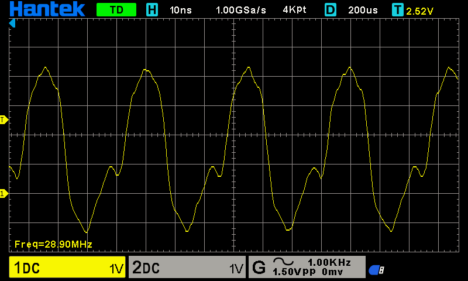
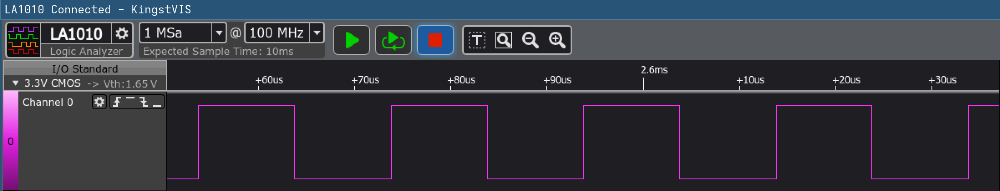
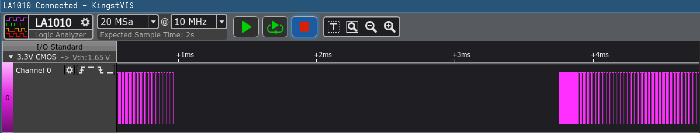
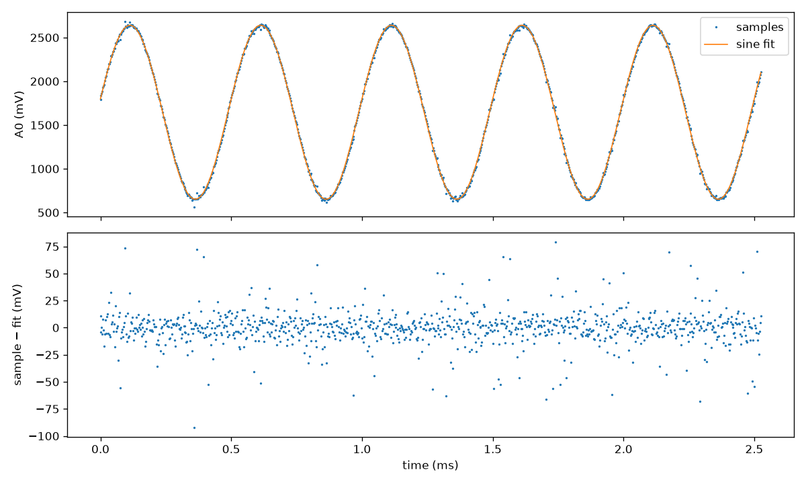
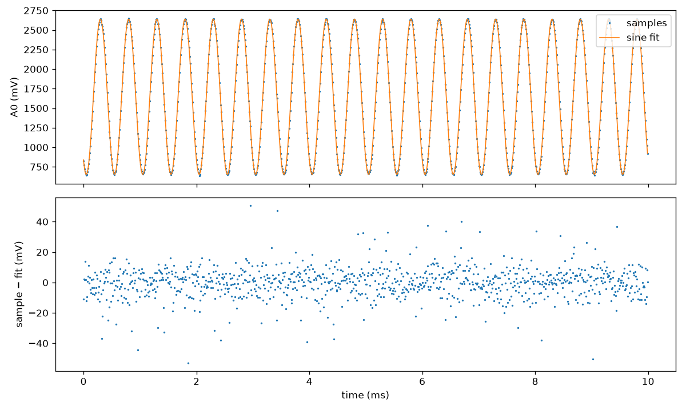

# ScopeLogic

> Benchmarked polling, interrupt, and DMA-based ADC acquisition in bare-metal C on an STM32F429 (register-level, no HAL); using logic-analyzer GPIO instrumentation and oscilloscope timing measurements, showed DMA cut CPU load from **[A]%** to **[B]%**, reduced sampling jitter from **[C] µs** to **<[D] ns**, and raised max sustained sample rate **[E]×** to **[X] MSPS**.

## Step 1 — Confirm the toolchain can talk to the board

**Goal:** before writing any code, confirm the PC can reach the STM32 through the Nucleo's ST-LINK.

1. Plug the Nucleo into USB through the ST-LINK connector (the end of the board with the ST-LINK chip on it).
2. Connect and read the chip: `STM32_Programmer_CLI -c port=SWD`

**Done when:** substep 2 reports device ID `0x419` (the STM32F42x/F43x family) and a flash size of 2 MBytes.

### Step 1 summary

**Step 1 confirmed that the PC can reach the STM32 through the Nucleo's on-board ST-LINK, before any code was written.**

- `STM32_Programmer_CLI -c port=SWD` connected over SWD and reported device ID `0x419` (STM32F42x/F43x) with 2 MBytes of flash, which matches the STM32F429ZI.
- That shows the USB cable, the ST-LINK and the programmer software all work. From here on, if something fails, the cause is in the code or the wiring, not the connection to the board.

## Step 2 — Turn on an LED from your own code

**Goal:** build the smallest possible bare-metal program, flash it, and see it run. It turns on the green user LED (LD1, wired to pin PB0).

1. Start from a known state: erase the flash with `STM32_Programmer_CLI -c port=SWD mode=UR -e all`, then check that LD1 (the green LED labelled LD1 on the board) is **off**. With the flash erased the chip runs nothing, so nothing drives PB0.
2. `firmware/stm32f429zi.ld`: tell the linker where flash and RAM are, and put the vector table at the start of flash:
   ```ld
   MEMORY {
     FLASH (rx)  : ORIGIN = 0x08000000, LENGTH = 2048K
     RAM   (rwx) : ORIGIN = 0x20000000, LENGTH = 192K
   }
   SECTIONS {
     .isr_vector : { KEEP(*(.isr_vector)) } > FLASH
     .text       : { *(.text*) *(.rodata*) } > FLASH
   }
   ```
3. `firmware/main.c`: write the registers directly by address (from the reference manual, RM0090):
   ```c
   #include <stdint.h>

   #define RCC_AHB1ENR (*(volatile uint32_t *)0x40023830)
   #define GPIOB_MODER (*(volatile uint32_t *)0x40020400)
   #define GPIOB_BSRR  (*(volatile uint32_t *)0x40020418)

   void Reset_Handler(void)
   {
       RCC_AHB1ENR |= 1u << 1;                  /* turn on GPIOB's clock */
       (void)RCC_AHB1ENR;                       /* wait for it to take effect */
       GPIOB_MODER = (GPIOB_MODER & ~3u) | 1u;  /* PB0 = output */
       GPIOB_BSRR  = 1u << 0;                   /* PB0 high: LD1 on */
       for (;;) {}
   }

   /* The two words the CPU reads at reset: initial stack pointer, reset address. */
   __attribute__((section(".isr_vector"), used))
   void *const vectors[2] = { (void *)0x20030000, Reset_Handler };
   ```
4. Build, from `firmware/`: `mkdir -p build && arm-none-eabi-gcc -mcpu=cortex-m4 -mthumb -Wall -nostdlib -T stm32f429zi.ld main.c -o build/fw.elf`
5. Flash: `STM32_Programmer_CLI -c port=SWD -w build/fw.elf -v -rst`

**Done when:** LD1 goes from off (substep 1) to on after flashing, and lights again after unplugging and replugging USB, which shows the program is stored in flash.

### Step 2 summary

**Step 2 built the smallest possible bare-metal program, with no HAL, no startup file and no C library, and ran it: it turns on LD1.**

**What the program needs:**
1. A linker script: flash at `0x08000000`, RAM at `0x20000000`, and the vector table first in flash.
2. A two-word vector table: the initial stack pointer (`0x20030000`, the end of the 192K RAM) and the address of `Reset_Handler`.
3. Three register writes in `Reset_Handler`: turn on GPIOB's clock (`RCC_AHB1ENR`), set PB0 as an output (`GPIOB_MODER`), and drive PB0 high (`GPIOB_BSRR`).

**Results:**

| Check | Expected | Seen |
|---|---|---|
| LD1 after erasing flash | off | off |
| LD1 after flashing | on | on |
| LD1 after unplugging and replugging USB | on | on |

**What you learned along the way:**
- **The CPU starts by reading two words** from the start of flash: where the stack begins and where the code begins. That's all a program needs to run.
- **With `-nostdlib` nothing runs before `Reset_Handler`**, so global variables aren't set up. That's fine here because the program doesn't use any.
- **A peripheral's clock must be on before you touch it.** The extra read of `RCC_AHB1ENR` gives the clock time to start.
- **LD1 lighting again after a power cycle** shows the program is stored in flash, not just running from the debugger.

## Step 3 — See a pin toggle on the logic analyzer

**Goal:** drive a pin up and down as fast as a simple loop can, and capture it on the LA1010. This is the timing-marker technique the benchmarks will use. The pin is PF15, which comes out on the header socket labelled D2 and has nothing else connected to it.

1. Wire the LA1010: CH0 to the **D2** socket (PF15), and the LA's GND to a **GND** pin on the Nucleo.
2. Get a "before" capture: with the Step 2 program still on the board, capture about 1 ms in KingstVIS at 50 MS/s or faster. CH0 should show **no repeating pulses**.
3. Change `firmware/main.c` to keep LD1 on as a "program is running" light, and toggle PF15 forever:
   ```c
   #include <stdint.h>

   #define RCC_AHB1ENR (*(volatile uint32_t *)0x40023830)
   #define GPIOB_MODER (*(volatile uint32_t *)0x40020400)
   #define GPIOB_BSRR  (*(volatile uint32_t *)0x40020418)
   #define GPIOF_MODER (*(volatile uint32_t *)0x40021400)
   #define GPIOF_BSRR  (*(volatile uint32_t *)0x40021418)

   void Reset_Handler(void)
   {
       RCC_AHB1ENR |= (1u << 1) | (1u << 5);         /* turn on GPIOB and GPIOF clocks */
       (void)RCC_AHB1ENR;                            /* wait for them to take effect */
       GPIOB_MODER = (GPIOB_MODER & ~3u) | 1u;       /* PB0 = output */
       GPIOB_BSRR  = 1u << 0;                        /* LD1 on: program is running */
       GPIOF_MODER = (GPIOF_MODER & ~(3u << 30)) | (1u << 30);  /* PF15 = output */

       for (;;) {
           GPIOF_BSRR = 1u << 15;                    /* PF15 high */
           GPIOF_BSRR = 1u << (15 + 16);             /* PF15 low */
       }
   }

   /* The two words the CPU reads at reset: initial stack pointer, reset address. */
   __attribute__((section(".isr_vector"), used))
   void *const vectors[2] = { (void *)0x20030000, Reset_Handler };
   ```
4. Build and flash, with the same commands as Step 2 (substeps 4 and 5).
5. Capture again, with the same settings as substep 2.

**Done when:** LD1 is on, and CH0 shows a steady repeating pulse train that wasn't there in substep 2. Write down its frequency, and how long it stays high and low: that's your first timing measurement.

**Measured (16 MHz HSI, KingstVIS at 50 MS/s):** 1.25 MHz, about 380 ns high and 420 ns low (800 ns period, about 13 CPU cycles). Single widths vary by ±20 ns because that's one 20 ns sample step; the low part is longer because the jump back to the top of the loop happens while the pin is low.


### Step 3 summary

**Step 3 toggled PF15 as fast as a simple loop can and captured it on the LA1010. This is the timing-marker technique the benchmarks will use.**

**What changed in the firmware:** it also turns on GPIOF's clock, sets PF15 as an output, and then loops forever writing PF15 high and low through `GPIOF_BSRR`. LD1 stays on as a "program is running" light.

**Results:**

| Check | Expected | Measured |
|---|---|---|
| LA1010 on PF15, before | no pulses | no pulses |
| LA1010 on PF15, after | steady pulse train | **1.25 MHz**, about 380 ns high and 420 ns low |

**What you learned along the way:**
- **One loop pass takes about 13 CPU cycles** (800 ns at 16 MHz). That's the cost of a GPIO timing marker, and the baseline Step 4 compared against.
- **`BSRR` sets or clears a pin in a single write**, with no read-modify-write, so a marker can't disturb the other pins on the port.
- **The low part is longer than the high part** because the jump back to the top of the loop happens while the pin is low.
- **The LA1010 measures in sample steps.** At 50 MS/s each step is 20 ns, so single widths vary by ±20 ns.

## Step 4 — Run the CPU at 144 MHz

**Goal:** switch from the 16 MHz internal clock (HSI) to 144 MHz from the PLL, fed by the 8 MHz clock the ST-LINK supplies (HSE bypass, the board's default wiring per UM1974 §7.8.1). 144 MHz is chosen for the ADC, not the CPU: it makes APB2 72 MHz, so the ADC clock can later run at its 36 MHz maximum (2.4 MSPS). 180 MHz would cap the ADC at 22.5 MHz. To prove the new speed, the chip also outputs its clock ÷ 5 on pin PC9 (MCO2) for the scope.

1. Wire the scope: probe tip to **CN8 pin 4** (D44, PC9), ground clip to **CN8 pin 11 or 13** (GND). CN8 is the upper header on the left side. Use the probe's ×10 setting and keep the ground lead short. Leave the LA1010 on D2 (PF15) from Step 3.
2. Change `firmware/main.c` to set up the clock output, then switch the clock, then turn LD1 on and toggle PF15 as before. LD1 now only comes on once the switch has finished, so if it stays off, the program is stuck waiting in one of the `while` loops.
   ```c
   #include <stdint.h>
   
   #define RCC_CR      (*(volatile uint32_t *)0x40023800)
   #define RCC_PLLCFGR (*(volatile uint32_t *)0x40023804)
   #define RCC_CFGR    (*(volatile uint32_t *)0x40023808)
   #define RCC_AHB1ENR (*(volatile uint32_t *)0x40023830)
   #define FLASH_ACR   (*(volatile uint32_t *)0x40023C00)
   #define GPIOB_MODER (*(volatile uint32_t *)0x40020400)
   #define GPIOB_BSRR  (*(volatile uint32_t *)0x40020418)
   #define GPIOC_MODER   (*(volatile uint32_t *)0x40020800)
   #define GPIOC_OSPEEDR (*(volatile uint32_t *)0x40020808)
   #define GPIOC_AFRH    (*(volatile uint32_t *)0x40020824)
   #define GPIOF_MODER (*(volatile uint32_t *)0x40021400)
   #define GPIOF_BSRR  (*(volatile uint32_t *)0x40021418)
   
   void Reset_Handler(void)
   {
       RCC_AHB1ENR |= (1u << 1) | (1u << 2) | (1u << 5);  /* GPIOB, GPIOC, GPIOF clocks */
       (void)RCC_AHB1ENR;
   
       /* MCO2 = SYSCLK / 5 on PC9 (set the divider before the pin starts outputting) */
       RCC_CFGR = (RCC_CFGR & ~(0x1Fu << 27)) | (7u << 27);   /* MCO2 = SYSCLK (00), MCO2PRE = /5 (111) */
       GPIOC_AFRH    &= ~(0xFu << 4);                          /* PC9 alternate function 0 = MCO2 */
       GPIOC_OSPEEDR |= 3u << 18;                              /* PC9 very high speed */
       GPIOC_MODER    = (GPIOC_MODER & ~(3u << 18)) | (2u << 18);  /* PC9 = alternate function */
   
       /* 1. HSE: the 8 MHz clock from the ST-LINK, fed in directly (bypass) */
       RCC_CR |= 1u << 18;                                     /* HSEBYP */
       RCC_CR |= 1u << 16;                                     /* HSEON */
       while (!(RCC_CR & (1u << 17))) {}                       /* wait for HSERDY */
   
       /* 2. PLL: 8 MHz / M=4 = 2 MHz, x N=144 = 288 MHz, / P=2 = 144 MHz (Q=6 gives 48 MHz) */
       RCC_PLLCFGR = (RCC_PLLCFGR & ~0x0F43FFFFu)
                   | (4u << 0) | (144u << 6) | (0u << 16) | (1u << 22) | (6u << 24);
       RCC_CR |= 1u << 24;                                     /* PLLON */
       while (!(RCC_CR & (1u << 25))) {}                       /* wait for PLLRDY */
   
       /* 3. Flash: 4 wait states for 144 MHz at 3.3 V, plus prefetch, instruction and data caches */
       FLASH_ACR = 4u | (1u << 8) | (1u << 9) | (1u << 10);
       while ((FLASH_ACR & 0xFu) != 4u) {}
   
       /* 4. Bus dividers: AHB /1 (144), APB1 /4 (36), APB2 /2 (72) */
       RCC_CFGR = (RCC_CFGR & ~0xFCF0u) | (5u << 10) | (4u << 13);
   
       /* 5. Switch the system clock to the PLL */
       RCC_CFGR = (RCC_CFGR & ~3u) | 2u;
       while (((RCC_CFGR >> 2) & 3u) != 2u) {}                 /* wait until SWS reports PLL */
   
       GPIOB_MODER = (GPIOB_MODER & ~3u) | 1u;
       GPIOB_BSRR  = 1u << 0;                                  /* LD1 on: clock switch finished */
       GPIOF_MODER = (GPIOF_MODER & ~(3u << 30)) | (1u << 30);
   
       for (;;) {
           GPIOF_BSRR = 1u << 15;
           GPIOF_BSRR = 1u << (15 + 16);
       }
   }
   
   __attribute__((section(".isr_vector"), used))
   void *const vectors[2] = { (void *)0x20030000, Reset_Handler };
   ```
   Register notes (RM0090): the power controller's voltage scale is already Scale 1 at reset, which allows up to 168 MHz, so over-drive isn't needed. Flash needs 4 wait states between 120 and 150 MHz at 3.3 V, and must be set before the clock goes up. The bus dividers are also set before the switch so APB1 and APB2 never exceed their limits (45 and 90 MHz).
3. Build and flash, with the same commands as Step 2 (substeps 4 and 5). If the programmer can't connect afterwards, add `mode=UR` to the flash command.
4. Measure: the scope on PC9, and the LA1010 on PF15 at its highest sample rate (100 MS/s with 3 or fewer channels enabled).

**Done when:** LD1 is on, the scope shows about **28.8 MHz** on PC9 (144 MHz ÷ 5), and the PF15 toggle is about **9× faster** than the 1.25 MHz measured in Step 3. Write down both frequencies. The scope number checks the clock directly; the toggle number shows what the loop actually costs at the new speed, which won't be exactly 9× because flash wait states and the cache change the cycle count.

**Measured (144 MHz PLL):** LD1 on. Scope on PC9: **28.90 MHz** (expected 28.8; the 0.35% difference is the scope's measurement limit). The wave looks rounded because the 5th harmonic (144 MHz) is at the scope's 150 MHz bandwidth limit. It overshoots to about +4.2 V and −1.3 V (about 5.5 Vpp) because of ringing from the probe's clip-on ground lead. A spring ground tip reduces both. PF15 toggle on the LA1010 (100 MS/s): **11.11 MHz**, a 90 ns period, which is 8.9× Step 3. That's about 13 CPU cycles per loop at 144 MHz, the same as at 16 MHz: the flash's 4 wait states cost nothing here because the ART accelerator's instruction cache and prefetch serve the tiny loop. The true value is probably 144 MHz ÷ 13 = 11.08 MHz; 11.11 MHz is the nearest the 10 ns sample step can show.




### Step 4 summary

**Step 4 switched the CPU from its 16 MHz internal clock to 144 MHz from the PLL. The scope and the logic analyzer both confirmed the new speed.**

**Why 144 MHz:** it's chosen for the ADC, not the CPU. It puts APB2 at 72 MHz, which lets the ADC clock run at its 36 MHz maximum later (2.4 MSPS). 180 MHz would have limited the ADC clock to 22.5 MHz.

**What the firmware does, in order:**
1. Sets PC9 to output SYSCLK ÷ 5 (MCO2), so the scope can measure the clock.
2. Turns on HSE, the 8 MHz clock from the ST-LINK, fed in directly (bypass mode).
3. Sets up the PLL: 8 MHz ÷ 4 × 144 ÷ 2 = 144 MHz.
4. Sets flash to 4 wait states and turns on the prefetch and caches. This has to happen before the speed goes up.
5. Sets the bus dividers: AHB 144 MHz, APB1 36 MHz, APB2 72 MHz, all within their limits.
6. Switches the system clock to the PLL, then turns LD1 on and toggles PF15 as in Step 3.

**Results:**

| Check | Expected | Measured |
|---|---|---|
| LD1 | on | on |
| Scope on PC9 | about 28.8 MHz | **28.90 MHz** |
| LA1010 on PF15 | about 9× 1.25 MHz | **11.11 MHz** (8.9×) |

**What you learned along the way:**
- **The toggle loop still takes about 13 cycles.** The flash wait states cost nothing in a loop this small, because the ART cache serves it.
- **The scope wave looks rounded** because 28.8 MHz is close to what the scope's 150 MHz bandwidth can show cleanly.
- **The 5.5 Vpp swing** from a 3.3 V pin is ringing caused by the probe's clip-on ground lead. A spring ground tip would reduce it.
- **The LA1010 can only resolve 10 ns at 100 MS/s.** The true toggle rate is probably 11.08 MHz, and 11.11 MHz is the closest value it can show.

## Step 5 — Time PF15 with the cycle counter

**Goal:** turn on the Cortex-M4's built-in cycle counter (`DWT_CYCCNT`), which counts every CPU clock at 144 MHz, and use it to toggle PF15 exactly every **1440 cycles (10 µs)** instead of as fast as the loop goes. Every later measurement (CPU load, timing, the benchmarks) relies on this counter.

1. Wiring: same as Step 4. The LA1010 stays on **D2** (PF15, CN10 pin 12) with its GND on **CN10 pin 17**. The scope isn't needed.
2. Change `firmware/main.c`: add four register addresses, start the counter after the clock switch, and replace the toggle loop with one that waits for a deadline. Everything else is the same as Step 4.
   ```c
   #include <stdint.h>
   
   #define RCC_CR      (*(volatile uint32_t *)0x40023800)
   #define RCC_PLLCFGR (*(volatile uint32_t *)0x40023804)
   #define RCC_CFGR    (*(volatile uint32_t *)0x40023808)
   #define RCC_AHB1ENR (*(volatile uint32_t *)0x40023830)
   #define FLASH_ACR   (*(volatile uint32_t *)0x40023C00)
   #define GPIOB_MODER (*(volatile uint32_t *)0x40020400)
   #define GPIOB_BSRR  (*(volatile uint32_t *)0x40020418)
   #define GPIOC_MODER   (*(volatile uint32_t *)0x40020800)
   #define GPIOC_OSPEEDR (*(volatile uint32_t *)0x40020808)
   #define GPIOC_AFRH    (*(volatile uint32_t *)0x40020824)
   #define GPIOF_MODER (*(volatile uint32_t *)0x40021400)
   #define GPIOF_ODR   (*(volatile uint32_t *)0x40021414)
   #define GPIOF_BSRR  (*(volatile uint32_t *)0x40021418)
   #define DEMCR       (*(volatile uint32_t *)0xE000EDFC)
   #define DWT_CTRL    (*(volatile uint32_t *)0xE0001000)
   #define DWT_CYCCNT  (*(volatile uint32_t *)0xE0001004)
   
   #define PERIOD 1440u                                    /* 1440 cycles at 144 MHz = 10 us */
   
   void Reset_Handler(void)
   {
       RCC_AHB1ENR |= (1u << 1) | (1u << 2) | (1u << 5);  /* GPIOB, GPIOC, GPIOF clocks */
       (void)RCC_AHB1ENR;
   
       /* MCO2 = SYSCLK / 5 on PC9 (set the divider before the pin starts outputting) */
       RCC_CFGR = (RCC_CFGR & ~(0x1Fu << 27)) | (7u << 27);   /* MCO2 = SYSCLK (00), MCO2PRE = /5 (111) */
       GPIOC_AFRH    &= ~(0xFu << 4);                          /* PC9 alternate function 0 = MCO2 */
       GPIOC_OSPEEDR |= 3u << 18;                              /* PC9 very high speed */
       GPIOC_MODER    = (GPIOC_MODER & ~(3u << 18)) | (2u << 18);  /* PC9 = alternate function */
   
       /* 1. HSE: the 8 MHz clock from the ST-LINK, fed in directly (bypass) */
       RCC_CR |= 1u << 18;                                     /* HSEBYP */
       RCC_CR |= 1u << 16;                                     /* HSEON */
       while (!(RCC_CR & (1u << 17))) {}                       /* wait for HSERDY */
   
       /* 2. PLL: 8 MHz / M=4 = 2 MHz, x N=144 = 288 MHz, / P=2 = 144 MHz (Q=6 gives 48 MHz) */
       RCC_PLLCFGR = (RCC_PLLCFGR & ~0x0F43FFFFu)
                   | (4u << 0) | (144u << 6) | (0u << 16) | (1u << 22) | (6u << 24);
       RCC_CR |= 1u << 24;                                     /* PLLON */
       while (!(RCC_CR & (1u << 25))) {}                       /* wait for PLLRDY */
   
       /* 3. Flash: 4 wait states for 144 MHz at 3.3 V, plus prefetch, instruction and data caches */
       FLASH_ACR = 4u | (1u << 8) | (1u << 9) | (1u << 10);
       while ((FLASH_ACR & 0xFu) != 4u) {}
   
       /* 4. Bus dividers: AHB /1 (144), APB1 /4 (36), APB2 /2 (72) */
       RCC_CFGR = (RCC_CFGR & ~0xFCF0u) | (5u << 10) | (4u << 13);
   
       /* 5. Switch the system clock to the PLL */
       RCC_CFGR = (RCC_CFGR & ~3u) | 2u;
       while (((RCC_CFGR >> 2) & 3u) != 2u) {}                 /* wait until SWS reports PLL */
   
       GPIOB_MODER = (GPIOB_MODER & ~3u) | 1u;
       GPIOB_BSRR  = 1u << 0;                                  /* LD1 on: clock switch finished */
       GPIOF_MODER = (GPIOF_MODER & ~(3u << 30)) | (1u << 30);
   
       /* Cycle counter: counts every CPU clock (144 MHz) */
       DEMCR     |= 1u << 24;                              /* TRCENA: turn on the debug/trace block */
       DWT_CYCCNT = 0;
       DWT_CTRL  |= 1u << 0;                               /* CYCCNTENA: start counting */
   
       uint32_t next = DWT_CYCCNT;
       for (;;) {
           next += PERIOD;                                 /* next deadline, from the last one, not from now */
           while ((int32_t)(DWT_CYCCNT - next) < 0) {}     /* wait for it (works across wraparound) */
           GPIOF_BSRR = (GPIOF_ODR & (1u << 15)) ? 1u << (15 + 16) : 1u << 15;  /* flip PF15 */
       }
   }
   
   __attribute__((section(".isr_vector"), used))
   void *const vectors[2] = { (void *)0x20030000, Reset_Handler };
   ```
   Register notes (Cortex-M4 / ARMv7-M architecture manual): `DEMCR` bit 24 (`TRCENA`) powers the debug and trace block the counter lives in; `DWT_CTRL` bit 0 (`CYCCNTENA`) starts it. It's a 32-bit counter, so at 144 MHz it wraps every 29.8 s. Comparing `(int32_t)(DWT_CYCCNT - next) < 0` instead of `DWT_CYCCNT < next` keeps the wait correct across the wrap. `GPIOF_ODR` is read to find PF15's current level so the loop can flip it.

   Each deadline is set from the previous deadline, not from "now", so the time spent in the loop never adds up: the edges stay on a fixed 10 µs grid. A hardware timer works the same way, and the ADC sample clock will later.
3. Build and flash, with the same commands as Step 2 (substeps 4 and 5).
4. Check the counter is running, without any probe: read it over SWD twice while the board runs. The two values should differ.
   ```
   STM32_Programmer_CLI -c port=SWD mode=HOTPLUG -r32 0xE0001004 1
   ```
5. Measure: capture PF15 on the LA1010 at 100 MS/s, 1 MSa (10 ms), as in Step 4. Read the frequency and the high and low widths.

**Done when:** the two counter readings in substep 4 differ, and PF15 is a **50.00 kHz** square wave with high and low widths both about **10.00 µs** that don't drift across the 10 ms capture. Single widths can be off by up to about ±0.1 µs: the wait loop only checks the counter every few cycles (about 6 instructions), so each edge lands up to a few cycles after its deadline, and the LA adds its own ±10 ns sample step. Because the deadlines don't move, those small errors never add up, so the average stays at exactly 50.00 kHz. Write down the frequency and the widths.

**Measured (144 MHz, cycle counter, KingstVIS at 100 MS/s):** the counter read over SWD went up by about 6.6–6.7 million in the ~45 ms between reads, which is about 144 MHz. PF15: **10.01 µs high, 10.00 µs low**, KingstVIS frequency **49.975 kHz**. That's 1 ÷ 20.01 µs: KingstVIS works out the frequency from a single period, and 20.01 µs is one 10 ns sample longer than 20.00 µs. The deadlines are exactly 1440 cycles apart, so the average is 50.000 kHz. No drift: edges 2.6 ms into the capture still sit on the 10 µs grid.


### Step 5 summary

**Step 5 turned on the Cortex-M4's cycle counter and used it to toggle PF15 on a fixed 10 µs grid, instead of as fast as the loop goes.**

**What changed in the firmware:**
1. Turns on the cycle counter: `DEMCR.TRCENA` powers the debug and trace block, then `DWT_CYCCNT` is cleared and `DWT_CTRL.CYCCNTENA` starts it.
2. Replaces the toggle loop with a deadline loop: add 1440 cycles to the last deadline, wait until the counter passes it, flip PF15.

**Results:**

| Check | Expected | Measured |
|---|---|---|
| Counter over SWD | changes between reads | about 144 MHz (6.6–6.7 M counts per ~45 ms) |
| PF15 frequency | 50.00 kHz | 49.975 kHz on one period (20.01 µs); 50.000 kHz on average |
| PF15 high / low | about 10.00 µs each, ±0.1 µs | 10.01 µs / 10.00 µs |

**What you learned along the way:**
- **The cycle counter is a free 144 MHz stopwatch** (6.9 ns resolution) that wraps every 29.8 s. Comparing with `(int32_t)(now - deadline) < 0` keeps working across the wrap.
- **Setting each deadline from the last deadline, not from "now", stops errors from adding up.** Each edge can land a few cycles late, but the next deadline doesn't move, so the average rate is exact. A hardware timer works the same way.
- **The edge lateness depends on how often the wait loop checks the counter**: about every 6 instructions here. That's the same kind of jitter software-started ADC sampling will have in the benchmarks.
- **`mode=HOTPLUG` reads memory over SWD while the program keeps running**: a way to look at variables without UART or a debugger session.
- **A frequency read from one period inherits the analyzer's step:** 10 ns in 20 µs is 0.05%, so 49.975 kHz instead of 50.000.

## Step 6 — Startup code, global variables and a Makefile

**Goal:** make global variables work, give the CPU a proper vector table, and build with `make`. So far the firmware has had no startup code (`-nostdlib`), so nothing set globals to their starting values: C promises that `uint32_t count;` starts at 0 and `uint32_t period = 1440;` starts at 1440, but on this board both would start with whatever was in RAM. Every later step needs globals (sample buffers, counters, flags shared with interrupts) and interrupt handlers. On the board nothing visible changes: PF15 stays at 50 kHz. What's new is that it now comes from a global variable, which you also read back over SWD.

1. Wiring: same as Step 5 (LA1010 CH0 on D2 / PF15, CN10 pin 12; GND on CN10 pin 17).
2. `firmware/stm32f429zi.ld`: add a `.data` section (in RAM, with its starting values stored in flash) and a `.bss` section (in RAM, zeroed), and export the addresses the startup code needs:
   ```ld
   ENTRY(Reset_Handler)
   
   MEMORY {
     FLASH (rx)  : ORIGIN = 0x08000000, LENGTH = 2048K
     RAM   (rwx) : ORIGIN = 0x20000000, LENGTH = 192K
   }
   
   _estack = ORIGIN(RAM) + LENGTH(RAM);        /* 0x20030000: the stack starts at the top of RAM */
   
   SECTIONS {
     .isr_vector : { KEEP(*(.isr_vector)) } > FLASH
     .text       : { *(.text*) *(.rodata*) . = ALIGN(4); } > FLASH
   
     /* Initialized globals: live in RAM, but their starting values are stored in flash */
     .data : {
       _sdata = .;
       *(.data*)
       . = ALIGN(4);
       _edata = .;
     } > RAM AT > FLASH
     _sidata = LOADADDR(.data);                /* where in flash the starting values are */
   
     /* Zero-initialized globals: live in RAM, nothing stored in flash */
     .bss (NOLOAD) : {
       _sbss = .;
       *(.bss*) *(COMMON)
       . = ALIGN(4);
       _ebss = .;
     } > RAM
   }
   ```
   `AT > FLASH` is what puts `.data`'s starting values in flash while its addresses point at RAM. `ENTRY(Reset_Handler)` tells the tools where the program starts.
3. `firmware/startup.c` (new): `Reset_Handler` moves here, does the RAM setup, then calls `main()`. The vector table grows to the 16 Cortex-M4 entries:
   ```c
   #include <stdint.h>
   
   /* Defined by the linker script */
   extern uint32_t _estack, _sidata, _sdata, _edata, _sbss, _ebss;
   
   int main(void);
   
   /* Runs first after every reset: set up RAM the way C expects, then call main() */
   void Reset_Handler(void)
   {
       uint32_t *src = &_sidata;
       uint32_t *dst = &_sdata;
       while (dst < &_edata) *dst++ = *src++;      /* .data: copy starting values from flash */
   
       for (dst = &_sbss; dst < &_ebss; ) *dst++ = 0;  /* .bss: zero */
   
       main();
       for (;;) {}                                 /* main() should never return */
   }
   
   /* Any fault or interrupt without its own handler ends up here. In a debugger,
      a program stuck in Default_Handler means something went wrong. */
   void Default_Handler(void) { for (;;) {} }
   
   /* "weak": a later step can define e.g. SysTick_Handler() in another file and it replaces this */
   void NMI_Handler(void)        __attribute__((weak, alias("Default_Handler")));
   void HardFault_Handler(void)  __attribute__((weak, alias("Default_Handler")));
   void MemManage_Handler(void)  __attribute__((weak, alias("Default_Handler")));
   void BusFault_Handler(void)   __attribute__((weak, alias("Default_Handler")));
   void UsageFault_Handler(void) __attribute__((weak, alias("Default_Handler")));
   void SVC_Handler(void)        __attribute__((weak, alias("Default_Handler")));
   void DebugMon_Handler(void)   __attribute__((weak, alias("Default_Handler")));
   void PendSV_Handler(void)     __attribute__((weak, alias("Default_Handler")));
   void SysTick_Handler(void)    __attribute__((weak, alias("Default_Handler")));
   
   /* The 16 Cortex-M4 entries. Peripheral interrupts (timer, ADC, DMA) get added in the steps that use them. */
   __attribute__((section(".isr_vector"), used))
   void (*const vectors[16])(void) = {
       (void (*)(void))&_estack,   /*  0: initial stack pointer */
       Reset_Handler,              /*  1 */
       NMI_Handler,                /*  2 */
       HardFault_Handler,          /*  3 */
       MemManage_Handler,          /*  4 */
       BusFault_Handler,           /*  5 */
       UsageFault_Handler,         /*  6 */
       0, 0, 0, 0,                 /*  7-10: reserved */
       SVC_Handler,                /* 11 */
       DebugMon_Handler,           /* 12 */
       0,                          /* 13: reserved */
       PendSV_Handler,             /* 14 */
       SysTick_Handler,            /* 15 */
   };
   ```
   Any fault (for example a bad memory access) now ends in `Default_Handler` instead of jumping to a random address. The handlers are `weak`, so a later step can write its own `SysTick_Handler()` in another file and it replaces the default one.
4. `firmware/main.c`: three changes from Step 5. `Reset_Handler` becomes `main`, the `PERIOD` constant becomes a global `period` (in `.data`) and a new global `toggles` (in `.bss`) counts flips, and the vector table moves out to `startup.c`:
   ```c
   #include <stdint.h>
   
   #define RCC_CR      (*(volatile uint32_t *)0x40023800)
   #define RCC_PLLCFGR (*(volatile uint32_t *)0x40023804)
   #define RCC_CFGR    (*(volatile uint32_t *)0x40023808)
   #define RCC_AHB1ENR (*(volatile uint32_t *)0x40023830)
   #define FLASH_ACR   (*(volatile uint32_t *)0x40023C00)
   #define GPIOB_MODER (*(volatile uint32_t *)0x40020400)
   #define GPIOB_BSRR  (*(volatile uint32_t *)0x40020418)
   #define GPIOC_MODER   (*(volatile uint32_t *)0x40020800)
   #define GPIOC_OSPEEDR (*(volatile uint32_t *)0x40020808)
   #define GPIOC_AFRH    (*(volatile uint32_t *)0x40020824)
   #define GPIOF_MODER (*(volatile uint32_t *)0x40021400)
   #define GPIOF_ODR   (*(volatile uint32_t *)0x40021414)
   #define GPIOF_BSRR  (*(volatile uint32_t *)0x40021418)
   #define DEMCR       (*(volatile uint32_t *)0xE000EDFC)
   #define DWT_CTRL    (*(volatile uint32_t *)0xE0001000)
   #define DWT_CYCCNT  (*(volatile uint32_t *)0xE0001004)
   
   /* Globals: the startup code sets these up before main() runs */
   uint32_t period = 1440;                                 /* .data: 1440 cycles at 144 MHz = 10 us */
   uint32_t toggles;                                       /* .bss: starts at 0 */
   
   int main(void)
   {
       RCC_AHB1ENR |= (1u << 1) | (1u << 2) | (1u << 5);  /* GPIOB, GPIOC, GPIOF clocks */
       (void)RCC_AHB1ENR;
   
       /* MCO2 = SYSCLK / 5 on PC9 (set the divider before the pin starts outputting) */
       RCC_CFGR = (RCC_CFGR & ~(0x1Fu << 27)) | (7u << 27);   /* MCO2 = SYSCLK (00), MCO2PRE = /5 (111) */
       GPIOC_AFRH    &= ~(0xFu << 4);                          /* PC9 alternate function 0 = MCO2 */
       GPIOC_OSPEEDR |= 3u << 18;                              /* PC9 very high speed */
       GPIOC_MODER    = (GPIOC_MODER & ~(3u << 18)) | (2u << 18);  /* PC9 = alternate function */
   
       /* 1. HSE: the 8 MHz clock from the ST-LINK, fed in directly (bypass) */
       RCC_CR |= 1u << 18;                                     /* HSEBYP */
       RCC_CR |= 1u << 16;                                     /* HSEON */
       while (!(RCC_CR & (1u << 17))) {}                       /* wait for HSERDY */
   
       /* 2. PLL: 8 MHz / M=4 = 2 MHz, x N=144 = 288 MHz, / P=2 = 144 MHz (Q=6 gives 48 MHz) */
       RCC_PLLCFGR = (RCC_PLLCFGR & ~0x0F43FFFFu)
                   | (4u << 0) | (144u << 6) | (0u << 16) | (1u << 22) | (6u << 24);
       RCC_CR |= 1u << 24;                                     /* PLLON */
       while (!(RCC_CR & (1u << 25))) {}                       /* wait for PLLRDY */
   
       /* 3. Flash: 4 wait states for 144 MHz at 3.3 V, plus prefetch, instruction and data caches */
       FLASH_ACR = 4u | (1u << 8) | (1u << 9) | (1u << 10);
       while ((FLASH_ACR & 0xFu) != 4u) {}
   
       /* 4. Bus dividers: AHB /1 (144), APB1 /4 (36), APB2 /2 (72) */
       RCC_CFGR = (RCC_CFGR & ~0xFCF0u) | (5u << 10) | (4u << 13);
   
       /* 5. Switch the system clock to the PLL */
       RCC_CFGR = (RCC_CFGR & ~3u) | 2u;
       while (((RCC_CFGR >> 2) & 3u) != 2u) {}                 /* wait until SWS reports PLL */
   
       GPIOB_MODER = (GPIOB_MODER & ~3u) | 1u;
       GPIOB_BSRR  = 1u << 0;                                  /* LD1 on: clock switch finished */
       GPIOF_MODER = (GPIOF_MODER & ~(3u << 30)) | (1u << 30);
   
       /* Cycle counter: counts every CPU clock (144 MHz) */
       DEMCR     |= 1u << 24;                              /* TRCENA: turn on the debug/trace block */
       DWT_CYCCNT = 0;
       DWT_CTRL  |= 1u << 0;                               /* CYCCNTENA: start counting */
   
       uint32_t next = DWT_CYCCNT;
       for (;;) {
           next += period;                                 /* next deadline, from the last one, not from now */
           while ((int32_t)(DWT_CYCCNT - next) < 0) {}     /* wait for it (works across wraparound) */
           GPIOF_BSRR = (GPIOF_ODR & (1u << 15)) ? 1u << (15 + 16) : 1u << 15;  /* flip PF15 */
           toggles++;
       }
   }
   ```
5. `firmware/Makefile` (new). It uses the same compiler flags as before, plus `-g` (debug info: it doesn't change the code). Recipe lines must start with a **tab**, not spaces:
   ```make
   CC      = arm-none-eabi-gcc
   CFLAGS  = -mcpu=cortex-m4 -mthumb -Wall -g
   LDFLAGS = -nostdlib -T stm32f429zi.ld
   SRCS    = startup.c main.c
   
   build/fw.elf: $(SRCS) stm32f429zi.ld Makefile
   	mkdir -p build
   	$(CC) $(CFLAGS) $(LDFLAGS) $(SRCS) -o $@
   	arm-none-eabi-size $@
   
   flash: build/fw.elf
   	STM32_Programmer_CLI -c port=SWD -w $< -v -rst
   
   clean:
   	rm -rf build
   
   .PHONY: flash clean
   ```
   Optimization stays off for now. Turning it on (`-O2`) changes the loop timing and is worth trying as its own change later.
6. From `firmware/`: `make`, then `make flash`. `make` should report `data 4` and `bss 4`: those are `period` and `toggles`.
7. Find where the linker put the two globals: `arm-none-eabi-nm build/fw.elf | grep -E "period|toggles"`. Expect `20000000 D period` and `20000004 B toggles` (`D` = `.data`, `B` = `.bss`).
8. Unplug and replug the Nucleo's USB. RAM keeps its contents through a reset, but not through a power cycle, so this makes sure `period` really came from the startup code and not from the previous program.
9. Read both globals over SWD while the board runs, twice:
   ```
   STM32_Programmer_CLI -c port=SWD mode=HOTPLUG -r32 0x20000000 8
   ```
   The `8` is the number of **bytes** to read (two 32-bit words). The first word is `period`, the second is `toggles`.
10. Measure PF15 on the LA1010 as in Step 5 (100 MS/s, 1 MSa).

**Done when:** `make` and `make flash` work; after the power cycle, `period` reads `0x000005A0` (1440); `toggles` goes up between the two reads at about **100,000 per second** (two flips per 20 µs period: about 4,500 for reads 45 ms apart); and PF15 is still a 50 kHz square wave with 10 µs high and low widths, as in Step 5. If `period` hadn't been copied, PF15 would run at some other rate: as fast as the loop can go if it were 0, or something odd if it were random.

**Measured (after a power cycle):** `make` reported `data 4`, `bss 4`; `nm` put `period` at `0x20000000` and `toggles` at `0x20000004`. Over SWD: `period` = **`0x000005A0`** (1440) in both reads; `toggles` = 735,743 then 739,477, up 3,734 in about 40 ms, which is about 100,000 per second, and 735,743 is about 7.4 s of counting since power-up. PF15 on the LA1010 at 100 MS/s: the same 50 kHz square wave as Step 5, every high and low part **10.0 µs** (read off the screenshot, ±0.05 µs), with edges 2.6 ms into the capture still on the 10 µs grid.



### Step 6 summary

**Step 6 added startup code, so global variables start with the values C promises, gave the CPU a proper vector table, and replaced the hand-typed build and flash commands with a Makefile. The board behaves exactly as in Step 5. The difference is that the 10 µs period now comes from a global variable.**

**What changed:**
1. **Linker script:** new `.data` section (in RAM, starting values stored in flash) and `.bss` section (in RAM, zeroed), plus the addresses the startup code needs.
2. **`startup.c` (new):** `Reset_Handler` copies `.data` from flash to RAM, zeroes `.bss`, then calls `main()`. The vector table now has all 16 Cortex-M4 entries, with faults and unused interrupts going to `Default_Handler`.
3. **`main.c`:** `Reset_Handler` became `main()`; the period is the global `period` (`.data`), and the global `toggles` (`.bss`) counts flips.
4. **`Makefile` (new):** `make`, `make flash`, `make clean`.

**Results:**

| Check | Expected | Measured |
|---|---|---|
| `make` sizes | data 4, bss 4 | data 4, bss 4 |
| `period` after power cycle | `0x5A0` (1440) | `0x5A0` |
| `toggles` rate | about 100,000 per second | 3,734 in about 40 ms (about 100,000 per second) |
| PF15 | 50 kHz, 10 µs high and low | 50 kHz, 10.0 µs high and low |

**What you learned along the way:**
- **Globals don't set themselves up.** On a PC the operating system and C library do it before `main()`; with `-nostdlib` your own `Reset_Handler` has to.
- **An initialized global lives in two places:** its starting value in flash (`_sidata`), and the variable itself in RAM (`_sdata`). `AT > FLASH` in the linker script is what sets that up.
- **RAM keeps its contents through a reset but not a power cycle,** so only a power cycle shows the startup code really did the copy.
- **`STM32_Programmer_CLI -r32` takes its size in bytes**, not words: `8` reads two 32-bit values.
- **`weak` handlers** let later steps add an interrupt handler just by writing a function with the right name, such as `SysTick_Handler`.

## Step 7 — Send text to the PC over UART

**Goal:** send a line of text from the board to the PC once a second, over the ST-LINK's USB serial port. Measurement data will leave the board this way, starting with the first ADC readings. Each line also reports how many cycles the previous line took to send, so the step measures the cost of sending too.

No extra wiring: on the NUCLEO-F429ZI, USART3 (PD8 TX, PD9 RX) is connected to the ST-LINK's virtual serial port by default (UM1974), which shows up on the PC as `/dev/ttyACM0`. The LA1010 stays on D2 (PF15) as in Step 6.

1. Change `firmware/main.c`: add the USART3 and GPIOD registers, three small send functions (there's no C library, so no `printf`), set up USART3 after the clock switch, and send a line every 100,000 flips. `startup.c`, the linker script and the Makefile are unchanged.
   ```c
   #include <stdint.h>
   
   #define RCC_CR      (*(volatile uint32_t *)0x40023800)
   #define RCC_PLLCFGR (*(volatile uint32_t *)0x40023804)
   #define RCC_CFGR    (*(volatile uint32_t *)0x40023808)
   #define RCC_AHB1ENR (*(volatile uint32_t *)0x40023830)
   #define RCC_APB1ENR (*(volatile uint32_t *)0x40023840)
   #define FLASH_ACR   (*(volatile uint32_t *)0x40023C00)
   #define GPIOB_MODER (*(volatile uint32_t *)0x40020400)
   #define GPIOB_BSRR  (*(volatile uint32_t *)0x40020418)
   #define GPIOC_MODER   (*(volatile uint32_t *)0x40020800)
   #define GPIOC_OSPEEDR (*(volatile uint32_t *)0x40020808)
   #define GPIOC_AFRH    (*(volatile uint32_t *)0x40020824)
   #define GPIOD_MODER (*(volatile uint32_t *)0x40020C00)
   #define GPIOD_AFRH  (*(volatile uint32_t *)0x40020C24)
   #define GPIOF_MODER (*(volatile uint32_t *)0x40021400)
   #define GPIOF_ODR   (*(volatile uint32_t *)0x40021414)
   #define GPIOF_BSRR  (*(volatile uint32_t *)0x40021418)
   #define DEMCR       (*(volatile uint32_t *)0xE000EDFC)
   #define DWT_CTRL    (*(volatile uint32_t *)0xE0001000)
   #define DWT_CYCCNT  (*(volatile uint32_t *)0xE0001004)
   #define USART3_SR   (*(volatile uint32_t *)0x40004800)
   #define USART3_DR   (*(volatile uint32_t *)0x40004804)
   #define USART3_BRR  (*(volatile uint32_t *)0x40004808)
   #define USART3_CR1  (*(volatile uint32_t *)0x4000480C)
   
   /* Globals: the startup code sets these up before main() runs */
   uint32_t period = 1440;                                 /* .data: 1440 cycles at 144 MHz = 10 us */
   uint32_t toggles;                                       /* .bss: starts at 0 */
   
   /* Send one byte: wait until the transmitter can take it (TXE), then hand it over */
   static void uart_putc(char c)
   {
       while (!(USART3_SR & (1u << 7))) {}                 /* TXE: transmit data register empty */
       USART3_DR = (uint8_t)c;
   }
   
   static void uart_puts(const char *s)
   {
       while (*s) uart_putc(*s++);
   }
   
   /* Send a number in decimal (no printf without a C library) */
   static void uart_putu(uint32_t v)
   {
       char digits[10];
       int n = 0;
       do { digits[n++] = (char)('0' + v % 10); v /= 10; } while (v);
       while (n) uart_putc(digits[--n]);                   /* most significant digit first */
   }
   
   int main(void)
   {
       RCC_AHB1ENR |= (1u << 1) | (1u << 2) | (1u << 3) | (1u << 5);  /* GPIOB, GPIOC, GPIOD, GPIOF clocks */
       (void)RCC_AHB1ENR;
   
       /* MCO2 = SYSCLK / 5 on PC9 (set the divider before the pin starts outputting) */
       RCC_CFGR = (RCC_CFGR & ~(0x1Fu << 27)) | (7u << 27);   /* MCO2 = SYSCLK (00), MCO2PRE = /5 (111) */
       GPIOC_AFRH    &= ~(0xFu << 4);                          /* PC9 alternate function 0 = MCO2 */
       GPIOC_OSPEEDR |= 3u << 18;                              /* PC9 very high speed */
       GPIOC_MODER    = (GPIOC_MODER & ~(3u << 18)) | (2u << 18);  /* PC9 = alternate function */
   
       /* 1. HSE: the 8 MHz clock from the ST-LINK, fed in directly (bypass) */
       RCC_CR |= 1u << 18;                                     /* HSEBYP */
       RCC_CR |= 1u << 16;                                     /* HSEON */
       while (!(RCC_CR & (1u << 17))) {}                       /* wait for HSERDY */
   
       /* 2. PLL: 8 MHz / M=4 = 2 MHz, x N=144 = 288 MHz, / P=2 = 144 MHz (Q=6 gives 48 MHz) */
       RCC_PLLCFGR = (RCC_PLLCFGR & ~0x0F43FFFFu)
                   | (4u << 0) | (144u << 6) | (0u << 16) | (1u << 22) | (6u << 24);
       RCC_CR |= 1u << 24;                                     /* PLLON */
       while (!(RCC_CR & (1u << 25))) {}                       /* wait for PLLRDY */
   
       /* 3. Flash: 4 wait states for 144 MHz at 3.3 V, plus prefetch, instruction and data caches */
       FLASH_ACR = 4u | (1u << 8) | (1u << 9) | (1u << 10);
       while ((FLASH_ACR & 0xFu) != 4u) {}
   
       /* 4. Bus dividers: AHB /1 (144), APB1 /4 (36), APB2 /2 (72) */
       RCC_CFGR = (RCC_CFGR & ~0xFCF0u) | (5u << 10) | (4u << 13);
   
       /* 5. Switch the system clock to the PLL */
       RCC_CFGR = (RCC_CFGR & ~3u) | 2u;
       while (((RCC_CFGR >> 2) & 3u) != 2u) {}                 /* wait until SWS reports PLL */
   
       GPIOB_MODER = (GPIOB_MODER & ~3u) | 1u;
       GPIOB_BSRR  = 1u << 0;                                  /* LD1 on: clock switch finished */
       GPIOF_MODER = (GPIOF_MODER & ~(3u << 30)) | (1u << 30);
   
       /* USART3 on PD8 (TX), wired to the ST-LINK's virtual serial port: 115200 baud, 8N1 */
       RCC_APB1ENR |= 1u << 18;                            /* USART3 clock */
       (void)RCC_APB1ENR;
       GPIOD_AFRH  = (GPIOD_AFRH & ~0xFu) | 7u;            /* PD8 alternate function 7 = USART3_TX */
       GPIOD_MODER = (GPIOD_MODER & ~(3u << 16)) | (2u << 16);  /* PD8 = alternate function */
       USART3_BRR  = 313;                                  /* 36 MHz / 115200 = 312.5 -> 313 */
       USART3_CR1  = (1u << 13) | (1u << 3);               /* UE: USART on, TE: transmitter on */
   
       /* Cycle counter: counts every CPU clock (144 MHz) */
       DEMCR     |= 1u << 24;                              /* TRCENA: turn on the debug/trace block */
       DWT_CYCCNT = 0;
       DWT_CTRL  |= 1u << 0;                               /* CYCCNTENA: start counting */
   
       uint32_t tx = 0;                                    /* cycles the last line took to send */
       uint32_t next = DWT_CYCCNT;
       for (;;) {
           next += period;                                 /* next deadline, from the last one, not from now */
           while ((int32_t)(DWT_CYCCNT - next) < 0) {}     /* wait for it (works across wraparound) */
           GPIOF_BSRR = (GPIOF_ODR & (1u << 15)) ? 1u << (15 + 16) : 1u << 15;  /* flip PF15 */
           toggles++;
   
           if (toggles % 100000u == 0) {                   /* 100,000 flips = once a second */
               uint32_t start = DWT_CYCCNT;
               uart_puts("t=");        uart_putu(toggles / 100000u);
               uart_puts(" toggles="); uart_putu(toggles);
               uart_puts(" tx=");      uart_putu(tx);
               uart_puts("\r\n");
               tx = DWT_CYCCNT - start;                    /* cycles this line took, sent with the next one */
           }
       }
   }
   ```
   Register notes (RM0090): USART3 is on APB1, which runs at 36 MHz. With 16× oversampling `BRR` = 36,000,000 ÷ 115,200 = 312.5, rounded to 313, giving 115,016 baud: 0.16% slow, far inside what a UART tolerates (a few %). `TXE` (bit 7 of `USART3_SR`) means the transmitter has room for the next byte. PD8's alternate function 7 connects it to USART3.
2. From `firmware/`: `make`, then `make flash`.
3. Watch the output: `picocom -b 115200 /dev/ttyACM0` (quit with Ctrl-A then Ctrl-X). Lines look like:
   ```
   t=12 toggles=1200000 tx=375807
   ```
   Prediction for `tx`: each byte is 10 bits on the wire (start bit, 8 data bits, stop bit), so 86.9 µs at 115,016 baud. The transmitter holds two bytes at once: one in the shift register that's sending bits, and one waiting in the data register. So the first two bytes of a line go in without waiting, and `uart_puts()` returns as soon as the last byte is handed over, not when it has finished going out. A line of *n* characters therefore measures *n* − 2 byte-times: for a 32-character line, 30 × 86.9 µs = 2.61 ms, or **about 375,600 cycles** (plus a couple of hundred cycles for the code itself). Each character more or less moves it by about 12,500 cycles. The first line shows `tx=0` because nothing had been sent yet.
4. Capture PF15 on the LA1010 for **at least 1 s**, so the capture is sure to include a line being sent. A 10 ms capture would catch it only about 1 time in 100. Use **10 MHz and 20 MSa** (2 s): 100 ns per sample is still plenty for 10 µs pulses and a gap of a few ms. Then zoom in on the gap. While a line is being sent the CPU is stuck in `uart_putc()` and misses about 260 of PF15's 10 µs deadlines. Afterwards the deadline loop catches up by flipping PF15 as fast as it can until it's back on schedule.

**Done when:** picocom shows one new line per second, with `t` going up by 1 and `toggles` by 100,000 each line; `tx` is about (*n* − 2) × 12,520 cycles for an *n*-character line: about 375,600 (2.6 ms) for 32 characters, about 350,600 (2.4 ms) for the 30-character lines while `t` is below 10; and the LA1010 shows, once a second, **a gap on PF15 of about (*n* − 2) byte-times (2.4–3.0 ms, depending on line length), followed by a short burst of fast pulses**, with normal 10 µs pulses either side. That gap is what the project is about: while the CPU waits on I/O, its timing suffers. Interrupts and DMA will fix it later.

**Measured:** one line per second, `t` +1 and `toggles` +100,000 every line. `tx` against the *n* − 2 rule:

| Line length | When | Predicted | Measured `tx` |
|---|---|---|---|
| 30 characters | `t` = 1–9 | 350,560 | 350,704–351,935 |
| 32 characters | `t` = 10–99 | 375,600 | 375,752–376,967 |
| 36 characters | `t` ≥ 1000 | 425,680 | 426,295–426,357 |

The extra few hundred to ~1,250 cycles is the code itself plus waiting for the UART's bit clock: a byte can only start on the next bit tick, which adds 0 to 1 bit-time (about 1,250 cycles). It creeps up by about 32 cycles per line and then drops back, as the 1 s schedule slides against that clock.

LA1010 on PF15 at 10 MHz, 2 s: the whole capture shows two thin breaks about 1.00 s apart (at 0.153 s and 1.151 s). Zoomed in on one: normal 10 µs pulses, then PF15 stays low for **2.79 ms**, then a dense burst of about **0.13 ms** (about 280 catch-up flips, about 0.46 µs or 67 cycles each), then normal pulses back on schedule. The capture was taken while `t` was in the hundreds, when lines were 34 characters long: predicted 32 byte-times = 2.78 ms.



### Step 7 summary

**Step 7 got text from the board to the PC over the ST-LINK's USB serial port, and measured what sending it costs: while the CPU waits on the UART, PF15's 10 µs timing stops for 2.4–3 ms once a second.**

**What changed in the firmware:**
1. **USART3 setup:** GPIOD and USART3 clocks on, PD8 to alternate function 7, `BRR` = 313 for 115,016 baud from the 36 MHz APB1 clock, transmitter on.
2. **Send functions:** `uart_putc()` waits for `TXE` and writes a byte; `uart_puts()` sends a string; `uart_putu()` sends a number in decimal (there's no `printf` without a C library).
3. **Once a second** (every 100,000 flips): send `t`, `toggles` and `tx`, the cycles the previous line took, timed with the cycle counter.

**Results:**

| Check | Expected | Measured |
|---|---|---|
| Lines on `/dev/ttyACM0` | one per second | one per second |
| `t`, `toggles` | +1, +100,000 per line | +1, +100,000 per line |
| `tx`, 32-character line | about 375,600 cycles | 375,752–376,967 |
| PF15 gap, 34-character line | about 2.78 ms | 2.79 ms, then a 0.13 ms catch-up burst |

**What you learned along the way:**
- **The UART holds two bytes at once** (shift register + data register), so sending *n* characters blocks for *n* − 2 byte-times, not *n*. My first prediction (*n* − 1) was wrong; the measurement caught it.
- **A byte on the wire is 10 bits** (start, 8 data, stop): 86.9 µs at 115,016 baud.
- **Blocking I/O wrecks timing.** For 2.4–3 ms per line the CPU can do nothing else, so PF15 misses about 280 deadlines. The deadline loop then catches up as fast as it can, so the average rate stays right but the spacing doesn't. That's the problem interrupts and DMA solve in later steps.
- **A once-a-second event in a 2 s capture is easy to miss when zoomed in.** Zoom all the way out and look for breaks first, then zoom in on one.
- **Old serial data can be waiting when you open the port.** Somewhere between the ST-LINK and the PC, lines sent while nothing had the port open were held, and arrived in a burst when it was opened (even after clearing the PC's input buffer). Ignore the first lines after opening.

## Step 8 — First ADC readings

**Goal:** get ADC1 working with single conversions started by software, and check it against voltages you already know, before connecting a signal generator. Each second the board reads two inputs and sends the results over the UART from Step 7:

- **VREFINT** (ADC channel 17): the chip's internal reference of about 1.2 V. No wiring needed. At the factory, ST measured what this chip's ADC reads for it at a 3.3 V supply and 30 °C, and stored the result in read-only memory at `0x1FFF7A2A` (`VREFINT_CAL`). This board's value is **1491** (`0x05D3`, read over SWD).
- **PA3** (header **A0**, ADC channel 3): connected with a jumper wire to GND, then 3V3, then nothing.

From those it works out the real supply voltage, `vdda_mV = 3300 × cal ÷ vref` (if the supply is higher than 3.3 V, the 1.2 V reference is a smaller share of it and reads lower), and A0 in millivolts, `a0_mV = a0 × vdda_mV ÷ 4095`. It also times one conversion with the cycle counter.

1. Wiring: one jumper wire (male–male) into the **A0** socket: **CN9 pin 1**, the first pin of the lower header on the left side, labelled A0. The other end goes into **GND** or **3V3** on **CN8** (the upper left header: 3V3 is pin 7, GND is pin 11 or 13), as each check in substep 4 asks. Check the labels printed next to the sockets. Both are within the ADC's 0–3.3 V range, so nothing can be damaged. The LA1010 can stay on PF15, but it isn't needed.
2. Change `firmware/main.c`: add the ADC registers, an `adc_read()` function, the ADC setup after the cycle counter starts, and a new line format. The `tx` measurement from Step 7 is gone.
   ```c
   #include <stdint.h>
   
   #define RCC_CR      (*(volatile uint32_t *)0x40023800)
   #define RCC_PLLCFGR (*(volatile uint32_t *)0x40023804)
   #define RCC_CFGR    (*(volatile uint32_t *)0x40023808)
   #define RCC_AHB1ENR (*(volatile uint32_t *)0x40023830)
   #define RCC_APB1ENR (*(volatile uint32_t *)0x40023840)
   #define RCC_APB2ENR (*(volatile uint32_t *)0x40023844)
   #define FLASH_ACR   (*(volatile uint32_t *)0x40023C00)
   #define GPIOA_MODER (*(volatile uint32_t *)0x40020000)
   #define GPIOB_MODER (*(volatile uint32_t *)0x40020400)
   #define GPIOB_BSRR  (*(volatile uint32_t *)0x40020418)
   #define GPIOC_MODER   (*(volatile uint32_t *)0x40020800)
   #define GPIOC_OSPEEDR (*(volatile uint32_t *)0x40020808)
   #define GPIOC_AFRH    (*(volatile uint32_t *)0x40020824)
   #define GPIOD_MODER (*(volatile uint32_t *)0x40020C00)
   #define GPIOD_AFRH  (*(volatile uint32_t *)0x40020C24)
   #define GPIOF_MODER (*(volatile uint32_t *)0x40021400)
   #define GPIOF_ODR   (*(volatile uint32_t *)0x40021414)
   #define GPIOF_BSRR  (*(volatile uint32_t *)0x40021418)
   #define DEMCR       (*(volatile uint32_t *)0xE000EDFC)
   #define DWT_CTRL    (*(volatile uint32_t *)0xE0001000)
   #define DWT_CYCCNT  (*(volatile uint32_t *)0xE0001004)
   #define USART3_SR   (*(volatile uint32_t *)0x40004800)
   #define USART3_DR   (*(volatile uint32_t *)0x40004804)
   #define USART3_BRR  (*(volatile uint32_t *)0x40004808)
   #define USART3_CR1  (*(volatile uint32_t *)0x4000480C)
   #define ADC1_SR     (*(volatile uint32_t *)0x40012000)
   #define ADC1_CR2    (*(volatile uint32_t *)0x40012008)
   #define ADC1_SMPR1  (*(volatile uint32_t *)0x4001200C)
   #define ADC1_SMPR2  (*(volatile uint32_t *)0x40012010)
   #define ADC1_SQR3   (*(volatile uint32_t *)0x40012034)
   #define ADC1_DR     (*(volatile uint32_t *)0x4001204C)
   #define ADC_CCR     (*(volatile uint32_t *)0x40012304)
   #define VREFINT_CAL (*(volatile uint16_t *)0x1FFF7A2A)  /* factory reading of VREFINT at 3.3 V, 30 C */
   
   /* Globals: the startup code sets these up before main() runs */
   uint32_t period = 1440;                                 /* .data: 1440 cycles at 144 MHz = 10 us */
   uint32_t toggles;                                       /* .bss: starts at 0 */
   
   /* Send one byte: wait until the transmitter can take it (TXE), then hand it over */
   static void uart_putc(char c)
   {
       while (!(USART3_SR & (1u << 7))) {}                 /* TXE: transmit data register empty */
       USART3_DR = (uint8_t)c;
   }
   
   static void uart_puts(const char *s)
   {
       while (*s) uart_putc(*s++);
   }
   
   /* Send a number in decimal (no printf without a C library) */
   static void uart_putu(uint32_t v)
   {
       char digits[10];
       int n = 0;
       do { digits[n++] = (char)('0' + v % 10); v /= 10; } while (v);
       while (n) uart_putc(digits[--n]);                   /* most significant digit first */
   }
   
   static void uart_field(const char *name, uint32_t v)   /* sends e.g. " a0=1234" */
   {
       uart_puts(name);
       uart_putu(v);
   }
   
   /* One conversion, started by software, waited for by polling */
   static uint32_t adc_read(uint32_t channel)
   {
       ADC1_SQR3 = channel;                                /* the one channel to convert */
       ADC1_CR2 |= 1u << 30;                               /* SWSTART: start a conversion */
       while (!(ADC1_SR & (1u << 1))) {}                   /* wait for EOC: end of conversion */
       return ADC1_DR;                                     /* 12-bit result, 0..4095; reading it clears EOC */
   }
   
   int main(void)
   {
       RCC_AHB1ENR |= (1u << 0) | (1u << 1) | (1u << 2) | (1u << 3) | (1u << 5);  /* GPIOA, B, C, D, F clocks */
       (void)RCC_AHB1ENR;
   
       /* MCO2 = SYSCLK / 5 on PC9 (set the divider before the pin starts outputting) */
       RCC_CFGR = (RCC_CFGR & ~(0x1Fu << 27)) | (7u << 27);   /* MCO2 = SYSCLK (00), MCO2PRE = /5 (111) */
       GPIOC_AFRH    &= ~(0xFu << 4);                          /* PC9 alternate function 0 = MCO2 */
       GPIOC_OSPEEDR |= 3u << 18;                              /* PC9 very high speed */
       GPIOC_MODER    = (GPIOC_MODER & ~(3u << 18)) | (2u << 18);  /* PC9 = alternate function */
   
       /* 1. HSE: the 8 MHz clock from the ST-LINK, fed in directly (bypass) */
       RCC_CR |= 1u << 18;                                     /* HSEBYP */
       RCC_CR |= 1u << 16;                                     /* HSEON */
       while (!(RCC_CR & (1u << 17))) {}                       /* wait for HSERDY */
   
       /* 2. PLL: 8 MHz / M=4 = 2 MHz, x N=144 = 288 MHz, / P=2 = 144 MHz (Q=6 gives 48 MHz) */
       RCC_PLLCFGR = (RCC_PLLCFGR & ~0x0F43FFFFu)
                   | (4u << 0) | (144u << 6) | (0u << 16) | (1u << 22) | (6u << 24);
       RCC_CR |= 1u << 24;                                     /* PLLON */
       while (!(RCC_CR & (1u << 25))) {}                       /* wait for PLLRDY */
   
       /* 3. Flash: 4 wait states for 144 MHz at 3.3 V, plus prefetch, instruction and data caches */
       FLASH_ACR = 4u | (1u << 8) | (1u << 9) | (1u << 10);
       while ((FLASH_ACR & 0xFu) != 4u) {}
   
       /* 4. Bus dividers: AHB /1 (144), APB1 /4 (36), APB2 /2 (72) */
       RCC_CFGR = (RCC_CFGR & ~0xFCF0u) | (5u << 10) | (4u << 13);
   
       /* 5. Switch the system clock to the PLL */
       RCC_CFGR = (RCC_CFGR & ~3u) | 2u;
       while (((RCC_CFGR >> 2) & 3u) != 2u) {}                 /* wait until SWS reports PLL */
   
       GPIOB_MODER = (GPIOB_MODER & ~3u) | 1u;
       GPIOB_BSRR  = 1u << 0;                                  /* LD1 on: clock switch finished */
       GPIOF_MODER = (GPIOF_MODER & ~(3u << 30)) | (1u << 30);
   
       /* USART3 on PD8 (TX), wired to the ST-LINK's virtual serial port: 115200 baud, 8N1 */
       RCC_APB1ENR |= 1u << 18;                            /* USART3 clock */
       (void)RCC_APB1ENR;
       GPIOD_AFRH  = (GPIOD_AFRH & ~0xFu) | 7u;            /* PD8 alternate function 7 = USART3_TX */
       GPIOD_MODER = (GPIOD_MODER & ~(3u << 16)) | (2u << 16);  /* PD8 = alternate function */
       USART3_BRR  = 313;                                  /* 36 MHz / 115200 = 312.5 -> 313 */
       USART3_CR1  = (1u << 13) | (1u << 3);               /* UE: USART on, TE: transmitter on */
   
       /* Cycle counter: counts every CPU clock (144 MHz) */
       DEMCR     |= 1u << 24;                              /* TRCENA: turn on the debug/trace block */
       DWT_CYCCNT = 0;
       DWT_CTRL  |= 1u << 0;                               /* CYCCNTENA: start counting */
   
       /* ADC1: PA3 (A0, channel 3) and the internal reference VREFINT (channel 17) */
       RCC_APB2ENR |= 1u << 8;                             /* ADC1 clock */
       (void)RCC_APB2ENR;
       GPIOA_MODER |= 3u << 6;                             /* PA3 = analog */
       ADC_CCR = (ADC_CCR & ~(3u << 16)) | (1u << 23);     /* ADCPRE = /2: 72 MHz APB2 -> 36 MHz ADC clock; TSVREFE: VREFINT on */
       ADC1_SMPR2 |= 7u << 9;                              /* channel 3: sample for 480 ADC cycles */
       ADC1_SMPR1 |= 7u << 21;                             /* channel 17: 480 cycles (VREFINT needs at least 10 us) */
       ADC1_CR2   |= 1u << 0;                              /* ADON: power up the ADC */
       uint32_t t0 = DWT_CYCCNT;
       while (DWT_CYCCNT - t0 < 20u * 144u) {}             /* wait 20 us for the ADC and VREFINT to settle */
   
       uint32_t next = DWT_CYCCNT;
       for (;;) {
           next += period;                                 /* next deadline, from the last one, not from now */
           while ((int32_t)(DWT_CYCCNT - next) < 0) {}     /* wait for it (works across wraparound) */
           GPIOF_BSRR = (GPIOF_ODR & (1u << 15)) ? 1u << (15 + 16) : 1u << 15;  /* flip PF15 */
           toggles++;
   
           if (toggles % 100000u == 0) {                   /* 100,000 flips = once a second */
               uint32_t c0   = DWT_CYCCNT;
               uint32_t a0   = adc_read(3);
               uint32_t conv = DWT_CYCCNT - c0;            /* cycles one conversion took */
               uint32_t vref = adc_read(17);
               uint32_t cal  = VREFINT_CAL;
               uint32_t vdda_mV = vref ? 3300u * cal / vref : 0;  /* real supply: VREFINT read low = supply high */
               uint32_t a0_mV   = a0 * vdda_mV / 4095u;
   
               uart_field("t=",        toggles / 100000u);
               uart_field(" a0=",      a0);
               uart_field(" a0_mV=",   a0_mV);
               uart_field(" vref=",    vref);
               uart_field(" cal=",     cal);
               uart_field(" vdda_mV=", vdda_mV);
               uart_field(" conv=",    conv);
               uart_puts("\r\n");
           }
       }
   }
   ```
   Register notes (RM0090, datasheet DS9405): the ADC clock is APB2 (72 MHz) ÷ 2 = **36 MHz**, its maximum; that's why Step 4 chose 144 MHz. `TSVREFE` in `ADC_CCR` switches VREFINT on. Both channels sample for 480 ADC cycles because VREFINT needs at least 10 µs of sampling. The ADC needs about 3 µs after `ADON` and VREFINT up to 10 µs after `TSVREFE` before readings are valid, so the code waits 20 µs. `adc_read()` is polling: start a conversion, wait for `EOC`, read the result.

   Prediction for `conv`: 480 sampling + 12 conversion cycles = 492 ADC cycles at 36 MHz = 13.67 µs, which is **about 1,970 CPU cycles**, plus a few dozen for the code and the bus.
3. From `firmware/`: `make`, then `make flash`. Watch with `picocom -b 115200 /dev/ttyACM0` (quit with Ctrl-A then Ctrl-X). Lines look like:
   ```
   t=12 a0=0 a0_mV=0 vref=1490 cal=1491 vdda_mV=3302 conv=1990
   ```
4. Watch a few lines each way: A0 to **GND**, A0 to **3V3**, and A0 with the wire **removed**.

**Done when:**
- `vref` is within about ±1% of `cal` (1476–1506), and `vdda_mV` is about 3300 (3250–3350). The board's 3.3 V regulator sets the real supply, and the ADC's readings are relative to it.
- A0 to GND reads under about 10, and A0 to 3V3 reads over about 4085. A0 to 3V3 is the supply itself, so `a0_mV` should come out close to `vdda_mV`.
- A0 with nothing connected gives readings that wander. A floating input picks up whatever is nearby, so there's no right value.
- `conv` is about 1,970 cycles, steady from line to line.

Write down `cal`, a typical `vref` and `vdda_mV`, the GND and 3V3 readings, and `conv`.

**Measured** (one line per second, about 12–20 s for each check):

- `cal` = **1491**. `vref` = **1500–1504**, 0.6–0.9% above `cal`, inside ±1%. `vdda_mV` = **3271–3280**, so the supply is about 0.7% below 3.3 V. That's why `vref` reads high.
- `conv` = **2057–2058** cycles on every line. That's about 90 cycles more than the 1,970 predicted, where I'd said "a few dozen". The extra comes from code compiled without optimisation, register accesses over the APB2 bus, and syncing between the 36 MHz ADC clock and the 144 MHz CPU clock.
- **A0 to GND:** the reading was either exactly **0** or a jump, never anything in between. With the jumper on the first GND pin, 9 of 15 readings were 0 and the rest were 16–25 (12–19 mV). On a second GND pin, 11 of 20 were 0 and the rest were 68–80 (54–63 mV). Pushing the jumper in further changed nothing. That misses the "under about 10" check.
- **A0 to 3V3:** the same pattern, the other way up. 7 of 12 readings were **4095**, with `a0_mV` equal to `vdda_mV`, and 5 dipped to **4040–4053**, 33–44 mV low. That misses the "over about 4085" check.
- **A0 floating:** **965–990** (771–791 mV), much the same as in earlier sessions. It moved about 25 counts but didn't wander as much as expected.

The jumps on A0 aren't the ADC's own error, which is only a few counts. Their size depends on which GND pin A0 is tied to, while `vref`, which is measured inside the chip, stays steady throughout. Most likely the grounds and supply at the header pins aren't all at quite the same voltage as the ADC's, and the difference moves around with current from the USB, the ST-LINK and the switching pins. Catching it needs many readings close together, which comes with the timer- and DMA-driven sampling in later steps.

The floating value probably stays near 0.78 V because a floating pin holds its charge. Each conversion connects the ADC's small sampling capacitor to the pin, and on its own the pin leaks only slowly. This is my best guess, not something I measured.

### Step 8 summary

**Step 8 got ADC1 reading with single conversions started by software. The internal reference and the timing came out as predicted. The external pin works, but at both GND and 3V3 about half the readings are off by 15–80 counts.**

**What changed in the firmware:**
1. **ADC1 setup:** GPIOA and ADC1 clocks on, PA3 to analog mode, ADC clock = APB2 ÷ 2 = 36 MHz, VREFINT on, 480-cycle sampling for channels 3 and 17, ADC on, then a 20 µs wait.
2. **`adc_read()`:** picks the channel, starts a conversion, waits for `EOC`, returns `DR`.
3. **Once a second:** read A0 (timed with the cycle counter) and VREFINT, work out `vdda_mV` and `a0_mV`, and send them all. The Step 7 `tx` field is gone.

**Results:**

| Check | Expected | Measured |
|---|---|---|
| `vref` against `cal` = 1491 | within ±1% (1476–1506) | 1500–1504 (+0.6 to +0.9%) |
| `vdda_mV` | 3250–3350 | 3271–3280 |
| `conv` | about 1,970 cycles, steady | 2057–2058, steady |
| A0 to GND | under about 10 | 0, with jumps to 16–25 (first GND pin) or 68–80 (second GND pin) about half the time |
| A0 to 3V3 | over about 4085, `a0_mV` ≈ `vdda_mV` | 4095 (`a0_mV` = `vdda_mV`), with dips to 4040–4053 about half the time |
| A0 floating | wanders | 965–990 (about 0.78 V) |

**What you learned along the way:**
- **The ADC measures relative to its own supply.** A reading only becomes volts once you know VDDA, and VREFINT plus the factory `VREFINT_CAL` tell you VDDA (3.275 V here, not 3.300 V).
- **With the longest sampling time, which VREFINT needs, a conversion is mostly sampling.** A conversion is the sampling time (3 to 480 ADC cycles, set in `SMPR1`/`SMPR2`) plus 12 cycles to work out the 12 bits. We used 480 for both channels because VREFINT needs at least 10 µs of sampling, so 480 of the 492 cycles go on charging the sampling capacitor: 13.67 µs at 36 MHz, or about 2,000 CPU cycles of waiting while polling. A strong source like a signal generator can be sampled for just 3 cycles (0.42 µs per conversion); a weak one needs longer for the capacitor to charge to within half a count.
- **Ground isn't one voltage.** Tying A0 to a different GND pin changed the error by four times. The internal reference never goes through a header pin, so it stayed steady.
- **One reading a second only shows that something is wrong.** It can't show what the jumps look like or when they happen. Faster sampling, coming later, can.

## Step 9 — Capture a sine wave from the signal generator

**Goal:** feed a known signal into A0 and check that the ADC sees it correctly. The scope's built-in generator makes a **2 kHz sine from 0.65 to 2.65 V**. Once a second the board takes a **burst of 1,000 conversions back to back** and sends them over the UART, and a Python script on the PC measures the sine's frequency, amplitude and offset. You compare those with what the scope measures on the same signal.

Two things change on the ADC side:

- **A0's sampling time drops from 480 to 56 ADC cycles.** A generator can charge the sampling capacitor much faster than VREFINT can, so 480 cycles would only make each conversion slower (see the Step 8 lessons). VREFINT keeps its 480 cycles.
- **One reading a second becomes 1,000 readings in about 2.6 ms.** That's enough to see the waveform, and also the A0 jumps from Step 8, sample by sample.

1. **Set the generator, and check it on the scope before it goes anywhere near the board.** Generator: **sine, 2 kHz, 2 Vpp, offset +1.65 V**, and **Impedance: High Z**. On the DSO2D15 that's the **[Wave Gen]** menu. The manual gives the Impedance default as 50 Ω. Set to 50 Ω, the output into a high-impedance load like CH1 or A0 is about double what the screen says. Pressing a setting's soft key again switches the knob to fine steps. The output is the **EXT TRIG/GEN OUT** BNC. Connect a BNC-to-clip lead to it and clip scope CH1's probe onto it: tip on the red clip, probe ground on the black clip. Leave the board unconnected for now. Measure on CH1 (DC coupling):
   - It should swing from about **0.65 V to 2.65 V**: 2.0 Vpp, 1.65 V mean, 2.000 kHz.
   - If it shows about **1.3 to 4.0 V**, the generator assumes a 50 Ω load and is putting out double. Halve the amplitude and the offset, and check again. **Never connect a signal above 3.3 V or below 0 V to A0.**
   - Write down the Vpp, mean and frequency the scope measures. Those are the numbers to compare with.
2. **Wiring.** Keep CH1 clipped on. Black clip to a **GND** pin on the board. Red clip to **A0** through a **1 kΩ resistor** if you have one: if the signal is ever set wrong, the resistor limits the current into the pin. Any resistor from 1 kΩ to 4.7 kΩ works. Without one, connect straight to A0, but only after substep 1 checked out.

   The ST datasheet (DS9405, ADC characteristics) gives the highest source resistance each sampling time can charge to 12-bit accuracy: R_AIN ≤ (k − 0.5) ÷ (f_ADC × C_ADC × ln(2¹⁴)) − R_ADC, with *k* the sampling cycles, f_ADC = 36 MHz, C_ADC ≈ 4 pF and R_ADC ≤ 6 kΩ. For 56 cycles that's about **33 kΩ**, so 1–4.7 kΩ plus the generator's 50 Ω is fine. For 3 cycles the result is negative: even a perfect source wouldn't be fast enough at 36 MHz with 12-bit accuracy, so 56 leaves good margin.
3. **Change `firmware/main.c`.** The rest of the file stays as in Step 8.

   After the globals, add the sample buffer:
   ```c
   #define NSAMP 1000
   uint16_t samples[NSAMP];                                /* .bss: 2,000 bytes for one burst */
   ```
   In the ADC setup, change channel 3's sampling time from 480 to 56 cycles. Replace `ADC1_SMPR2 |= 7u << 9;` with:
   ```c
       ADC1_SMPR2 = (ADC1_SMPR2 & ~(7u << 9)) | (3u << 9);  /* channel 3: sample for 56 ADC cycles */
   ```
   Replace the body of `if (toggles % 100000u == 0) { ... }` with:
   ```c
           if (toggles % 100000u == 0) {                   /* once a second */
               uint32_t c0 = DWT_CYCCNT;
               for (uint32_t i = 0; i < NSAMP; i++)
                   samples[i] = (uint16_t)adc_read(3);     /* back to back: no gaps between conversions */
               uint32_t burst = DWT_CYCCNT - c0;           /* cycles for the whole burst */
               uint32_t vref = adc_read(17);
               uint32_t vdda_mV = vref ? 3300u * VREFINT_CAL / vref : 0;

               uint32_t lo = 4095, hi = 0;
               for (uint32_t i = 0; i < NSAMP; i++) {
                   if (samples[i] < lo) lo = samples[i];
                   if (samples[i] > hi) hi = samples[i];
               }

               uart_field("t=",        toggles / 100000u);
               uart_field(" vdda_mV=", vdda_mV);
               uart_field(" burst=",   burst);
               uart_field(" min=",     lo);
               uart_field(" max=",     hi);
               uart_puts("\r\n");

               uart_puts("s=");                            /* all 1,000 samples on one line */
               for (uint32_t i = 0; i < NSAMP; i++) {
                   if (i) uart_putc(',');
                   uart_putu(samples[i]);
               }
               uart_puts("\r\n");
           }
   ```
   With no interrupts running, every pass of the burst loop takes the same time, so the samples are evenly spaced and the spacing is `burst` ÷ 1000.

   Sending the samples takes about 5,000 bytes, about **0.43 s** at 115,200 baud. PF15 stops for that long once a second, then catches up. That's the Step 7 problem at a much larger scale, and fine for now.

   Prediction for `burst`: one conversion is 56 + 12 = 68 ADC cycles = 1.89 µs = 272 CPU cycles. Step 8 measured about 90 cycles of overhead per `adc_read()` at `-O0`, and the loop and the store add roughly a dozen more. That's **about 375 cycles per sample**: a burst of about **375,000 cycles (2.6 ms)**, about 384,000 samples a second. At 2 kHz that's about 5 periods and about 190 samples per period.
4. **Add `analysis/burst.py`.** It reads one burst from the serial port, converts to millivolts with `vdda_mV`, measures the frequency from the rising crossings of the middle level, fits a sine at that frequency to get the amplitude and offset, and reports what's left over (the residual). With `--plot` it also saves a picture.
   ```python
   #!/usr/bin/env python3
   """Step 9: read one ADC burst from the board and measure the sine in it."""
   import argparse

   import numpy as np
   import serial

   CPU_HZ = 144_000_000

   def read_burst(port, nsamp=1000):
       """Return (header fields, samples) from the second complete burst.

       The first one may be old data held since before the port was opened (Step 7 lesson).
       """
       found = 0
       header = None
       with serial.Serial(port, 115200, timeout=3) as ser:
           ser.reset_input_buffer()
           while True:
               line = ser.readline().decode(errors="replace").strip()
               if not line:
                   raise SystemExit("no data from the board")
               if line.startswith("t="):
                   try:
                       header = dict(kv.split("=") for kv in line.split())
                   except ValueError:
                       header = None                       # cut-off line
               elif line.startswith("s=") and header:
                   values = line[2:].split(",")
                   if len(values) == nsamp and all(v.isdigit() for v in values):
                       found += 1
                       if found == 2:
                           return header, np.array([int(v) for v in values])
                   header = None

   def rising_crossings(mv, dt):
       """Times where the signal rises through its middle level, with hysteresis against noise."""
       mid = (mv.max() + mv.min()) / 2
       hyst = (mv.max() - mv.min()) / 4
       times, armed = [], False
       for i in range(1, len(mv)):
           if mv[i] < mid - hyst:
               armed = True
           elif armed and mv[i - 1] < mid <= mv[i]:
               frac = (mid - mv[i - 1]) / (mv[i] - mv[i - 1])  # between the two samples
               times.append((i - 1 + frac) * dt)
               armed = False
       return times

   def main():
       ap = argparse.ArgumentParser()
       ap.add_argument("port", nargs="?", default="/dev/ttyACM0")
       ap.add_argument("--plot", metavar="PNG", help="save a plot of the burst")
       args = ap.parse_args()

       header, s = read_burst(args.port)
       vdda = int(header["vdda_mV"])
       burst = int(header["burst"])
       dt = burst / len(s) / CPU_HZ
       mv = s * vdda / 4095
       t = np.arange(len(s)) * dt

       print(f"burst: {len(s)} samples in {burst} cycles = {burst / CPU_HZ * 1e3:.3f} ms, "
             f"{dt * 1e6:.3f} us apart ({1 / dt / 1e3:.1f} kHz), VDDA {vdda} mV")
       print(f"min {mv.min():.0f} mV, max {mv.max():.0f} mV, mean {mv.mean():.0f} mV")

       fit = None
       swing = mv.max() - mv.min()
       times = rising_crossings(mv, dt) if swing > 500 else []  # under 500 mV: no sine, just noise
       if len(times) >= 2:
           f = (len(times) - 1) / (times[-1] - times[0])
           w = 2 * np.pi * f * t
           a = np.column_stack([np.sin(w), np.cos(w), np.ones_like(t)])
           coef, *_ = np.linalg.lstsq(a, mv, rcond=None)
           fit = a @ coef
           amp = np.hypot(coef[0], coef[1])
           resid = mv - fit
           print(f"frequency {f:.1f} Hz ({len(times)} rising crossings)")
           print(f"sine fit: amplitude {amp:.0f} mV ({2 * amp:.0f} mVpp), offset {coef[2]:.0f} mV")
           print(f"residual: rms {resid.std():.1f} mV, worst {np.abs(resid).max():.0f} mV")
       else:
           print("no sine found (swing under 500 mV or fewer than 2 rising crossings): "
                 f"spread {mv.std():.1f} mV rms around the mean")

       if args.plot:
           import matplotlib
           matplotlib.use("Agg")
           import matplotlib.pyplot as plt
           rows = 2 if fit is not None else 1
           fig, ax = plt.subplots(rows, 1, sharex=True, figsize=(10, 3 * rows), squeeze=False)
           ax[0][0].plot(t * 1e3, mv, ".", ms=2, label="samples")
           if fit is not None:
               ax[0][0].plot(t * 1e3, fit, lw=1, label="sine fit")
               ax[1][0].plot(t * 1e3, mv - fit, ".", ms=2)
               ax[1][0].set_ylabel("sample − fit (mV)")
           ax[0][0].set_ylabel("A0 (mV)")
           ax[0][0].legend(loc="upper right")
           ax[-1][0].set_xlabel("time (ms)")
           fig.tight_layout()
           fig.savefig(args.plot, dpi=120)
           print(f"saved {args.plot}")

   if __name__ == "__main__":
       main()
   ```
5. From `firmware/`: `make`, then `make flash`. From the repo root, with nothing else holding the serial port (quit picocom first): `python3 analysis/burst.py --plot docs/step9-sine.png`. Run it a few times. Output looks like:
   ```
   burst: 1000 samples in 375210 cycles = 2.606 ms, 2.606 us apart (383.8 kHz), VDDA 3275 mV
   min 648 mV, max 2652 mV, mean 1655 mV
   frequency 2000.2 Hz (5 rising crossings)
   sine fit: amplitude 1000 mV (2000 mVpp), offset 1650 mV
   residual: rms 3.0 mV, worst 12 mV
   ```
6. **Optional, for the Step 8 jumps:** disconnect the generator and tie A0 to GND, run the script again, and look at the plot. One reading a second showed jumps of 15–80 counts about half the time. A 2.6 ms burst shows whether they're single samples, short bursts or a slow wobble. Not part of the Done-when check.

**Done when:**
- Substep 1: the scope shows the generator at about 0.65–2.65 V, 2 kHz, *before* it was connected to A0.
- `burst` is about **375,000 cycles** (within about 10%) and nearly the same on every line.
- The script's **frequency** is within 1% of 2 kHz.
- The fitted **peak-to-peak** (2 × amplitude) is within about 3% of the Vpp the scope measured, and the **offset** within about 50 mV of the scope's mean.
- The plot shows a clean sine, and the residual rms is a few mV. Spikes like the Step 8 jumps would show up here as single points far from the fit: write down how many there are and how big.

Write down the scope's Vpp, mean and frequency; `burst`; and the script's frequency, amplitude, offset and residual. Save the plot.

**Measured:**

Scope, CH1 on the generator before connecting (**[Meas] → All Measure**, which calls them Pk-Pk and Average): **Pk-Pk 1.94 V, Average 1.67 V, Frequency 2 kHz, Max 2.62 V, Min 0.68 V**. With the board connected, Pk-Pk read 2.0 V.

Board, generator connected straight to A0. Three runs of `analysis/burst.py`:

| | Run 1 | Run 2 | Run 3 |
|---|---|---|---|
| `burst` (cycles) | 364,027 | 364,027 | 364,026 |
| Frequency | 2000.0 Hz | 2000.3 Hz | 2000.0 Hz |
| Fitted peak-to-peak | 1988 mV | 1985 mV | 1987 mV |
| Fitted offset | 1646 mV | 1645 mV | 1645 mV |
| Residual rms / worst | 15.8 / 92 mV | 14.5 / 84 mV | 14.2 / 78 mV |

- `burst` is **364,026–364,027 cycles**, 2.528 ms, so the samples are **2.528 µs apart (395.6 kHz)**. That's 3% under the 375,000 predicted: the overhead per reading is about 92 cycles beyond the 272 for the conversion, not the ~100 I estimated.
- Frequency, peak-to-peak and offset all pass. Peak-to-peak is within 3% of the scope's reading, and the offset is 21–25 mV below the scope's Average.
- The residual does **not** pass the "a few mV" check. It has two parts. Every sample has a spread of about **10 mV rms**. On top of that, in three further bursts **49–67 of 1,000 samples (5–7%)** were off by **30–90 mV**, typically about 40 mV, about as many up as down. They're almost always **single samples**: only 0–3 times did two land next to each other.



These single-sample outliers are the Step 8 jumps. In Step 8, at GND and 3V3, you could only see them going one way, because a reading can't go below 0 or above 4095. In mid-range they show up in both directions. During the burst PF15 isn't toggling and the UART is idle, so they probably don't come from the board's own activity. The USB/ST-LINK, or the ground connection now shared with the scope, are more likely. Carried forward as an open item.

### Step 9 summary

**Step 9 captured a 2 kHz sine from the scope's generator with 1,000 back-to-back ADC readings. Frequency, amplitude and offset match the scope, but 5–7% of samples carry single-sample errors of 30–90 mV.**

**What changed:**
1. **A0 sampling time** went from 480 to 56 ADC cycles, so one conversion takes 1.89 µs. VREFINT keeps 480.
2. **Once a second:** a burst of 1,000 polled `adc_read(3)` calls into `samples[]`, timed with the cycle counter, then one line with `vdda_mV`, `burst`, `min` and `max`, and one `s=` line with all the samples.
3. **`analysis/burst.py`:** reads one burst, measures the frequency from the rising crossings, fits a sine for amplitude and offset, reports the residual and saves a plot.

**Results:**

| Check | Expected | Measured |
|---|---|---|
| Generator on CH1, before connecting | 0.65–2.65 V, 2 kHz | 0.68–2.62 V, Pk-Pk 1.94 V, Average 1.67 V, 2 kHz |
| `burst` | about 375,000 cycles, steady | 364,026–364,027 |
| Frequency | 2 kHz ± 1% | 2000.0–2000.3 Hz |
| Peak-to-peak | within 3% of the scope | 1985–1988 mV |
| Offset | within 50 mV of the scope | 1645–1646 mV |
| Residual | a few mV rms | 14–16 mV rms: 10 mV spread plus 5–7% single-sample outliers of 30–90 mV |

**What you learned along the way:**
- **Check the generator on the scope first, and its Impedance setting.** Set to 50 Ω, a generator puts about double the voltage on screen into a high-impedance input. The manual gives 50 Ω as the default. Set it to High Z, and let the CH1 reading confirm the voltage.
- **Read the time base before reading the wave.** At 10 ns/div a 2 kHz sine looks like a small flat squiggle, and Frequency shows "*****". On the DSO2D15, H at the top of the screen is time per division and D is the delay.
- **Sampling time follows the source.** A generator charges the sampling capacitor quickly, so 56 cycles is plenty. The datasheet formula gives about 33 kΩ as the most source resistance it can handle.
- **A sine fit makes noise visible.** Subtracting the fitted sine leaves just the error, which showed the Step 8 jumps as isolated single samples going both up and down.


## Step 10 — Pace the samples with a hardware timer

**Goal:** take each sample at a time set by a hardware timer instead of "as fast as the loop goes". TIM1 runs continuously at **100 kHz** (one tick every 1,440 CPU cycles). Each tick does two things:

- It drives **PE9** (header **D6**) high: a square wave you can see on the scope. Its rising edge marks **the intended sample time**. Later steps use that edge to measure how late each sample really is (jitter).
- It sets the flag **CC1IF**. The burst loop from Step 9 now waits for that flag before each conversion.

The CPU still starts each conversion and waits for it (polling). What changes is *when* it starts: on the timer's beat, not straight after the previous one. That makes the sample spacing exact: 10.000 µs, set by the timer and not by how long the code takes. The firmware also counts **missed** ticks: a tick that came while the previous conversion was still running, which means the CPU couldn't keep up.

Later steps reuse this timer: a background interrupt load comes next, then the timer starts conversions in hardware (IRQ and DMA modes).

1. **Wiring.** Keep the generator connected to A0 and CH1 on the generator, as in Step 9. Add **scope CH2** on PE9: push a jumper wire into **D6** (**CN10 pin 4**: the lower header on the right side, with the ST-LINK USB at the top, second row from the top, right-hand column) and another into **GND** (**CN10 pin 5**: third row, left-hand column; the pin right next to D6, pin 3, is AGND, which also works). Clip CH2's probe tip to the D6 wire and its ground clip to the GND wire. Check the labels next to the sockets. Keep the clips off the board and away from the bare pin rows along the edges, as in Step 9. Set CH2's probe switch and menu to match (both 10X), DC coupling, 1 V/div.
2. **Change `firmware/main.c`.** The rest stays as in Step 9.

   Add the registers, after the ADC ones:
   ```c
   #define GPIOE_MODER   (*(volatile uint32_t *)0x40021000)
   #define GPIOE_OSPEEDR (*(volatile uint32_t *)0x40021008)
   #define GPIOE_AFRH    (*(volatile uint32_t *)0x40021024)
   #define TIM1_CR1    (*(volatile uint32_t *)0x40010000)
   #define TIM1_SR     (*(volatile uint32_t *)0x40010010)
   #define TIM1_EGR    (*(volatile uint32_t *)0x40010014)
   #define TIM1_CCMR1  (*(volatile uint32_t *)0x40010018)
   #define TIM1_CCER   (*(volatile uint32_t *)0x40010020)
   #define TIM1_PSC    (*(volatile uint32_t *)0x40010028)
   #define TIM1_ARR    (*(volatile uint32_t *)0x4001002C)
   #define TIM1_CCR1   (*(volatile uint32_t *)0x40010034)
   #define TIM1_BDTR   (*(volatile uint32_t *)0x40010044)

   #define FS 100000u                                      /* sample rate in Hz: must divide 144 MHz exactly */
   ```
   Turn on the GPIOE clock too. Replace the `RCC_AHB1ENR` line at the top of `main()` with:
   ```c
       RCC_AHB1ENR |= (1u << 0) | (1u << 1) | (1u << 2) | (1u << 3) | (1u << 4) | (1u << 5);  /* GPIOA-F clocks */
   ```
   After the 20 µs ADC settling wait, add the timer setup:
   ```c
       /* TIM1: the sample clock. Counts 144 MHz ticks from 0 to ARR, over and over */
       RCC_APB2ENR |= 1u << 0;                             /* TIM1 clock: APB2 is 72 MHz, so timers get 2 x 72 = 144 MHz */
       (void)RCC_APB2ENR;
       GPIOE_AFRH    = (GPIOE_AFRH & ~(0xFu << 4)) | (1u << 4);       /* PE9 alternate function 1 = TIM1_CH1 */
       GPIOE_OSPEEDR |= 3u << 18;                          /* PE9 very high speed: sharp edges for timing */
       GPIOE_MODER   = (GPIOE_MODER & ~(3u << 18)) | (2u << 18);      /* PE9 = alternate function */
       TIM1_PSC   = 0;                                     /* count every 144 MHz tick */
       TIM1_ARR   = 144000000u / FS - 1;                   /* 1440 ticks per period at 100 kHz: count 0..1439 */
       TIM1_CCR1  = (144000000u / FS) / 2;                 /* compare at the middle: 50% duty */
       TIM1_CCMR1 = (7u << 4) | (1u << 3);                 /* OC1M = PWM mode 2: PE9 goes high when CNT reaches CCR1; OC1PE */
       TIM1_CCER  = 1u << 0;                               /* CC1E: drive the pin */
       TIM1_BDTR  = 1u << 15;                              /* MOE: TIM1 is an "advanced" timer, its outputs stay off without this */
       TIM1_EGR   = 1u << 0;                               /* UG: load PSC, ARR and CCR1 now */
       TIM1_CR1   = 1u << 0;                               /* CEN: start counting */
   ```
   Replace the body of `if (toggles % 100000u == 0) { ... }` with:
   ```c
           if (toggles % 100000u == 0) {                   /* once a second */
               uint32_t missed = 0, first = 0, last = 0;
               TIM1_SR = ~(1u << 1);                       /* clear CC1IF: ignore ticks from before the burst */
               for (uint32_t i = 0; i < NSAMP; i++) {
                   while (!(TIM1_SR & (1u << 1))) {}       /* wait for CC1IF: the next sample time */
                   TIM1_SR = ~(1u << 1);                   /* clear it (writing 0 clears a flag, writing 1 leaves it alone) */
                   last = DWT_CYCCNT;
                   if (i == 0) first = last;
                   samples[i] = (uint16_t)adc_read(3);
                   if (TIM1_SR & (1u << 1)) missed++;      /* the next tick came before this sample finished */
               }
               uint32_t span = last - first;               /* cycles from the first sample's start to the last's */
               uint32_t vref = adc_read(17);
               uint32_t vdda_mV = vref ? 3300u * VREFINT_CAL / vref : 0;

               uint32_t lo = 4095, hi = 0;
               for (uint32_t i = 0; i < NSAMP; i++) {
                   if (samples[i] < lo) lo = samples[i];
                   if (samples[i] > hi) hi = samples[i];
               }

               uart_field("t=",        toggles / 100000u);
               uart_field(" vdda_mV=", vdda_mV);
               uart_field(" fs=",      FS);
               uart_field(" span=",    span);
               uart_field(" missed=",  missed);
               uart_field(" min=",     lo);
               uart_field(" max=",     hi);
               uart_puts("\r\n");

               uart_puts("s=");                            /* all 1,000 samples on one line */
               for (uint32_t i = 0; i < NSAMP; i++) {
                   if (i) uart_putc(',');
                   uart_putu(samples[i]);
               }
               uart_puts("\r\n");
           }
   ```
   Register notes (RM0090): TIM1 sits on APB2, and because APB2 runs at ÷2, the timer gets twice the bus clock: **144 MHz**. The counter runs 0 … ARR and wraps, so the period is ARR + 1 = **1,440 ticks = 10.000 µs**. In PWM mode 2 the output is low while the count is below CCR1 and high from CCR1 on, so **PE9 rises at the same moment CC1IF is set**: that edge is the sample time. `MOE` is easy to forget: TIM1 is an advanced timer meant for motor control, and its outputs stay disabled until it's set. The status flags are cleared by writing 0, so writing `~(1u << 1)` clears CC1IF and leaves the others alone.

   Predictions:
   - **`span` = 999 × 1,440 = 1,438,560 cycles**, give or take about 10. The first and last samples are 999 ticks apart, and the ticks come from hardware, so the only error is how quickly the wait loop notices the flag (a few cycles). Unlike Step 9, the code's speed doesn't matter.
   - **`missed` = 0.** One `adc_read()` takes about 364 cycles (Step 9), well inside the 1,440-cycle period.
   - The burst now lasts **10 ms**: 20 cycles of the 2 kHz sine, 50 samples per cycle.
3. **Change `analysis/burst.py`** so it takes the sample spacing from the timer rate when the board sends one. In `main()`, replace from `burst = int(header["burst"])` to the line before `print(f"min ...")` with:
   ```python
       if "fs" in header:                              # Step 10 on: samples paced by TIM1
           dt = 1 / int(header["fs"])
           print(f"burst: {len(s)} samples at {int(header['fs']) / 1e3:g} kHz ({dt * 1e6:.3f} us apart), "
                 f"span {header['span']} cycles, missed {header['missed']}, VDDA {vdda} mV")
       else:                                           # Step 9: back to back, spacing from the burst time
           burst = int(header["burst"])
           dt = burst / len(s) / CPU_HZ
           print(f"burst: {len(s)} samples in {burst} cycles = {burst / CPU_HZ * 1e3:.3f} ms, "
                 f"{dt * 1e6:.3f} us apart ({1 / dt / 1e3:.1f} kHz), VDDA {vdda} mV")
       mv = s * vdda / 4095
       t = np.arange(len(s)) * dt

   ```
4. From `firmware/`: `make`, then `make flash`. On the scope, **CH2 (PE9)**: All Measure with source CH2, or Measure → Frequency and Duty for CH2. Then from the repo root: `python3 analysis/burst.py --plot docs/step10-sine.png`, a few times.
5. **Optional, to see what "missed" looks like:** set `FS` to **500000u** (288 cycles per period, still dividing 144 MHz exactly), rebuild and flash, and run the script. The ADC alone could keep up, since a 56-cycle conversion is 272 CPU cycles. But `adc_read()` and the loop add about 90–100 more, so each sample takes longer than a period. Expect `missed` close to **1,000**, and `span` well above 999 × 288 = 287,712: the loop runs at its own speed again, about 999 × 380 ≈ 380,000, and the script's frequency comes out wrong because the real spacing isn't 2 µs. Set `FS` back to 100000u afterwards. Getting past this limit is what IRQ and DMA modes are for.

**Done when:**
- **CH2 on PE9** shows a 0–3.3 V square wave at **100.000 kHz** with **50%** duty.
- Every line shows **`span` = 1,438,560** cycles, within about ±10, and **`missed=0`**.
- The script's **frequency** is within **0.1%** of 2 kHz. Board and generator now both keep time from crystals, so it should land much closer than that. Amplitude and offset match Step 9: peak-to-peak within 3% of the scope's, offset within 50 mV.
- The plot shows 20 clean cycles of the sine.

Write down the CH2 frequency and duty, the range of `span`, `missed`, and the script's frequency, amplitude, offset and residual. Save the plot.

**Measured:**

Scope, CH2 on PE9 with the clip line (1X), H = 10 µs/div. All Measure read **96.15 kHz** and **+Duty 46.15%**. The cursors disagreed: across 10 periods, rising edge to rising edge, ΔX = **100.2 µs** (10.02 µs per period, 99.8 kHz). Rising edge to the next falling edge, ΔX = **5.0 µs** (50%). The 0.2 µs left over is about one cursor step at 10 µs/div. The register values fix the period at exactly 1,440 cycles and CCR1 at half of it, and the board's `span` confirms that, so the cursor readings are right and the automatic measurement is wrong on this signal. The automatic readings, 10.4 µs period and 4.8 µs high, are both whole multiples of 0.4 µs. That suggests the scope measures from a coarse copy of the waveform rather than the full 1 GSa/s data. The clip line's ringing edges may add to the error.

Board, generator on A0 as in Step 9. Three runs of `analysis/burst.py`:

| | Run 1 | Run 2 | Run 3 |
|---|---|---|---|
| `span` (cycles) | 1,438,550 | 1,438,562 | 1,438,562 |
| `missed` | 0 | 0 | 0 |
| Frequency | 1999.9 Hz | 2000.1 Hz | 1999.8 Hz |
| Fitted peak-to-peak | 1986 mV | 1985 mV | 1985 mV |
| Fitted offset | 1646 mV | 1644 mV | 1643 mV |
| Residual rms / worst | 10.1 / 53 mV | 9.9 / 48 mV | 9.8 / 51 mV |

- `span` takes only two values, **1,438,562** (most lines) and **1,438,550**: 2 and 10 cycles from the prediction. The 12-cycle gap is one trip round the wait loop: the loop notices the flag on whichever pass comes first after the tick, so the first and last samples can each land one pass later.
- `missed` is 0 on every line, and the frequency is within 0.01% of 2 kHz. Peak-to-peak and offset match Step 9.
- The residual is down from 14–16 mV rms to **about 10 mV**. In earlier bursts only **13–22 of 1,000 samples** were off by more than 30 mV, against 49–67 in Step 9, and the worst is about 50 mV instead of 80–90. Without them the spread is about 8 mV rms. The open item from Step 9 is smaller, but it hasn't gone away.



### Step 10 summary

**Step 10 paces each ADC reading with TIM1 at exactly 100 kHz. The first and last samples are always 999 × 1,440 cycles apart, give or take one pass of the wait loop, no matter how fast the code runs.**

**What changed:**
1. **TIM1** counts the 144 MHz timer clock from 0 to 1439 and sets CC1IF halfway through each period. PWM mode 2 drives **PE9 (D6)** high at that same moment, so the sample clock can be seen on a pin.
2. **The burst** waits for CC1IF before each reading. It counts a missed tick if the next one arrived before the reading finished, and reports `fs`, `span` and `missed` instead of `burst`.
3. **`analysis/burst.py`** takes the sample spacing from `fs` when the board sends it.

**Results:**

| Check | Expected | Measured |
|---|---|---|
| PE9 frequency | 100.000 kHz | 100.2 µs for 10 periods (cursors); All Measure 96.15 kHz |
| PE9 duty | 50% | 5.0 µs high (cursors); All Measure 46.15% |
| `span` | 1,438,560 ± 10 | 1,438,550 or 1,438,562 |
| `missed` | 0 | 0 |
| Frequency | 2 kHz ± 0.1% | 1999.8–2000.1 Hz |
| Peak-to-peak / offset | as Step 9 | 1985–1986 mV / 1643–1646 mV |
| Residual | | about 10 mV rms, worst about 50 mV |

**What you learned along the way:**
- **Check the scope's automatic measurements with the cursors.** On a fast square wave seen through a clip line, All Measure was 4% off, while cursors across 10 periods agreed with the board to 0.2%. Measuring across many periods makes any error in where you place the cursors that many times smaller.
- **Time cursors and voltage cursors are different lines.** AX/BX are vertical lines that measure time, and AY/BY are horizontal lines that measure voltage.
- **A hardware timer sets when each sample is taken, not how fast the code runs.** The only timing error left is the wait loop's granularity, about 12 cycles (83 ns), and `missed` shows when the code can't keep up.


## Step 11 — Add a background interrupt load and measure how late each sample is

**Goal:** make the CPU busy with something else, the way a real application is, and measure what that does to the sample timing. A **SysTick interrupt** fires about 1,000 times a second and wastes **2 µs** each time. It stands in for "the rest of the program": a control loop, a display, a protocol stack.

In Step 10 nothing could interrupt the burst, so every sample started within about 12 cycles of its tick. Now, if SysTick fires just before a tick, the CPU is still inside the interrupt when the tick arrives, so the conversion starts late. To see that, each sample now records **how late it is**. The firmware reads TIM1's counter right after noticing CC1IF. The flag was set when the counter reached CCR1 (720), so `counter − 720` is the number of cycles since the tick, measured by the same hardware clock that made it.

This is the **jitter** of polled sampling: the spread of those delays. The polling, interrupt and DMA steps all measure it with this load running, so the comparison reflects a busy CPU, not an idle one.

Two details:
- **The interrupt only delays a sample if it's running when the tick arrives** and the CPU is waiting in the loop. If it fires while `adc_read()` is waiting for the conversion, the conversion is already running in hardware: the result is collected later, but it was sampled on time. One `adc_read()` takes about 364 cycles and the interrupt about 330, so even then the CPU is back well before the next tick.
- **The period is 144,007 cycles, not 144,000.** 144,000 is exactly 100 sample periods, so the interrupt would land at the same point in the sample period every time. Depending on where it landed at power-up, it would then hit every burst or none of them. 144,007 shifts the interrupt by 7 cycles each time, so over many bursts it lands everywhere. Real background work isn't locked to the sample clock either.

1. **Wiring.** Keep everything from Step 10. Add the **LA1010**: **CH0** on a jumper in **D4** (PF14, **CN10 pin 8**: fourth row from the top, right-hand column) and the LA ground on a jumper in **GND** (**CN10 pin 17**: ninth row, left-hand column). PF14 is high while the interrupt runs.
2. **Change `firmware/main.c`.**

   Add the registers, after the TIM1 ones:
   ```c
   #define TIM1_CNT    (*(volatile uint32_t *)0x40010024)
   #define SYST_CSR    (*(volatile uint32_t *)0xE000E010)
   #define SYST_RVR    (*(volatile uint32_t *)0xE000E014)
   #define SYST_CVR    (*(volatile uint32_t *)0xE000E018)
   ```
   Below `#define FS`, add:
   ```c
   #define PERIOD (144000000u / FS)                        /* CPU cycles per sample: 1440 */

   #define LOAD 1                                          /* 1: background SysTick load on, 0: off */
   #define SYSTICK_CYCLES 144007u                          /* about 1 kHz; deliberately not a multiple of PERIOD */
   #define LOAD_CYCLES    288u                             /* 2 us of busy work per interrupt */
   #define LATE_LIMIT     100u                             /* a sample more than this many cycles late counts as late */
   ```
   After `uint16_t samples[NSAMP];`, add the counter and the interrupt handler:
   ```c
   volatile uint32_t systicks;                             /* .bss: counted by SysTick_Handler */

   /* The background load. This replaces the weak SysTick_Handler in startup.c */
   void SysTick_Handler(void)
   {
       GPIOF_BSRR = 1u << 14;                              /* PF14 (D4) high: handler running */
       uint32_t t0 = DWT_CYCCNT;
       while (DWT_CYCCNT - t0 < LOAD_CYCLES) {}            /* stand-in for real work */
       systicks++;
       GPIOF_BSRR = 1u << (14 + 16);                       /* PF14 low */
   }
   ```
   `volatile` matters here: `main()` reads `systicks`, but only the interrupt changes it. Without `volatile` the compiler may keep a copy in a register and never see it change.

   Make PF14 an output. After the PF15 `GPIOF_MODER` line, add:
   ```c
       GPIOF_MODER = (GPIOF_MODER & ~(3u << 28)) | (1u << 28);   /* PF14 (D4) = output: SysTick marker */
   ```
   After `TIM1_CR1 = 1u << 0;`, start SysTick:
   ```c
   #if LOAD
       SYST_RVR = SYSTICK_CYCLES - 1;                      /* counts down from RVR to 0, then interrupts */
       SYST_CVR = 0;                                       /* start from the top */
       SYST_CSR = 7u;                                      /* CLKSOURCE = CPU clock, TICKINT = interrupt, ENABLE */
   #endif
   ```
   Change `uint32_t next = DWT_CYCCNT;` before the main loop to:
   ```c
       uint32_t next = DWT_CYCCNT, prev_systicks = 0;
   ```
   In the once-a-second block, replace from `uint32_t missed = 0, first = 0, last = 0;` to the end of the burst's `for` loop with:
   ```c
               uint32_t missed = 0, first = 0, last = 0;
               uint32_t late_min = PERIOD, late_max = 0, n_late = 0;
               TIM1_SR = ~(1u << 1);                       /* clear CC1IF: ignore ticks from before the burst */
               for (uint32_t i = 0; i < NSAMP; i++) {
                   while (!(TIM1_SR & (1u << 1))) {}       /* wait for CC1IF: the next sample time */
                   TIM1_SR = ~(1u << 1);                   /* clear it */
                   uint32_t cnt = TIM1_CNT;                /* where the timer is now */
                   last = DWT_CYCCNT;
                   if (i == 0) first = last;
                   samples[i] = (uint16_t)adc_read(3);
                   uint32_t late = (cnt + PERIOD - PERIOD / 2) % PERIOD;  /* cycles since CNT passed CCR1 */
                   if (late < late_min) late_min = late;
                   if (late > late_max) late_max = late;
                   if (late > LATE_LIMIT) n_late++;
                   if (TIM1_SR & (1u << 1)) missed++;      /* the next tick came before this sample finished */
               }
   ```
   The lateness is worked out *after* `adc_read()`, so the division doesn't delay the conversion. Add four fields to the line, after `missed=`:
   ```c
               uart_field(" systicks=", systicks - prev_systicks);
               prev_systicks = systicks;
               uart_field(" late_min=", late_min);
               uart_field(" late_max=", late_max);
               uart_field(" n_late=",   n_late);
   ```
   Register notes: SysTick is part of the Cortex-M4 core, not an ST peripheral, so it's in ARM's documentation (PM0214) rather than RM0090. It counts down from `RVR` to 0 and then interrupts, so the period is `RVR + 1` cycles. Its priority is 0 after reset, the highest, so nothing in this program can delay it. The handler needs no setup beyond its name: the vector table in `startup.c` already points entry 15 at `SysTick_Handler`, and the `weak` default gets replaced (Step 6).

   Predictions, per line:
   - **`systicks` = 1000**, sometimes 999: 144,000,000 / 144,007 = 999.95 per second.
   - **`late_min`** is a few tens of cycles: the wait loop, clearing the flag and reading the counter. It barely changes from line to line, because nothing in that path varies.
   - **Most lines (roughly 3 in 4):** `late_max` within about 12 of `late_min`, and `n_late=0`. Interrupts that come in the 10 ms burst then all land while `adc_read()` is waiting, which doesn't delay a sample.
   - **The other lines:** `n_late` up to about **10** (one per interrupt in the 10 ms burst; they all land at about the same point in the sample period), and `late_max` up to about **330 cycles** more than `late_min`, which is **about 2.3 µs**: 288 cycles of busy work plus about 12 cycles to enter the interrupt, about 12 to leave it, and the handler's own code.
   - **`missed=0`** still: even a late sample finishes long before the next tick. `span` matches Step 10, except on lines where the first or last sample was late.
   - **PF14 on the LA:** a pulse a little over **2.0 µs** wide every **1.000 ms**.
3. From `firmware/`: first set `#define LOAD 0`, then `make` and `make flash`. Watch the lines for about 20 s, without the sample lines:
   `stty -F /dev/ttyACM0 115200 raw -echo; grep -a --line-buffered '^t=' /dev/ttyACM0`
   This is the baseline: `systicks=0`, PF14 stays low.
4. Set `#define LOAD 1`, `make`, `make flash`, and watch for about 30 s again.
5. In KingstVIS, capture CH0 at **100 MSa/s** for at least **5 ms**. Measure one PF14 pulse width and the time between two rising edges.

**Done when:**
- With `LOAD 0`: `systicks=0`, `n_late=0` and `late_max` − `late_min` ≤ about 12 on every line.
- With `LOAD 1`: `systicks` is 999 or 1000 on every line, and `missed=0`.
- With `LOAD 1`, some lines show `n_late` > 0 and `late_max` about 100–330 cycles above `late_min`, while the other lines look like the baseline.
- The LA shows PF14 pulses about 2.0 µs wide, 1.000 ms apart.

Write down `late_min` and `late_max` for both runs, and for `LOAD 1` how many lines out of 30 had late samples, the largest `n_late` and the largest `late_max`. Also write down the LA pulse width and period. In µs (cycles ÷ 144), `late_max` − `late_min` is the jitter of polled sampling with this load.
