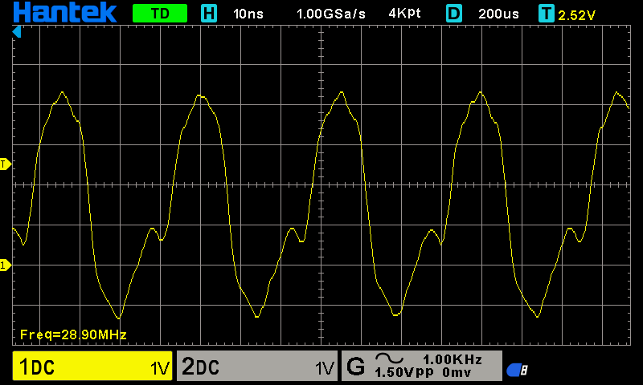
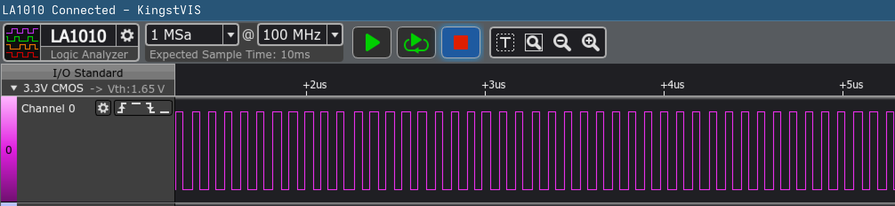
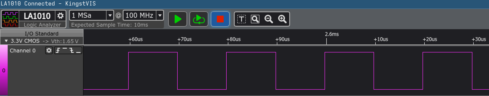
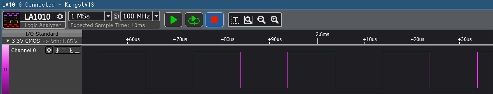

# ScopeLogic

> Benchmarked polling, interrupt, and DMA-based ADC acquisition in bare-metal C on an STM32F429 (register-level, no HAL); using logic-analyzer GPIO instrumentation and oscilloscope timing measurements, showed DMA cut CPU load from **[A]%** to **[B]%**, reduced sampling jitter from **[C] µs** to **<[D] ns**, and raised max sustained sample rate **[E]×** to **[X] MSPS**.

## Step 1 — Confirm the toolchain can talk to the board

**Goal:** before writing any code, confirm the PC can reach the STM32 through the Nucleo's ST-LINK.

1. Plug the Nucleo into USB through the ST-LINK connector (the end of the board with the ST-LINK chip on it).
2. Connect and read the chip: `STM32_Programmer_CLI -c port=SWD`

**Done when:** substep 2 reports device ID `0x419` (the STM32F42x/F43x family) and a flash size of 2 MBytes.

### Step 1 summary

**Step 1 confirmed that the PC can reach the STM32 through the Nucleo's on-board ST-LINK, before any code was written.**

- `STM32_Programmer_CLI -c port=SWD` connected over SWD and reported device ID `0x419` (STM32F42x/F43x) with 2 MBytes of flash, which matches the STM32F429ZI.
- That shows the USB cable, the ST-LINK and the programmer software all work. From here on, if something fails, the cause is in the code or the wiring, not the connection to the board.

## Step 2 — Turn on an LED from your own code

**Goal:** build the smallest possible bare-metal program, flash it, and see it run. It turns on the green user LED (LD1, wired to pin PB0).

1. Start from a known state: erase the flash with `STM32_Programmer_CLI -c port=SWD mode=UR -e all`, then check that LD1 (the green LED labelled LD1 on the board) is **off**. With the flash erased the chip runs nothing, so nothing drives PB0.
2. `firmware/stm32f429zi.ld`: tell the linker where flash and RAM are, and put the vector table at the start of flash:
   ```ld
   MEMORY {
     FLASH (rx)  : ORIGIN = 0x08000000, LENGTH = 2048K
     RAM   (rwx) : ORIGIN = 0x20000000, LENGTH = 192K
   }
   SECTIONS {
     .isr_vector : { KEEP(*(.isr_vector)) } > FLASH
     .text       : { *(.text*) *(.rodata*) } > FLASH
   }
   ```
3. `firmware/main.c`: write the registers directly by address (from the reference manual, RM0090):
   ```c
   #include <stdint.h>

   #define RCC_AHB1ENR (*(volatile uint32_t *)0x40023830)
   #define GPIOB_MODER (*(volatile uint32_t *)0x40020400)
   #define GPIOB_BSRR  (*(volatile uint32_t *)0x40020418)

   void Reset_Handler(void)
   {
       RCC_AHB1ENR |= 1u << 1;                  /* turn on GPIOB's clock */
       (void)RCC_AHB1ENR;                       /* wait for it to take effect */
       GPIOB_MODER = (GPIOB_MODER & ~3u) | 1u;  /* PB0 = output */
       GPIOB_BSRR  = 1u << 0;                   /* PB0 high: LD1 on */
       for (;;) {}
   }

   /* The two words the CPU reads at reset: initial stack pointer, reset address. */
   __attribute__((section(".isr_vector"), used))
   void *const vectors[2] = { (void *)0x20030000, Reset_Handler };
   ```
4. Build, from `firmware/`: `mkdir -p build && arm-none-eabi-gcc -mcpu=cortex-m4 -mthumb -Wall -nostdlib -T stm32f429zi.ld main.c -o build/fw.elf`
5. Flash: `STM32_Programmer_CLI -c port=SWD -w build/fw.elf -v -rst`

**Done when:** LD1 goes from off (substep 1) to on after flashing, and lights again after unplugging and replugging USB, which shows the program is stored in flash.

### Step 2 summary

**Step 2 built the smallest possible bare-metal program, with no HAL, no startup file and no C library, and ran it: it turns on LD1.**

**What the program needs:**
1. A linker script: flash at `0x08000000`, RAM at `0x20000000`, and the vector table first in flash.
2. A two-word vector table: the initial stack pointer (`0x20030000`, the end of the 192K RAM) and the address of `Reset_Handler`.
3. Three register writes in `Reset_Handler`: turn on GPIOB's clock (`RCC_AHB1ENR`), set PB0 as an output (`GPIOB_MODER`), and drive PB0 high (`GPIOB_BSRR`).

**Results:**

| Check | Expected | Seen |
|---|---|---|
| LD1 after erasing flash | off | off |
| LD1 after flashing | on | on |
| LD1 after unplugging and replugging USB | on | on |

**What you learned along the way:**
- **The CPU starts by reading two words** from the start of flash: where the stack begins and where the code begins. That's all a program needs to run.
- **With `-nostdlib` nothing runs before `Reset_Handler`**, so global variables aren't set up. That's fine here because the program doesn't use any.
- **A peripheral's clock must be on before you touch it.** The extra read of `RCC_AHB1ENR` gives the clock time to start.
- **LD1 lighting again after a power cycle** shows the program is stored in flash, not just running from the debugger.

## Step 3 — See a pin toggle on the logic analyzer

**Goal:** drive a pin up and down as fast as a simple loop can, and capture it on the LA1010. This is the timing-marker technique the benchmarks will use. The pin is PF15, which comes out on the header socket labelled D2 and has nothing else connected to it.

1. Wire the LA1010: CH0 to the **D2** socket (PF15), and the LA's GND to a **GND** pin on the Nucleo.
2. Get a "before" capture: with the Step 2 program still on the board, capture about 1 ms in KingstVIS at 50 MS/s or faster. CH0 should show **no repeating pulses**.
3. Change `firmware/main.c` to keep LD1 on as a "program is running" light, and toggle PF15 forever:
   ```c
   #include <stdint.h>

   #define RCC_AHB1ENR (*(volatile uint32_t *)0x40023830)
   #define GPIOB_MODER (*(volatile uint32_t *)0x40020400)
   #define GPIOB_BSRR  (*(volatile uint32_t *)0x40020418)
   #define GPIOF_MODER (*(volatile uint32_t *)0x40021400)
   #define GPIOF_BSRR  (*(volatile uint32_t *)0x40021418)

   void Reset_Handler(void)
   {
       RCC_AHB1ENR |= (1u << 1) | (1u << 5);         /* turn on GPIOB and GPIOF clocks */
       (void)RCC_AHB1ENR;                            /* wait for them to take effect */
       GPIOB_MODER = (GPIOB_MODER & ~3u) | 1u;       /* PB0 = output */
       GPIOB_BSRR  = 1u << 0;                        /* LD1 on: program is running */
       GPIOF_MODER = (GPIOF_MODER & ~(3u << 30)) | (1u << 30);  /* PF15 = output */

       for (;;) {
           GPIOF_BSRR = 1u << 15;                    /* PF15 high */
           GPIOF_BSRR = 1u << (15 + 16);             /* PF15 low */
       }
   }

   /* The two words the CPU reads at reset: initial stack pointer, reset address. */
   __attribute__((section(".isr_vector"), used))
   void *const vectors[2] = { (void *)0x20030000, Reset_Handler };
   ```
4. Build and flash, with the same commands as Step 2 (substeps 4 and 5).
5. Capture again, with the same settings as substep 2.

**Done when:** LD1 is on, and CH0 shows a steady repeating pulse train that wasn't there in substep 2. Write down its frequency, and how long it stays high and low: that's your first timing measurement.

**Measured (16 MHz HSI, KingstVIS at 50 MS/s):** 1.25 MHz, about 380 ns high and 420 ns low (800 ns period, about 13 CPU cycles). Single widths vary by ±20 ns because that's one 20 ns sample step; the low part is longer because the jump back to the top of the loop happens while the pin is low.


### Step 3 summary

**Step 3 toggled PF15 as fast as a simple loop can and captured it on the LA1010. This is the timing-marker technique the benchmarks will use.**

**What changed in the firmware:** it also turns on GPIOF's clock, sets PF15 as an output, and then loops forever writing PF15 high and low through `GPIOF_BSRR`. LD1 stays on as a "program is running" light.

**Results:**

| Check | Expected | Measured |
|---|---|---|
| LA1010 on PF15, before | no pulses | no pulses |
| LA1010 on PF15, after | steady pulse train | **1.25 MHz**, about 380 ns high and 420 ns low |

**What you learned along the way:**
- **One loop pass takes about 13 CPU cycles** (800 ns at 16 MHz). That's the cost of a GPIO timing marker, and the baseline Step 4 compared against.
- **`BSRR` sets or clears a pin in a single write**, with no read-modify-write, so a marker can't disturb the other pins on the port.
- **The low part is longer than the high part** because the jump back to the top of the loop happens while the pin is low.
- **The LA1010 measures in sample steps.** At 50 MS/s each step is 20 ns, so single widths vary by ±20 ns.

## Step 4 — Run the CPU at 144 MHz

**Goal:** switch from the 16 MHz internal clock (HSI) to 144 MHz from the PLL, fed by the 8 MHz clock the ST-LINK supplies (HSE bypass, the board's default wiring per UM1974 §7.8.1). 144 MHz is chosen for the ADC, not the CPU: it makes APB2 72 MHz, so the ADC clock can later run at its 36 MHz maximum (2.4 MSPS). 180 MHz would cap the ADC at 22.5 MHz. To prove the new speed, the chip also outputs its clock ÷ 5 on pin PC9 (MCO2) for the scope.

1. Wire the scope: probe tip to **CN8 pin 4** (D44, PC9), ground clip to **CN8 pin 11 or 13** (GND). CN8 is the upper header on the left side. Use the probe's ×10 setting and keep the ground lead short. Leave the LA1010 on D2 (PF15) from Step 3.
2. Change `firmware/main.c` to set up the clock output, then switch the clock, then turn LD1 on and toggle PF15 as before. LD1 now only comes on once the switch has finished, so if it stays off, the program is stuck waiting in one of the `while` loops.
   ```c
   #include <stdint.h>
   
   #define RCC_CR      (*(volatile uint32_t *)0x40023800)
   #define RCC_PLLCFGR (*(volatile uint32_t *)0x40023804)
   #define RCC_CFGR    (*(volatile uint32_t *)0x40023808)
   #define RCC_AHB1ENR (*(volatile uint32_t *)0x40023830)
   #define FLASH_ACR   (*(volatile uint32_t *)0x40023C00)
   #define GPIOB_MODER (*(volatile uint32_t *)0x40020400)
   #define GPIOB_BSRR  (*(volatile uint32_t *)0x40020418)
   #define GPIOC_MODER   (*(volatile uint32_t *)0x40020800)
   #define GPIOC_OSPEEDR (*(volatile uint32_t *)0x40020808)
   #define GPIOC_AFRH    (*(volatile uint32_t *)0x40020824)
   #define GPIOF_MODER (*(volatile uint32_t *)0x40021400)
   #define GPIOF_BSRR  (*(volatile uint32_t *)0x40021418)
   
   void Reset_Handler(void)
   {
       RCC_AHB1ENR |= (1u << 1) | (1u << 2) | (1u << 5);  /* GPIOB, GPIOC, GPIOF clocks */
       (void)RCC_AHB1ENR;
   
       /* MCO2 = SYSCLK / 5 on PC9 (set the divider before the pin starts outputting) */
       RCC_CFGR = (RCC_CFGR & ~(0x1Fu << 27)) | (7u << 27);   /* MCO2 = SYSCLK (00), MCO2PRE = /5 (111) */
       GPIOC_AFRH    &= ~(0xFu << 4);                          /* PC9 alternate function 0 = MCO2 */
       GPIOC_OSPEEDR |= 3u << 18;                              /* PC9 very high speed */
       GPIOC_MODER    = (GPIOC_MODER & ~(3u << 18)) | (2u << 18);  /* PC9 = alternate function */
   
       /* 1. HSE: the 8 MHz clock from the ST-LINK, fed in directly (bypass) */
       RCC_CR |= 1u << 18;                                     /* HSEBYP */
       RCC_CR |= 1u << 16;                                     /* HSEON */
       while (!(RCC_CR & (1u << 17))) {}                       /* wait for HSERDY */
   
       /* 2. PLL: 8 MHz / M=4 = 2 MHz, x N=144 = 288 MHz, / P=2 = 144 MHz (Q=6 gives 48 MHz) */
       RCC_PLLCFGR = (RCC_PLLCFGR & ~0x0F43FFFFu)
                   | (4u << 0) | (144u << 6) | (0u << 16) | (1u << 22) | (6u << 24);
       RCC_CR |= 1u << 24;                                     /* PLLON */
       while (!(RCC_CR & (1u << 25))) {}                       /* wait for PLLRDY */
   
       /* 3. Flash: 4 wait states for 144 MHz at 3.3 V, plus prefetch, instruction and data caches */
       FLASH_ACR = 4u | (1u << 8) | (1u << 9) | (1u << 10);
       while ((FLASH_ACR & 0xFu) != 4u) {}
   
       /* 4. Bus dividers: AHB /1 (144), APB1 /4 (36), APB2 /2 (72) */
       RCC_CFGR = (RCC_CFGR & ~0xFCF0u) | (5u << 10) | (4u << 13);
   
       /* 5. Switch the system clock to the PLL */
       RCC_CFGR = (RCC_CFGR & ~3u) | 2u;
       while (((RCC_CFGR >> 2) & 3u) != 2u) {}                 /* wait until SWS reports PLL */
   
       GPIOB_MODER = (GPIOB_MODER & ~3u) | 1u;
       GPIOB_BSRR  = 1u << 0;                                  /* LD1 on: clock switch finished */
       GPIOF_MODER = (GPIOF_MODER & ~(3u << 30)) | (1u << 30);
   
       for (;;) {
           GPIOF_BSRR = 1u << 15;
           GPIOF_BSRR = 1u << (15 + 16);
       }
   }
   
   __attribute__((section(".isr_vector"), used))
   void *const vectors[2] = { (void *)0x20030000, Reset_Handler };
   ```
   Register notes (RM0090): the power controller's voltage scale is already Scale 1 at reset, which allows up to 168 MHz, so over-drive isn't needed. Flash needs 4 wait states between 120 and 150 MHz at 3.3 V, and must be set before the clock goes up. The bus dividers are also set before the switch so APB1 and APB2 never exceed their limits (45 and 90 MHz).
3. Build and flash, with the same commands as Step 2 (substeps 4 and 5). If the programmer can't connect afterwards, add `mode=UR` to the flash command.
4. Measure: the scope on PC9, and the LA1010 on PF15 at its highest sample rate (100 MS/s with 3 or fewer channels enabled).

**Done when:** LD1 is on, the scope shows about **28.8 MHz** on PC9 (144 MHz ÷ 5), and the PF15 toggle is about **9× faster** than the 1.25 MHz measured in Step 3. Write down both frequencies. The scope number checks the clock directly; the toggle number shows what the loop actually costs at the new speed, which won't be exactly 9× because flash wait states and the cache change the cycle count.

**Measured (144 MHz PLL):** LD1 on. Scope on PC9: **28.90 MHz** (expected 28.8; the 0.35% difference is the scope's measurement limit). The wave looks rounded because the 5th harmonic (144 MHz) is at the scope's 150 MHz bandwidth limit. It overshoots to about +4.2 V and −1.3 V (about 5.5 Vpp) because of ringing from the probe's clip-on ground lead. A spring ground tip reduces both. PF15 toggle on the LA1010 (100 MS/s): **11.11 MHz**, a 90 ns period, which is 8.9× Step 3. That's about 13 CPU cycles per loop at 144 MHz, the same as at 16 MHz: the flash's 4 wait states cost nothing here because the ART accelerator's instruction cache and prefetch serve the tiny loop. The true value is probably 144 MHz ÷ 13 = 11.08 MHz; 11.11 MHz is the nearest the 10 ns sample step can show.





### Step 4 summary

**Step 4 switched the CPU from its 16 MHz internal clock to 144 MHz from the PLL. The scope and the logic analyzer both confirmed the new speed.**

**Why 144 MHz:** it's chosen for the ADC, not the CPU. It puts APB2 at 72 MHz, which lets the ADC clock run at its 36 MHz maximum later (2.4 MSPS). 180 MHz would have limited the ADC clock to 22.5 MHz.

**What the firmware does, in order:**
1. Sets PC9 to output SYSCLK ÷ 5 (MCO2), so the scope can measure the clock.
2. Turns on HSE, the 8 MHz clock from the ST-LINK, fed in directly (bypass mode).
3. Sets up the PLL: 8 MHz ÷ 4 × 144 ÷ 2 = 144 MHz.
4. Sets flash to 4 wait states and turns on the prefetch and caches. This has to happen before the speed goes up.
5. Sets the bus dividers: AHB 144 MHz, APB1 36 MHz, APB2 72 MHz, all within their limits.
6. Switches the system clock to the PLL, then turns LD1 on and toggles PF15 as in Step 3.

**Results:**

| Check | Expected | Measured |
|---|---|---|
| LD1 | on | on |
| Scope on PC9 | about 28.8 MHz | **28.90 MHz** |
| LA1010 on PF15 | about 9× 1.25 MHz | **11.11 MHz** (8.9×) |

**What you learned along the way:**
- **The toggle loop still takes about 13 cycles.** The flash wait states cost nothing in a loop this small, because the ART cache serves it.
- **The scope wave looks rounded** because 28.8 MHz is close to what the scope's 150 MHz bandwidth can show cleanly.
- **The 5.5 Vpp swing** from a 3.3 V pin is ringing caused by the probe's clip-on ground lead. A spring ground tip would reduce it.
- **The LA1010 can only resolve 10 ns at 100 MS/s.** The true toggle rate is probably 11.08 MHz, and 11.11 MHz is the closest value it can show.

## Step 5 — Time PF15 with the cycle counter

**Goal:** turn on the Cortex-M4's built-in cycle counter (`DWT_CYCCNT`), which counts every CPU clock at 144 MHz, and use it to toggle PF15 exactly every **1440 cycles (10 µs)** instead of as fast as the loop goes. Every later measurement (CPU load, timing, the benchmarks) relies on this counter.

1. Wiring: same as Step 4. The LA1010 stays on **D2** (PF15, CN10 pin 12) with its GND on **CN10 pin 17**. The scope isn't needed.
2. Change `firmware/main.c`: add four register addresses, start the counter after the clock switch, and replace the toggle loop with one that waits for a deadline. Everything else is the same as Step 4.
   ```c
   #include <stdint.h>
   
   #define RCC_CR      (*(volatile uint32_t *)0x40023800)
   #define RCC_PLLCFGR (*(volatile uint32_t *)0x40023804)
   #define RCC_CFGR    (*(volatile uint32_t *)0x40023808)
   #define RCC_AHB1ENR (*(volatile uint32_t *)0x40023830)
   #define FLASH_ACR   (*(volatile uint32_t *)0x40023C00)
   #define GPIOB_MODER (*(volatile uint32_t *)0x40020400)
   #define GPIOB_BSRR  (*(volatile uint32_t *)0x40020418)
   #define GPIOC_MODER   (*(volatile uint32_t *)0x40020800)
   #define GPIOC_OSPEEDR (*(volatile uint32_t *)0x40020808)
   #define GPIOC_AFRH    (*(volatile uint32_t *)0x40020824)
   #define GPIOF_MODER (*(volatile uint32_t *)0x40021400)
   #define GPIOF_ODR   (*(volatile uint32_t *)0x40021414)
   #define GPIOF_BSRR  (*(volatile uint32_t *)0x40021418)
   #define DEMCR       (*(volatile uint32_t *)0xE000EDFC)
   #define DWT_CTRL    (*(volatile uint32_t *)0xE0001000)
   #define DWT_CYCCNT  (*(volatile uint32_t *)0xE0001004)
   
   #define PERIOD 1440u                                    /* 1440 cycles at 144 MHz = 10 us */
   
   void Reset_Handler(void)
   {
       RCC_AHB1ENR |= (1u << 1) | (1u << 2) | (1u << 5);  /* GPIOB, GPIOC, GPIOF clocks */
       (void)RCC_AHB1ENR;
   
       /* MCO2 = SYSCLK / 5 on PC9 (set the divider before the pin starts outputting) */
       RCC_CFGR = (RCC_CFGR & ~(0x1Fu << 27)) | (7u << 27);   /* MCO2 = SYSCLK (00), MCO2PRE = /5 (111) */
       GPIOC_AFRH    &= ~(0xFu << 4);                          /* PC9 alternate function 0 = MCO2 */
       GPIOC_OSPEEDR |= 3u << 18;                              /* PC9 very high speed */
       GPIOC_MODER    = (GPIOC_MODER & ~(3u << 18)) | (2u << 18);  /* PC9 = alternate function */
   
       /* 1. HSE: the 8 MHz clock from the ST-LINK, fed in directly (bypass) */
       RCC_CR |= 1u << 18;                                     /* HSEBYP */
       RCC_CR |= 1u << 16;                                     /* HSEON */
       while (!(RCC_CR & (1u << 17))) {}                       /* wait for HSERDY */
   
       /* 2. PLL: 8 MHz / M=4 = 2 MHz, x N=144 = 288 MHz, / P=2 = 144 MHz (Q=6 gives 48 MHz) */
       RCC_PLLCFGR = (RCC_PLLCFGR & ~0x0F43FFFFu)
                   | (4u << 0) | (144u << 6) | (0u << 16) | (1u << 22) | (6u << 24);
       RCC_CR |= 1u << 24;                                     /* PLLON */
       while (!(RCC_CR & (1u << 25))) {}                       /* wait for PLLRDY */
   
       /* 3. Flash: 4 wait states for 144 MHz at 3.3 V, plus prefetch, instruction and data caches */
       FLASH_ACR = 4u | (1u << 8) | (1u << 9) | (1u << 10);
       while ((FLASH_ACR & 0xFu) != 4u) {}
   
       /* 4. Bus dividers: AHB /1 (144), APB1 /4 (36), APB2 /2 (72) */
       RCC_CFGR = (RCC_CFGR & ~0xFCF0u) | (5u << 10) | (4u << 13);
   
       /* 5. Switch the system clock to the PLL */
       RCC_CFGR = (RCC_CFGR & ~3u) | 2u;
       while (((RCC_CFGR >> 2) & 3u) != 2u) {}                 /* wait until SWS reports PLL */
   
       GPIOB_MODER = (GPIOB_MODER & ~3u) | 1u;
       GPIOB_BSRR  = 1u << 0;                                  /* LD1 on: clock switch finished */
       GPIOF_MODER = (GPIOF_MODER & ~(3u << 30)) | (1u << 30);
   
       /* Cycle counter: counts every CPU clock (144 MHz) */
       DEMCR     |= 1u << 24;                              /* TRCENA: turn on the debug/trace block */
       DWT_CYCCNT = 0;
       DWT_CTRL  |= 1u << 0;                               /* CYCCNTENA: start counting */
   
       uint32_t next = DWT_CYCCNT;
       for (;;) {
           next += PERIOD;                                 /* next deadline, from the last one, not from now */
           while ((int32_t)(DWT_CYCCNT - next) < 0) {}     /* wait for it (works across wraparound) */
           GPIOF_BSRR = (GPIOF_ODR & (1u << 15)) ? 1u << (15 + 16) : 1u << 15;  /* flip PF15 */
       }
   }
   
   __attribute__((section(".isr_vector"), used))
   void *const vectors[2] = { (void *)0x20030000, Reset_Handler };
   ```
   Register notes (Cortex-M4 / ARMv7-M architecture manual): `DEMCR` bit 24 (`TRCENA`) powers the debug and trace block the counter lives in; `DWT_CTRL` bit 0 (`CYCCNTENA`) starts it. It's a 32-bit counter, so at 144 MHz it wraps every 29.8 s. Comparing `(int32_t)(DWT_CYCCNT - next) < 0` instead of `DWT_CYCCNT < next` keeps the wait correct across the wrap. `GPIOF_ODR` is read to find PF15's current level so the loop can flip it.

   Each deadline is set from the previous deadline, not from "now", so the time spent in the loop never adds up: the edges stay on a fixed 10 µs grid. A hardware timer works the same way, and the ADC sample clock will later.
3. Build and flash, with the same commands as Step 2 (substeps 4 and 5).
4. Check the counter is running, without any probe: read it over SWD twice while the board runs. The two values should differ.
   ```
   STM32_Programmer_CLI -c port=SWD mode=HOTPLUG -r32 0xE0001004 1
   ```
5. Measure: capture PF15 on the LA1010 at 100 MS/s, 1 MSa (10 ms), as in Step 4. Read the frequency and the high and low widths.

**Done when:** the two counter readings in substep 4 differ, and PF15 is a **50.00 kHz** square wave with high and low widths both about **10.00 µs** that don't drift across the 10 ms capture. Single widths can be off by up to about ±0.1 µs: the wait loop only checks the counter every few cycles (about 6 instructions), so each edge lands up to a few cycles after its deadline, and the LA adds its own ±10 ns sample step. Because the deadlines don't move, those small errors never add up, so the average stays at exactly 50.00 kHz. Write down the frequency and the widths.

**Measured (144 MHz, cycle counter, KingstVIS at 100 MS/s):** the counter read over SWD went up by about 6.6–6.7 million in the ~45 ms between reads, which is about 144 MHz. PF15: **10.01 µs high, 10.00 µs low**, KingstVIS frequency **49.975 kHz**. That's 1 ÷ 20.01 µs: KingstVIS works out the frequency from a single period, and 20.01 µs is one 10 ns sample longer than 20.00 µs. The deadlines are exactly 1440 cycles apart, so the average is 50.000 kHz. No drift: edges 2.6 ms into the capture still sit on the 10 µs grid.



### Step 5 summary

**Step 5 turned on the Cortex-M4's cycle counter and used it to toggle PF15 on a fixed 10 µs grid, instead of as fast as the loop goes.**

**What changed in the firmware:**
1. Turns on the cycle counter: `DEMCR.TRCENA` powers the debug and trace block, then `DWT_CYCCNT` is cleared and `DWT_CTRL.CYCCNTENA` starts it.
2. Replaces the toggle loop with a deadline loop: add 1440 cycles to the last deadline, wait until the counter passes it, flip PF15.

**Results:**

| Check | Expected | Measured |
|---|---|---|
| Counter over SWD | changes between reads | about 144 MHz (6.6–6.7 M counts per ~45 ms) |
| PF15 frequency | 50.00 kHz | 49.975 kHz on one period (20.01 µs); 50.000 kHz on average |
| PF15 high / low | about 10.00 µs each, ±0.1 µs | 10.01 µs / 10.00 µs |

**What you learned along the way:**
- **The cycle counter is a free 144 MHz stopwatch** (6.9 ns resolution) that wraps every 29.8 s. Comparing with `(int32_t)(now - deadline) < 0` keeps working across the wrap.
- **Setting each deadline from the last deadline, not from "now", stops errors from adding up.** Each edge can land a few cycles late, but the next deadline doesn't move, so the average rate is exact. A hardware timer works the same way.
- **The edge lateness depends on how often the wait loop checks the counter**: about every 6 instructions here. That's the same kind of jitter software-started ADC sampling will have in the benchmarks.
- **`mode=HOTPLUG` reads memory over SWD while the program keeps running**: a way to look at variables without UART or a debugger session.
- **A frequency read from one period inherits the analyzer's step:** 10 ns in 20 µs is 0.05%, so 49.975 kHz instead of 50.000.

## Step 6 — Startup code, global variables and a Makefile

**Goal:** make global variables work, give the CPU a proper vector table, and build with `make`. So far the firmware has had no startup code (`-nostdlib`), so nothing set globals to their starting values: C promises that `uint32_t count;` starts at 0 and `uint32_t period = 1440;` starts at 1440, but on this board both would start with whatever was in RAM. Every later step needs globals (sample buffers, counters, flags shared with interrupts) and interrupt handlers. On the board nothing visible changes: PF15 stays at 50 kHz. What's new is that it now comes from a global variable, which you also read back over SWD.

1. Wiring: same as Step 5 (LA1010 CH0 on D2 / PF15, CN10 pin 12; GND on CN10 pin 17).
2. `firmware/stm32f429zi.ld`: add a `.data` section (in RAM, with its starting values stored in flash) and a `.bss` section (in RAM, zeroed), and export the addresses the startup code needs:
   ```ld
   ENTRY(Reset_Handler)
   
   MEMORY {
     FLASH (rx)  : ORIGIN = 0x08000000, LENGTH = 2048K
     RAM   (rwx) : ORIGIN = 0x20000000, LENGTH = 192K
   }
   
   _estack = ORIGIN(RAM) + LENGTH(RAM);        /* 0x20030000: the stack starts at the top of RAM */
   
   SECTIONS {
     .isr_vector : { KEEP(*(.isr_vector)) } > FLASH
     .text       : { *(.text*) *(.rodata*) . = ALIGN(4); } > FLASH
   
     /* Initialized globals: live in RAM, but their starting values are stored in flash */
     .data : {
       _sdata = .;
       *(.data*)
       . = ALIGN(4);
       _edata = .;
     } > RAM AT > FLASH
     _sidata = LOADADDR(.data);                /* where in flash the starting values are */
   
     /* Zero-initialized globals: live in RAM, nothing stored in flash */
     .bss (NOLOAD) : {
       _sbss = .;
       *(.bss*) *(COMMON)
       . = ALIGN(4);
       _ebss = .;
     } > RAM
   }
   ```
   `AT > FLASH` is what puts `.data`'s starting values in flash while its addresses point at RAM. `ENTRY(Reset_Handler)` tells the tools where the program starts.
3. `firmware/startup.c` (new): `Reset_Handler` moves here, does the RAM setup, then calls `main()`. The vector table grows to the 16 Cortex-M4 entries:
   ```c
   #include <stdint.h>
   
   /* Defined by the linker script */
   extern uint32_t _estack, _sidata, _sdata, _edata, _sbss, _ebss;
   
   int main(void);
   
   /* Runs first after every reset: set up RAM the way C expects, then call main() */
   void Reset_Handler(void)
   {
       uint32_t *src = &_sidata;
       uint32_t *dst = &_sdata;
       while (dst < &_edata) *dst++ = *src++;      /* .data: copy starting values from flash */
   
       for (dst = &_sbss; dst < &_ebss; ) *dst++ = 0;  /* .bss: zero */
   
       main();
       for (;;) {}                                 /* main() should never return */
   }
   
   /* Any fault or interrupt without its own handler ends up here. In a debugger,
      a program stuck in Default_Handler means something went wrong. */
   void Default_Handler(void) { for (;;) {} }
   
   /* "weak": a later step can define e.g. SysTick_Handler() in another file and it replaces this */
   void NMI_Handler(void)        __attribute__((weak, alias("Default_Handler")));
   void HardFault_Handler(void)  __attribute__((weak, alias("Default_Handler")));
   void MemManage_Handler(void)  __attribute__((weak, alias("Default_Handler")));
   void BusFault_Handler(void)   __attribute__((weak, alias("Default_Handler")));
   void UsageFault_Handler(void) __attribute__((weak, alias("Default_Handler")));
   void SVC_Handler(void)        __attribute__((weak, alias("Default_Handler")));
   void DebugMon_Handler(void)   __attribute__((weak, alias("Default_Handler")));
   void PendSV_Handler(void)     __attribute__((weak, alias("Default_Handler")));
   void SysTick_Handler(void)    __attribute__((weak, alias("Default_Handler")));
   
   /* The 16 Cortex-M4 entries. Peripheral interrupts (timer, ADC, DMA) get added in the steps that use them. */
   __attribute__((section(".isr_vector"), used))
   void (*const vectors[16])(void) = {
       (void (*)(void))&_estack,   /*  0: initial stack pointer */
       Reset_Handler,              /*  1 */
       NMI_Handler,                /*  2 */
       HardFault_Handler,          /*  3 */
       MemManage_Handler,          /*  4 */
       BusFault_Handler,           /*  5 */
       UsageFault_Handler,         /*  6 */
       0, 0, 0, 0,                 /*  7-10: reserved */
       SVC_Handler,                /* 11 */
       DebugMon_Handler,           /* 12 */
       0,                          /* 13: reserved */
       PendSV_Handler,             /* 14 */
       SysTick_Handler,            /* 15 */
   };
   ```
   Any fault (for example a bad memory access) now ends in `Default_Handler` instead of jumping to a random address. The handlers are `weak`, so a later step can write its own `SysTick_Handler()` in another file and it replaces the default one.
4. `firmware/main.c`: three changes from Step 5. `Reset_Handler` becomes `main`, the `PERIOD` constant becomes a global `period` (in `.data`) and a new global `toggles` (in `.bss`) counts flips, and the vector table moves out to `startup.c`:
   ```c
   #include <stdint.h>
   
   #define RCC_CR      (*(volatile uint32_t *)0x40023800)
   #define RCC_PLLCFGR (*(volatile uint32_t *)0x40023804)
   #define RCC_CFGR    (*(volatile uint32_t *)0x40023808)
   #define RCC_AHB1ENR (*(volatile uint32_t *)0x40023830)
   #define FLASH_ACR   (*(volatile uint32_t *)0x40023C00)
   #define GPIOB_MODER (*(volatile uint32_t *)0x40020400)
   #define GPIOB_BSRR  (*(volatile uint32_t *)0x40020418)
   #define GPIOC_MODER   (*(volatile uint32_t *)0x40020800)
   #define GPIOC_OSPEEDR (*(volatile uint32_t *)0x40020808)
   #define GPIOC_AFRH    (*(volatile uint32_t *)0x40020824)
   #define GPIOF_MODER (*(volatile uint32_t *)0x40021400)
   #define GPIOF_ODR   (*(volatile uint32_t *)0x40021414)
   #define GPIOF_BSRR  (*(volatile uint32_t *)0x40021418)
   #define DEMCR       (*(volatile uint32_t *)0xE000EDFC)
   #define DWT_CTRL    (*(volatile uint32_t *)0xE0001000)
   #define DWT_CYCCNT  (*(volatile uint32_t *)0xE0001004)
   
   /* Globals: the startup code sets these up before main() runs */
   uint32_t period = 1440;                                 /* .data: 1440 cycles at 144 MHz = 10 us */
   uint32_t toggles;                                       /* .bss: starts at 0 */
   
   int main(void)
   {
       RCC_AHB1ENR |= (1u << 1) | (1u << 2) | (1u << 5);  /* GPIOB, GPIOC, GPIOF clocks */
       (void)RCC_AHB1ENR;
   
       /* MCO2 = SYSCLK / 5 on PC9 (set the divider before the pin starts outputting) */
       RCC_CFGR = (RCC_CFGR & ~(0x1Fu << 27)) | (7u << 27);   /* MCO2 = SYSCLK (00), MCO2PRE = /5 (111) */
       GPIOC_AFRH    &= ~(0xFu << 4);                          /* PC9 alternate function 0 = MCO2 */
       GPIOC_OSPEEDR |= 3u << 18;                              /* PC9 very high speed */
       GPIOC_MODER    = (GPIOC_MODER & ~(3u << 18)) | (2u << 18);  /* PC9 = alternate function */
   
       /* 1. HSE: the 8 MHz clock from the ST-LINK, fed in directly (bypass) */
       RCC_CR |= 1u << 18;                                     /* HSEBYP */
       RCC_CR |= 1u << 16;                                     /* HSEON */
       while (!(RCC_CR & (1u << 17))) {}                       /* wait for HSERDY */
   
       /* 2. PLL: 8 MHz / M=4 = 2 MHz, x N=144 = 288 MHz, / P=2 = 144 MHz (Q=6 gives 48 MHz) */
       RCC_PLLCFGR = (RCC_PLLCFGR & ~0x0F43FFFFu)
                   | (4u << 0) | (144u << 6) | (0u << 16) | (1u << 22) | (6u << 24);
       RCC_CR |= 1u << 24;                                     /* PLLON */
       while (!(RCC_CR & (1u << 25))) {}                       /* wait for PLLRDY */
   
       /* 3. Flash: 4 wait states for 144 MHz at 3.3 V, plus prefetch, instruction and data caches */
       FLASH_ACR = 4u | (1u << 8) | (1u << 9) | (1u << 10);
       while ((FLASH_ACR & 0xFu) != 4u) {}
   
       /* 4. Bus dividers: AHB /1 (144), APB1 /4 (36), APB2 /2 (72) */
       RCC_CFGR = (RCC_CFGR & ~0xFCF0u) | (5u << 10) | (4u << 13);
   
       /* 5. Switch the system clock to the PLL */
       RCC_CFGR = (RCC_CFGR & ~3u) | 2u;
       while (((RCC_CFGR >> 2) & 3u) != 2u) {}                 /* wait until SWS reports PLL */
   
       GPIOB_MODER = (GPIOB_MODER & ~3u) | 1u;
       GPIOB_BSRR  = 1u << 0;                                  /* LD1 on: clock switch finished */
       GPIOF_MODER = (GPIOF_MODER & ~(3u << 30)) | (1u << 30);
   
       /* Cycle counter: counts every CPU clock (144 MHz) */
       DEMCR     |= 1u << 24;                              /* TRCENA: turn on the debug/trace block */
       DWT_CYCCNT = 0;
       DWT_CTRL  |= 1u << 0;                               /* CYCCNTENA: start counting */
   
       uint32_t next = DWT_CYCCNT;
       for (;;) {
           next += period;                                 /* next deadline, from the last one, not from now */
           while ((int32_t)(DWT_CYCCNT - next) < 0) {}     /* wait for it (works across wraparound) */
           GPIOF_BSRR = (GPIOF_ODR & (1u << 15)) ? 1u << (15 + 16) : 1u << 15;  /* flip PF15 */
           toggles++;
       }
   }
   ```
5. `firmware/Makefile` (new). It uses the same compiler flags as before, plus `-g` (debug info: it doesn't change the code). Recipe lines must start with a **tab**, not spaces:
   ```make
   CC      = arm-none-eabi-gcc
   CFLAGS  = -mcpu=cortex-m4 -mthumb -Wall -g
   LDFLAGS = -nostdlib -T stm32f429zi.ld
   SRCS    = startup.c main.c
   
   build/fw.elf: $(SRCS) stm32f429zi.ld Makefile
   	mkdir -p build
   	$(CC) $(CFLAGS) $(LDFLAGS) $(SRCS) -o $@
   	arm-none-eabi-size $@
   
   flash: build/fw.elf
   	STM32_Programmer_CLI -c port=SWD -w $< -v -rst
   
   clean:
   	rm -rf build
   
   .PHONY: flash clean
   ```
   Optimization stays off for now. Turning it on (`-O2`) changes the loop timing and is worth trying as its own change later.
6. From `firmware/`: `make`, then `make flash`. `make` should report `data 4` and `bss 4`: those are `period` and `toggles`.
7. Find where the linker put the two globals: `arm-none-eabi-nm build/fw.elf | grep -E "period|toggles"`. Expect `20000000 D period` and `20000004 B toggles` (`D` = `.data`, `B` = `.bss`).
8. Unplug and replug the Nucleo's USB. RAM keeps its contents through a reset, but not through a power cycle, so this makes sure `period` really came from the startup code and not from the previous program.
9. Read both globals over SWD while the board runs, twice:
   ```
   STM32_Programmer_CLI -c port=SWD mode=HOTPLUG -r32 0x20000000 8
   ```
   The `8` is the number of **bytes** to read (two 32-bit words). The first word is `period`, the second is `toggles`.
10. Measure PF15 on the LA1010 as in Step 5 (100 MS/s, 1 MSa).

**Done when:** `make` and `make flash` work; after the power cycle, `period` reads `0x000005A0` (1440); `toggles` goes up between the two reads at about **100,000 per second** (two flips per 20 µs period: about 4,500 for reads 45 ms apart); and PF15 is still a 50 kHz square wave with 10 µs high and low widths, as in Step 5. If `period` hadn't been copied, PF15 would run at some other rate: as fast as the loop can go if it were 0, or something odd if it were random.

**Measured (after a power cycle):** `make` reported `data 4`, `bss 4`; `nm` put `period` at `0x20000000` and `toggles` at `0x20000004`. Over SWD: `period` = **`0x000005A0`** (1440) in both reads; `toggles` = 735,743 then 739,477, up 3,734 in about 40 ms, which is about 100,000 per second, and 735,743 is about 7.4 s of counting since power-up. PF15 on the LA1010 at 100 MS/s: the same 50 kHz square wave as Step 5, every high and low part **10.0 µs** (read off the screenshot, ±0.05 µs), with edges 2.6 ms into the capture still on the 10 µs grid.



### Step 6 summary

**Step 6 added startup code, so global variables start with the values C promises, gave the CPU a proper vector table, and replaced the hand-typed build and flash commands with a Makefile. The board behaves exactly as in Step 5. The difference is that the 10 µs period now comes from a global variable.**

**What changed:**
1. **Linker script:** new `.data` section (in RAM, starting values stored in flash) and `.bss` section (in RAM, zeroed), plus the addresses the startup code needs.
2. **`startup.c` (new):** `Reset_Handler` copies `.data` from flash to RAM, zeroes `.bss`, then calls `main()`. The vector table now has all 16 Cortex-M4 entries, with faults and unused interrupts going to `Default_Handler`.
3. **`main.c`:** `Reset_Handler` became `main()`; the period is the global `period` (`.data`), and the global `toggles` (`.bss`) counts flips.
4. **`Makefile` (new):** `make`, `make flash`, `make clean`.

**Results:**

| Check | Expected | Measured |
|---|---|---|
| `make` sizes | data 4, bss 4 | data 4, bss 4 |
| `period` after power cycle | `0x5A0` (1440) | `0x5A0` |
| `toggles` rate | about 100,000 per second | 3,734 in about 40 ms (about 100,000 per second) |
| PF15 | 50 kHz, 10 µs high and low | 50 kHz, 10.0 µs high and low |

**What you learned along the way:**
- **Globals don't set themselves up.** On a PC the operating system and C library do it before `main()`; with `-nostdlib` your own `Reset_Handler` has to.
- **An initialized global lives in two places:** its starting value in flash (`_sidata`), and the variable itself in RAM (`_sdata`). `AT > FLASH` in the linker script is what sets that up.
- **RAM keeps its contents through a reset but not a power cycle,** so only a power cycle shows the startup code really did the copy.
- **`STM32_Programmer_CLI -r32` takes its size in bytes**, not words: `8` reads two 32-bit values.
- **`weak` handlers** let later steps add an interrupt handler just by writing a function with the right name, such as `SysTick_Handler`.

## Step 7 — Send text to the PC over UART

**Goal:** send a line of text from the board to the PC once a second, over the ST-LINK's USB serial port. Measurement data will leave the board this way, starting with the first ADC readings. Each line also reports how many cycles the previous line took to send, so the step measures the cost of sending too.

No extra wiring: on the NUCLEO-F429ZI, USART3 (PD8 TX, PD9 RX) is connected to the ST-LINK's virtual serial port by default (UM1974), which shows up on the PC as `/dev/ttyACM0`. The LA1010 stays on D2 (PF15) as in Step 6.

1. Change `firmware/main.c`: add the USART3 and GPIOD registers, three small send functions (there's no C library, so no `printf`), set up USART3 after the clock switch, and send a line every 100,000 flips. `startup.c`, the linker script and the Makefile are unchanged.
   ```c
   #include <stdint.h>
   
   #define RCC_CR      (*(volatile uint32_t *)0x40023800)
   #define RCC_PLLCFGR (*(volatile uint32_t *)0x40023804)
   #define RCC_CFGR    (*(volatile uint32_t *)0x40023808)
   #define RCC_AHB1ENR (*(volatile uint32_t *)0x40023830)
   #define RCC_APB1ENR (*(volatile uint32_t *)0x40023840)
   #define FLASH_ACR   (*(volatile uint32_t *)0x40023C00)
   #define GPIOB_MODER (*(volatile uint32_t *)0x40020400)
   #define GPIOB_BSRR  (*(volatile uint32_t *)0x40020418)
   #define GPIOC_MODER   (*(volatile uint32_t *)0x40020800)
   #define GPIOC_OSPEEDR (*(volatile uint32_t *)0x40020808)
   #define GPIOC_AFRH    (*(volatile uint32_t *)0x40020824)
   #define GPIOD_MODER (*(volatile uint32_t *)0x40020C00)
   #define GPIOD_AFRH  (*(volatile uint32_t *)0x40020C24)
   #define GPIOF_MODER (*(volatile uint32_t *)0x40021400)
   #define GPIOF_ODR   (*(volatile uint32_t *)0x40021414)
   #define GPIOF_BSRR  (*(volatile uint32_t *)0x40021418)
   #define DEMCR       (*(volatile uint32_t *)0xE000EDFC)
   #define DWT_CTRL    (*(volatile uint32_t *)0xE0001000)
   #define DWT_CYCCNT  (*(volatile uint32_t *)0xE0001004)
   #define USART3_SR   (*(volatile uint32_t *)0x40004800)
   #define USART3_DR   (*(volatile uint32_t *)0x40004804)
   #define USART3_BRR  (*(volatile uint32_t *)0x40004808)
   #define USART3_CR1  (*(volatile uint32_t *)0x4000480C)
   
   /* Globals: the startup code sets these up before main() runs */
   uint32_t period = 1440;                                 /* .data: 1440 cycles at 144 MHz = 10 us */
   uint32_t toggles;                                       /* .bss: starts at 0 */
   
   /* Send one byte: wait until the transmitter can take it (TXE), then hand it over */
   static void uart_putc(char c)
   {
       while (!(USART3_SR & (1u << 7))) {}                 /* TXE: transmit data register empty */
       USART3_DR = (uint8_t)c;
   }
   
   static void uart_puts(const char *s)
   {
       while (*s) uart_putc(*s++);
   }
   
   /* Send a number in decimal (no printf without a C library) */
   static void uart_putu(uint32_t v)
   {
       char digits[10];
       int n = 0;
       do { digits[n++] = (char)('0' + v % 10); v /= 10; } while (v);
       while (n) uart_putc(digits[--n]);                   /* most significant digit first */
   }
   
   int main(void)
   {
       RCC_AHB1ENR |= (1u << 1) | (1u << 2) | (1u << 3) | (1u << 5);  /* GPIOB, GPIOC, GPIOD, GPIOF clocks */
       (void)RCC_AHB1ENR;
   
       /* MCO2 = SYSCLK / 5 on PC9 (set the divider before the pin starts outputting) */
       RCC_CFGR = (RCC_CFGR & ~(0x1Fu << 27)) | (7u << 27);   /* MCO2 = SYSCLK (00), MCO2PRE = /5 (111) */
       GPIOC_AFRH    &= ~(0xFu << 4);                          /* PC9 alternate function 0 = MCO2 */
       GPIOC_OSPEEDR |= 3u << 18;                              /* PC9 very high speed */
       GPIOC_MODER    = (GPIOC_MODER & ~(3u << 18)) | (2u << 18);  /* PC9 = alternate function */
   
       /* 1. HSE: the 8 MHz clock from the ST-LINK, fed in directly (bypass) */
       RCC_CR |= 1u << 18;                                     /* HSEBYP */
       RCC_CR |= 1u << 16;                                     /* HSEON */
       while (!(RCC_CR & (1u << 17))) {}                       /* wait for HSERDY */
   
       /* 2. PLL: 8 MHz / M=4 = 2 MHz, x N=144 = 288 MHz, / P=2 = 144 MHz (Q=6 gives 48 MHz) */
       RCC_PLLCFGR = (RCC_PLLCFGR & ~0x0F43FFFFu)
                   | (4u << 0) | (144u << 6) | (0u << 16) | (1u << 22) | (6u << 24);
       RCC_CR |= 1u << 24;                                     /* PLLON */
       while (!(RCC_CR & (1u << 25))) {}                       /* wait for PLLRDY */
   
       /* 3. Flash: 4 wait states for 144 MHz at 3.3 V, plus prefetch, instruction and data caches */
       FLASH_ACR = 4u | (1u << 8) | (1u << 9) | (1u << 10);
       while ((FLASH_ACR & 0xFu) != 4u) {}
   
       /* 4. Bus dividers: AHB /1 (144), APB1 /4 (36), APB2 /2 (72) */
       RCC_CFGR = (RCC_CFGR & ~0xFCF0u) | (5u << 10) | (4u << 13);
   
       /* 5. Switch the system clock to the PLL */
       RCC_CFGR = (RCC_CFGR & ~3u) | 2u;
       while (((RCC_CFGR >> 2) & 3u) != 2u) {}                 /* wait until SWS reports PLL */
   
       GPIOB_MODER = (GPIOB_MODER & ~3u) | 1u;
       GPIOB_BSRR  = 1u << 0;                                  /* LD1 on: clock switch finished */
       GPIOF_MODER = (GPIOF_MODER & ~(3u << 30)) | (1u << 30);
   
       /* USART3 on PD8 (TX), wired to the ST-LINK's virtual serial port: 115200 baud, 8N1 */
       RCC_APB1ENR |= 1u << 18;                            /* USART3 clock */
       (void)RCC_APB1ENR;
       GPIOD_AFRH  = (GPIOD_AFRH & ~0xFu) | 7u;            /* PD8 alternate function 7 = USART3_TX */
       GPIOD_MODER = (GPIOD_MODER & ~(3u << 16)) | (2u << 16);  /* PD8 = alternate function */
       USART3_BRR  = 313;                                  /* 36 MHz / 115200 = 312.5 -> 313 */
       USART3_CR1  = (1u << 13) | (1u << 3);               /* UE: USART on, TE: transmitter on */
   
       /* Cycle counter: counts every CPU clock (144 MHz) */
       DEMCR     |= 1u << 24;                              /* TRCENA: turn on the debug/trace block */
       DWT_CYCCNT = 0;
       DWT_CTRL  |= 1u << 0;                               /* CYCCNTENA: start counting */
   
       uint32_t tx = 0;                                    /* cycles the last line took to send */
       uint32_t next = DWT_CYCCNT;
       for (;;) {
           next += period;                                 /* next deadline, from the last one, not from now */
           while ((int32_t)(DWT_CYCCNT - next) < 0) {}     /* wait for it (works across wraparound) */
           GPIOF_BSRR = (GPIOF_ODR & (1u << 15)) ? 1u << (15 + 16) : 1u << 15;  /* flip PF15 */
           toggles++;
   
           if (toggles % 100000u == 0) {                   /* 100,000 flips = once a second */
               uint32_t start = DWT_CYCCNT;
               uart_puts("t=");        uart_putu(toggles / 100000u);
               uart_puts(" toggles="); uart_putu(toggles);
               uart_puts(" tx=");      uart_putu(tx);
               uart_puts("\r\n");
               tx = DWT_CYCCNT - start;                    /* cycles this line took, sent with the next one */
           }
       }
   }
   ```
   Register notes (RM0090): USART3 is on APB1, which runs at 36 MHz. With 16× oversampling `BRR` = 36,000,000 ÷ 115,200 = 312.5, rounded to 313, giving 115,016 baud: 0.16% slow, far inside what a UART tolerates (a few %). `TXE` (bit 7 of `USART3_SR`) means the transmitter has room for the next byte. PD8's alternate function 7 connects it to USART3.
2. From `firmware/`: `make`, then `make flash`.
3. Watch the output: `picocom -b 115200 /dev/ttyACM0` (quit with Ctrl-A then Ctrl-X). Lines look like:
   ```
   t=12 toggles=1200000 tx=388103
   ```
   Prediction for `tx`: each byte is 10 bits on the wire (start bit, 8 data bits, stop bit), so 86.9 µs at 115,016 baud. `uart_putc()` returns as soon as the last byte is handed to the transmitter, not when it has finished going out, so a 32-character line measures 31 byte-times: about 2.70 ms, or **about 388,000 cycles**. Each character more or less moves it by about 12,500 cycles. The first line shows `tx=0` because nothing had been sent yet.
4. Capture PF15 on the LA1010 for **at least 1 s**, so the capture is sure to include a line being sent. A 10 ms capture would catch it only about 1 time in 100. Use **10 MHz and 20 MSa** (2 s): 100 ns per sample is still plenty for 10 µs pulses and a 2.7 ms gap. Then zoom in on the gap. While a line is being sent the CPU is stuck in `uart_putc()` and misses about 270 of PF15's 10 µs deadlines. Afterwards the deadline loop catches up by flipping PF15 as fast as it can until it's back on schedule.

**Done when:** picocom shows one new line per second, with `t` going up by 1 and `toggles` by 100,000 each line; `tx` is about 388,000 cycles for a 32-character line (about 2.7 ms); and the LA1010 shows, once a second, **a gap of about 2.7 ms on PF15 followed by a short burst of fast pulses**, with normal 10 µs pulses either side. That gap is what the project is about: while the CPU waits on I/O, its timing suffers. Interrupts and DMA will fix it later.
